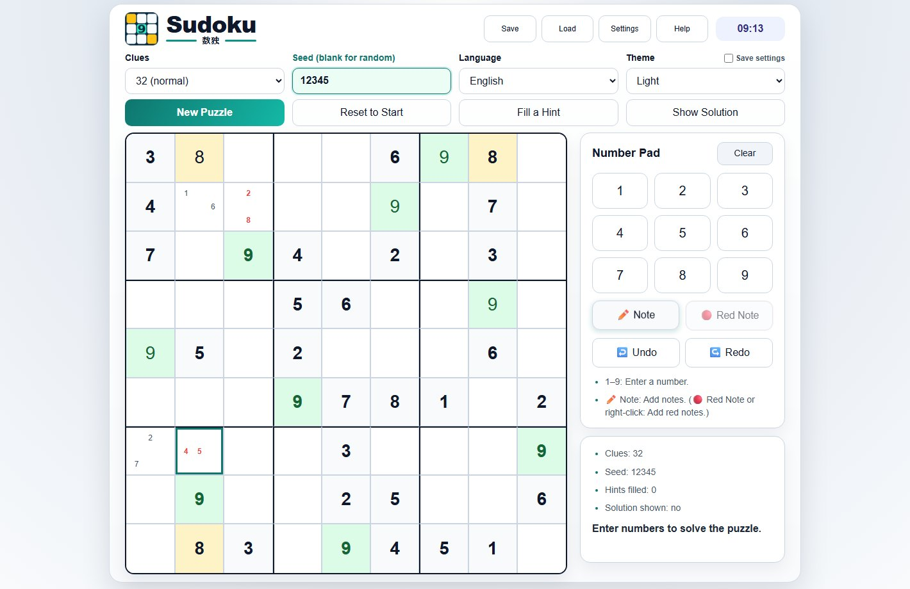
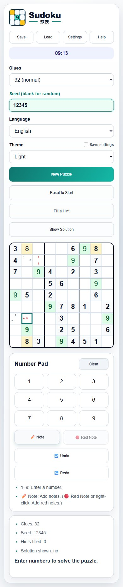

# Sudoku HTML

[日本語](./docs/READMEs/README.ja.md) | [English](./README.md) | [简体中文](./docs/READMEs/README.zh-CN.md) | [हिन्दी](./docs/READMEs/README.hi.md) | [Español](./docs/READMEs/README.es.md) | [العربية](./docs/READMEs/README.ar.md) | [Français](./docs/READMEs/README.fr.md) | [Português (Brasil)](./docs/READMEs/README.pt-BR.md) | [Português (Portugal)](./docs/READMEs/README.pt-PT.md) | [Русский](./docs/READMEs/README.ru.md) | [Deutsch](./docs/READMEs/README.de.md) | [Bahasa Indonesia](./docs/READMEs/README.id.md) | [বাংলা](./docs/READMEs/README.bn.md) | [Türkçe](./docs/READMEs/README.tr.md) | [한국어](./docs/READMEs/README.ko.md) | [Tiếng Việt](./docs/READMEs/README.vi.md) | [Italiano](./docs/READMEs/README.it.md) | [Nederlands](./docs/READMEs/README.nl.md) | [Polski](./docs/READMEs/README.pl.md) | [ไทย](./docs/READMEs/README.th.md) | [اردو](./docs/READMEs/README.ur.md) | [فارسی](./docs/READMEs/README.fa.md) | [Kiswahili](./docs/READMEs/README.sw.md) | [繁體中文](./docs/READMEs/README.zh-TW.md) | [Українська](./docs/READMEs/README.uk.md)

Sudoku HTML is a browser-based Sudoku game that you can play as a single `Sudoku_v1.9.0.html` file, from the online page, or as a Chrome, Edge, or Firefox extension.

| Desktop view | Mobile view |
| --- | --- |
|  |  |

## Play the Game

[Game Guide](./docs/game-guides/GAME_GUIDE.md)

Choose the version that fits how you want to play:

| Version | How to play |
| --- | --- |
| **Download the HTML file** | [Sudoku_v1.9.0.html](https://github.com/piccoripico/sudoku-html/releases/latest/download/Sudoku_v1.9.0.html) Open the downloaded file directly in your browser to play offline. |
| **Play online** | <https://piccoripico.github.io/sudoku-html/> Open the same game online. After the page has loaded, you can continue playing without an internet connection during that session. |
| **Install the browser extension** | Once installed, click the toolbar icon to open One-Click Sudoku in a regular browser tab and play without an internet connection.     |

## Highlights

- **Portable**: The entire app is packaged into a single `Sudoku_v1.9.0.html` file, so you can keep it on your computer or phone and take it anywhere.
- **Offline**: The app runs offline, so you can play without an internet connection after downloading `Sudoku_v1.9.0.html` or installing the Chrome, Edge, or Firefox extension.
- **Desktop / mobile UI**: The layout is designed to work comfortably on both wide desktop screens and tall mobile screens.
- **Light and dark themes**: Choose System, Light, or Dark appearance. System mode follows your operating system color scheme automatically.
- **Board reproducibility**: Enter the same seed value with the same clue count to recreate the same puzzle, including the clue layout.
- **Notes, hints, and undo history**: Use notes, red notes, hints, solution display, and Undo/Redo while solving.
- **Save and resume later**: You can save your current board, notes, timer, and Undo/Redo history as a local JSON file. Loading the saved file lets you resume from the same state.
- **No account or external service**: There are no ads, payments, accounts, analytics, gameplay data uploads, or user data collection.
- **Number of completed boards**: A single template family alone can generate more than about 609.5 billion transformed completed boards. The app uses multiple template families, so the overall variety is even larger.

## Development

1. Run `npm ci`.
2. Run `npm run typecheck`.
3. Run `npm test`.
4. Run `npm run build`.
5. The first time you use browser tests, run `npm run test:e2e:install`.
6. Run `npm run test:e2e` for browser/runtime smoke tests, or `npm run verify` for the complete local gate.

`npm run build` generates the self-contained `dist/Sudoku_v1.9.0.html` and the unpacked Manifest V3 extension package at `dist/extension-chromium` and `dist/extension-firefox`. `npm run verify` checks TypeScript, unit tests, built-artifact contracts, and browser/runtime tests.

## Automation

GitHub Actions automates testing, Pages deployment, and release asset generation.

- CI: [`.github/workflows/ci.yml`](./.github/workflows/ci.yml) runs for pull requests targeting `main`, and you can also start it manually from the `Actions` tab.
- Pages: [`.github/workflows/pages.yml`](./.github/workflows/pages.yml) runs on pushes to `main`, builds `dist/Sudoku_v1.9.0.html`, and publishes it to GitHub Pages at <https://piccoripico.github.io/sudoku-html/>.
- Release: [`.github/workflows/release.yml`](./.github/workflows/release.yml) runs when you push a version tag such as `v1.2.3` and automatically attaches `Sudoku_v1.9.0.html` to the GitHub Release.
