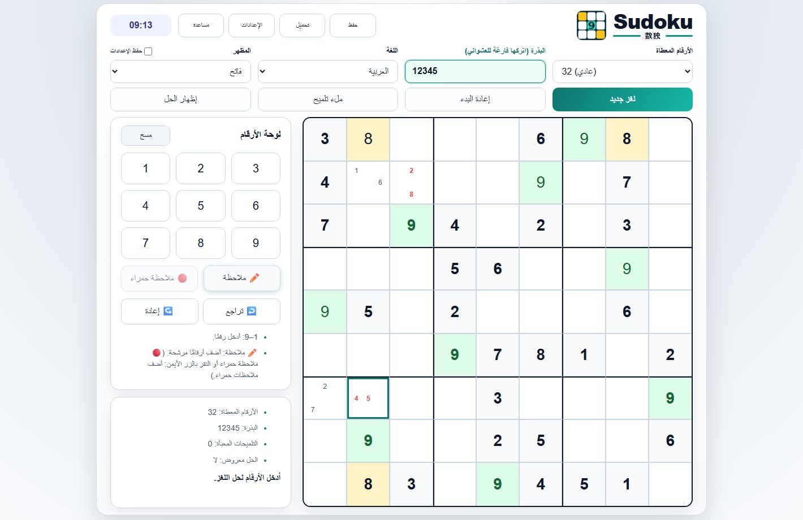
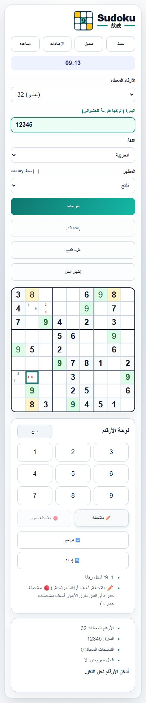

# Sudoku HTML — سودوكو

[日本語](./README.ja.md) | [English](../../README.md) | [简体中文](./README.zh-CN.md) | [हिन्दी](./README.hi.md) | [Español](./README.es.md) | [العربية](./README.ar.md) | [Français](./README.fr.md) | [Português (Brasil)](./README.pt-BR.md) | [Português (Portugal)](./README.pt-PT.md) | [Русский](./README.ru.md) | [Deutsch](./README.de.md) | [Bahasa Indonesia](./README.id.md) | [বাংলা](./README.bn.md) | [Türkçe](./README.tr.md) | [한국어](./README.ko.md) | [Tiếng Việt](./README.vi.md) | [Italiano](./README.it.md) | [Nederlands](./README.nl.md) | [Polski](./README.pl.md) | [ไทย](./README.th.md) | [اردو](./README.ur.md) | [فارسی](./README.fa.md) | [Kiswahili](./README.sw.md) | [繁體中文](./README.zh-TW.md) | [Українська](./README.uk.md)

Sudoku HTML لعبة سودوكو تعمل في المتصفح؛ يمكنك تشغيلها من ملف واحد `Sudoku_v1.9.0.html` أو من الصفحة على الإنترنت أو كإضافة Chrome وEdge وFirefox.

| حاسوب | هاتف |
| --- | --- |
|  |  |

## ابدأ اللعب

[دليل اللعب](../game-guides/GAME_GUIDE.ar.md)

اختر طريقة اللعب الأنسب لك:

| النسخة | طريقة اللعب |
| --- | --- |
| **تنزيل ملف HTML** | [Sudoku_v1.9.0.html](https://github.com/piccoripico/sudoku-html/releases/latest/download/Sudoku_v1.9.0.html) افتح الملف الذي نزّلته مباشرة في المتصفح للعب دون اتصال. |
| **اللعب عبر الإنترنت** | <https://piccoripico.github.io/sudoku-html/> افتح اللعبة نفسها عبر الإنترنت. بعد تحميل الصفحة يمكنك الاستمرار في اللعب دون اتصال خلال الجلسة نفسها. |
| **تثبيت إضافة المتصفح** | بعد التثبيت انقر على أيقونة شريط الأدوات لفتح One-Click Sudoku في تبويب متصفح عادي واللعب دون اتصال.     |

## المزايا

- **سهل النقل**: يحتوي الملف الواحد `Sudoku_v1.9.0.html` على التطبيق كله، ويمكن الاحتفاظ به على الكمبيوتر أو الهاتف واستخدامه في أي مكان.
- **دون اتصال**: يعمل التطبيق دون إنترنت بعد تنزيل ملف HTML أو تثبيت إضافة Chrome أو Edge أو Firefox.
- **واجهة للحاسوب والهاتف**: صُمّم التنسيق ليناسب الشاشات المكتبية العريضة وشاشات الهواتف الطولية.
- **السمتان الفاتحة والداكنة**: اختر النظام أو الفاتحة أو الداكنة؛ يتبع خيار النظام ألوان نظام التشغيل تلقائياً.
- **إعادة إنتاج اللوحة**: باستخدام البذرة نفسها وعدد الخانات المعطاة نفسه تُنشأ الأحجية ذاتها بما في ذلك مواقع الخانات المعطاة.
- **الملاحظات والتلميحات والتراجع**: استخدم الملاحظات العادية والحمراء وملء التلميحات وإظهار الحل والتراجع/الإعادة أثناء اللعب.
- **الحفظ والمتابعة لاحقاً**: احفظ اللوحة والملاحظات والمؤقّت وسجل التراجع/الإعادة في ملف JSON محلي؛ وحمّله لاستئناف الحالة نفسها.
- **دون حساب أو خدمة خارجية**: لا إعلانات أو مدفوعات أو حسابات أو تحليلات أو تحميل لبيانات اللعب أو جمع لبيانات المستخدم.
- **عدد اللوحات المكتملة**: تستطيع عائلة قوالب واحدة وحدها إنتاج أكثر من نحو 609.5 مليار لوحة مكتملة بعد التحويلات، ويستخدم التطبيق عائلات متعددة فتكون الخيارات أكثر.

## التطوير

1. نفّذ `npm ci`.
2. نفّذ `npm run typecheck`.
3. نفّذ `npm test`.
4. نفّذ `npm run build`.
5. عند تشغيل اختبارات المتصفح لأول مرة، نفّذ `npm run test:e2e:install`.
6. نفّذ `npm run test:e2e` للاختبارات الأساسية للمتصفح والتشغيل، أو `npm run verify` لكل فحوص البيئة المحلية.

ينتج `npm run build` ملف `dist/Sudoku_v1.9.0.html` المستقل وحزم Manifest V3 المفككة في `dist/extension-chromium` و`dist/extension-firefox`. ويتحقق `npm run verify` من TypeScript واختبارات الوحدات وشروط مخرجات البناء واختبارات المتصفح/التشغيل.

## الأتمتة

تؤتمت GitHub Actions الاختبارات ونشر Pages وإنشاء ملفات الإصدارات.

- CI: [`.github/workflows/ci.yml`](../../.github/workflows/ci.yml) يعمل مع طلبات السحب المستهدفة إلى `main`، ويمكن تشغيله يدوياً من تبويب `Actions`.
- Pages: [`.github/workflows/pages.yml`](../../.github/workflows/pages.yml) يعمل عند الدفع إلى `main` ويبني `dist/Sudoku_v1.9.0.html` وينشره على GitHub Pages: <https://piccoripico.github.io/sudoku-html/>.
- Release: [`.github/workflows/release.yml`](../../.github/workflows/release.yml) يعمل عند دفع وسم إصدار مثل `v1.2.3` ويرفق `Sudoku_v1.9.0.html` تلقائياً بإصدار GitHub Release.
