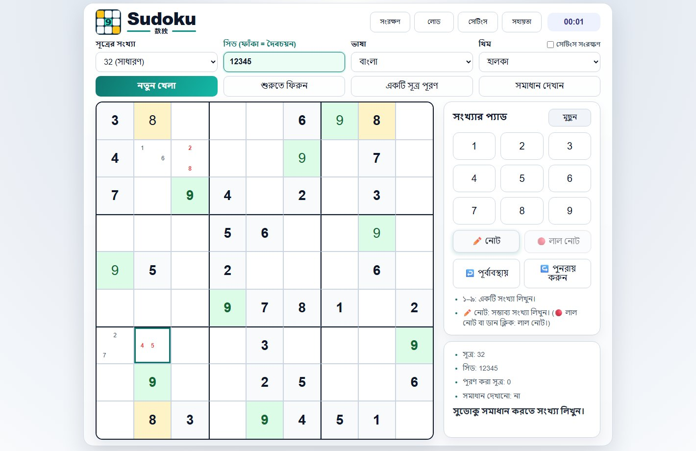
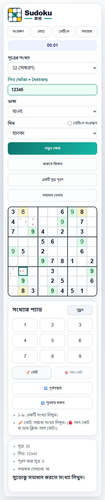

# Sudoku HTML — বাংলা

[日本語](./README.ja.md) | [English](../../README.md) | [简体中文](./README.zh-CN.md) | [हिन्दी](./README.hi.md) | [Español](./README.es.md) | [العربية](./README.ar.md) | [Français](./README.fr.md) | [Português (Brasil)](./README.pt-BR.md) | [Português (Portugal)](./README.pt-PT.md) | [Русский](./README.ru.md) | [Deutsch](./README.de.md) | [Bahasa Indonesia](./README.id.md) | [বাংলা](./README.bn.md) | [Türkçe](./README.tr.md) | [한국어](./README.ko.md) | [Tiếng Việt](./README.vi.md) | [Italiano](./README.it.md) | [Nederlands](./README.nl.md) | [Polski](./README.pl.md) | [ไทย](./README.th.md) | [اردو](./README.ur.md) | [فارسی](./README.fa.md) | [Kiswahili](./README.sw.md) | [繁體中文](./README.zh-TW.md) | [Українська](./README.uk.md)

Sudoku HTML একটি ব্রাউজারভিত্তিক সুডোকু গেম। এটি একটি `Sudoku_v1.9.0.html` ফাইল, অনলাইন পৃষ্ঠা অথবা Chrome, Edge ও Firefox এক্সটেনশন থেকে খেলা যায়।

| কম্পিউটার | মোবাইল |
| --- | --- |
|  |  |

## কীভাবে খেলবেন

[গেম গাইড](../game-guides/GAME_GUIDE.bn.md)

আপনার খেলার ধরন অনুযায়ী সংস্করণ বেছে নিন:

| সংস্করণ | খেলার পদ্ধতি |
| --- | --- |
| **HTML ফাইল ডাউনলোড** | [Sudoku_v1.9.0.html](https://github.com/piccoripico/sudoku-html/releases/latest/download/Sudoku_v1.9.0.html) ডাউনলোড করা ফাইল সরাসরি ব্রাউজারে খুলে অফলাইনে খেলুন। |
| **অনলাইনে খেলুন** | <https://piccoripico.github.io/sudoku-html/> অনলাইনে একই গেম খুলুন। পৃষ্ঠা লোড হয়ে গেলে সেই সেশনে ইন্টারনেট ছাড়াও খেলা চালাতে পারবেন। |
| **ব্রাউজার এক্সটেনশন ইনস্টল** | ইনস্টল করার পর টুলবার আইকনে ক্লিক করে One-Click Sudoku সাধারণ ব্রাউজার ট্যাবে খুলুন এবং অফলাইনে খেলুন।     |

## বৈশিষ্ট্য

- **সহজে বহনযোগ্য**: পুরো অ্যাপ একটি `Sudoku_v1.9.0.html` ফাইলে রয়েছে, যা কম্পিউটার বা ফোনে রেখে যেকোনো জায়গায় ব্যবহার করা যায়।
- **অফলাইন**: HTML ফাইল ডাউনলোড অথবা Chrome/Edge/Firefox এক্সটেনশন ইনস্টল করার পর ইন্টারনেট ছাড়াই গেম চলে।
- **ডেস্কটপ ও মোবাইল UI**: চওড়া কম্পিউটার স্ক্রিন ও লম্বা মোবাইল স্ক্রিন দুটির জন্যই বিন্যাস তৈরি।
- **হালকা ও গাঢ় থিম**: সিস্টেম, হালকা বা গাঢ় বেছে নিন; সিস্টেম মোড স্বয়ংক্রিয়ভাবে অপারেটিং সিস্টেমের রঙ অনুসরণ করে।
- **বোর্ড পুনরায় তৈরি**: একই সিড ও একই সূত্র সংখ্যা দিলে সূত্রের অবস্থানসহ হুবহু একই ধাঁধা আবার তৈরি হয়।
- **নোট, সূত্র ও ইতিহাস**: সাধারণ নোট, লাল নোট, সূত্র পূরণ, সমাধান দেখানো এবং পূর্বাবস্থা/পুনরায় করার সুবিধা ব্যবহার করুন।
- **সংরক্ষণ ও পরে আবার শুরু**: বোর্ড, নোট, টাইমার এবং পূর্বাবস্থা/পুনরায় করার ইতিহাস স্থানীয় JSON ফাইলে সংরক্ষণ করে পরে ঠিক একই অবস্থা থেকে চালিয়ে যান।
- **অ্যাকাউন্ট বা বাইরের পরিষেবা নেই**: বিজ্ঞাপন, অর্থপ্রদান, অ্যাকাউন্ট, বিশ্লেষণ, গেমের ডেটা আপলোড বা ব্যবহারকারীর তথ্য সংগ্রহ নেই।
- **সম্পূর্ণ বোর্ডের সংখ্যা**: একটি টেমপ্লেট পরিবার থেকেই রূপান্তরে প্রায় 609.5 বিলিয়নের বেশি সম্পূর্ণ বোর্ড তৈরি করা যায়। অ্যাপে একাধিক পরিবার ব্যবহার হয়, তাই মোট বৈচিত্র্য আরও বেশি।

## উন্নয়ন

1. চালান `npm ci`.
2. চালান `npm run typecheck`.
3. চালান `npm test`.
4. চালান `npm run build`.
5. ব্রাউজার পরীক্ষা প্রথমবার চালালে `npm run test:e2e:install` চালান।
6. ব্রাউজারের প্রাথমিক পরীক্ষার জন্য `npm run test:e2e` অথবা সম্পূর্ণ স্থানীয় যাচাইয়ের জন্য `npm run verify` চালান।

`npm run build` স্বয়ংসম্পূর্ণ `dist/Sudoku_v1.9.0.html` এবং খোলা Manifest V3 এক্সটেনশন প্যাকেজ `dist/extension-chromium` ও `dist/extension-firefox` তৈরি করে। `npm run verify` TypeScript, ইউনিট টেস্ট, বিল্ড ফলাফলের নিয়ম এবং ব্রাউজার পরীক্ষা চালায়।

## স্বয়ংক্রিয়করণ

GitHub Actions পরীক্ষা, Pages-এ প্রকাশ এবং রিলিজ ফাইল তৈরি স্বয়ংক্রিয়ভাবে করে।

- CI: [`.github/workflows/ci.yml`](../../.github/workflows/ci.yml) `main` লক্ষ্য করে করা pull request-এ চলে; `Actions` ট্যাব থেকে হাতেও চালু করা যায়।
- Pages: [`.github/workflows/pages.yml`](../../.github/workflows/pages.yml) `main`-এ push হলে `dist/Sudoku_v1.9.0.html` তৈরি করে GitHub Pages-এ প্রকাশ করে: <https://piccoripico.github.io/sudoku-html/>।
- Release: [`.github/workflows/release.yml`](../../.github/workflows/release.yml) `v1.2.3`-এর মতো সংস্করণ ট্যাগ push করলে স্বয়ংক্রিয়ভাবে `Sudoku_v1.9.0.html` GitHub Release-এ যোগ করে।
