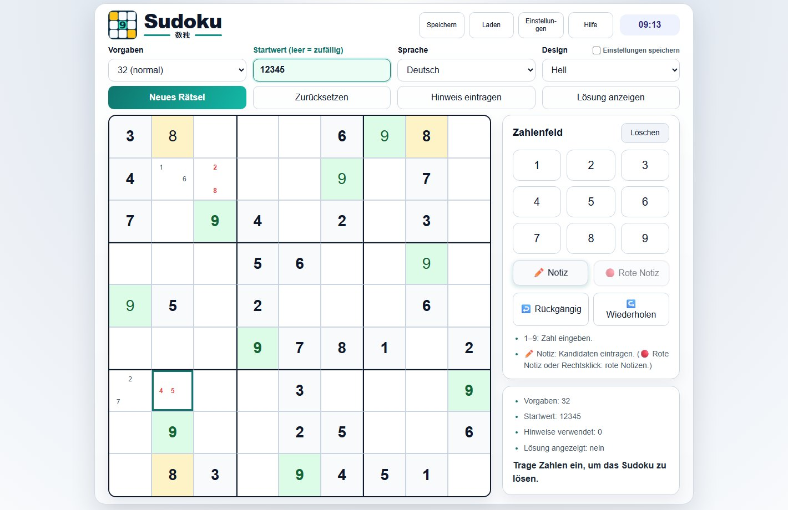
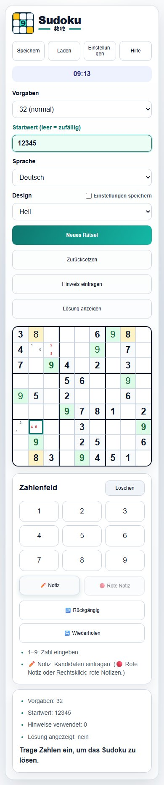

# Sudoku HTML — Deutsch

[日本語](./README.ja.md) | [English](../../README.md) | [简体中文](./README.zh-CN.md) | [हिन्दी](./README.hi.md) | [Español](./README.es.md) | [العربية](./README.ar.md) | [Français](./README.fr.md) | [Português (Brasil)](./README.pt-BR.md) | [Português (Portugal)](./README.pt-PT.md) | [Русский](./README.ru.md) | [Deutsch](./README.de.md) | [Bahasa Indonesia](./README.id.md) | [বাংলা](./README.bn.md) | [Türkçe](./README.tr.md) | [한국어](./README.ko.md) | [Tiếng Việt](./README.vi.md) | [Italiano](./README.it.md) | [Nederlands](./README.nl.md) | [Polski](./README.pl.md) | [ไทย](./README.th.md) | [اردو](./README.ur.md) | [فارسی](./README.fa.md) | [Kiswahili](./README.sw.md) | [繁體中文](./README.zh-TW.md) | [Українська](./README.uk.md)

Sudoku HTML ist ein Sudoku-Spiel für den Browser, das sich als einzelne Datei `Sudoku_v1.9.0.html`, über die Online-Seite oder als Chrome-, Edge- oder Firefox-Erweiterung spielen lässt.

| Desktop | Mobil |
| --- | --- |
|  |  |

## Spielanleitung

[Spielanleitung](../game-guides/GAME_GUIDE.de.md)

Wählen Sie die Spielweise, die am besten zu Ihnen passt:

| Version | Spielweise |
| --- | --- |
| **HTML-Datei herunterladen** | [Sudoku_v1.9.0.html](https://github.com/piccoripico/sudoku-html/releases/latest/download/Sudoku_v1.9.0.html) Öffnen Sie die heruntergeladene Datei direkt im Browser, um offline zu spielen. |
| **Online spielen** | <https://piccoripico.github.io/sudoku-html/> Öffnen Sie dasselbe Spiel online. Nach dem Laden der Seite können Sie während dieser Sitzung auch ohne Internet weiterspielen. |
| **Browser-Erweiterung installieren** | Klicken Sie nach der Installation auf das Symbol in der Symbolleiste, um One-Click Sudoku in einem normalen Tab zu öffnen und offline zu spielen.     |

## Funktionen

- **Mobil einsetzbar**: Die gesamte App steckt in einer einzigen Datei `Sudoku_v1.9.0.html`, die Sie auf Computer oder Smartphone mitnehmen können.
- **Offline**: Nach dem Herunterladen der HTML-Datei oder der Installation der Chrome-, Edge- oder Firefox-Erweiterung ist zum Spielen keine Internetverbindung nötig.
- **Desktop- und Mobilansicht**: Das Layout eignet sich für breite Desktop-Bildschirme ebenso wie für hohe Smartphone-Displays.
- **Helle und dunkle Designs**: Wählen Sie System, Hell oder Dunkel. System übernimmt automatisch die Farbeinstellung des Betriebssystems.
- **Reproduzierbare Rätsel**: Derselbe Seed mit derselben Vorgabenzahl erzeugt dasselbe Rätsel einschließlich der Positionen der Vorgaben.
- **Notizen, Hinweise und Verlauf**: Nutzen Sie normale und rote Notizen, Hinweise, Lösung anzeigen sowie Rückgängig/Wiederholen beim Lösen.
- **Speichern und später fortsetzen**: Speichern Sie Gitter, Notizen, Timer und Rückgängig/Wiederholen-Verlauf in einer lokalen JSON-Datei; laden Sie sie, um denselben Zustand fortzusetzen.
- **Kein Konto und keine externen Dienste**: Keine Werbung, Zahlungen, Konten, Analyse, Übertragung von Spieldaten oder Erfassung von Nutzerdaten.
- **Anzahl vollständiger Sudokus**: Schon eine einzige Vorlagenfamilie kann durch Transformationen mehr als rund 609,5 Milliarden vollständige Gitter erzeugen. Mehrere Vorlagenfamilien sorgen für noch größere Vielfalt.

## Entwicklung

1. Führen Sie `npm ci`.
2. Führen Sie `npm run typecheck`.
3. Führen Sie `npm test`.
4. Führen Sie `npm run build`.
5. Führen Sie bei der ersten Nutzung der Browser-Tests `npm run test:e2e:install` aus.
6. Führen Sie `npm run test:e2e` für Browser-/Laufzeit-Smoke-Tests oder `npm run verify` für die vollständige lokale Prüfung aus.

`npm run build` erzeugt die eigenständige Datei `dist/Sudoku_v1.9.0.html` und die entpackten Manifest-V3-Pakete unter `dist/extension-chromium` und `dist/extension-firefox`. `npm run verify` prüft TypeScript, Unit-Tests, Artefaktanforderungen und Browser-/Laufzeittests.

## Automatisierung

GitHub Actions automatisiert Tests, Pages-Bereitstellung und die Erzeugung der Release-Artefakte.

- CI: [`.github/workflows/ci.yml`](../../.github/workflows/ci.yml) läuft bei Pull Requests gegen `main` und kann über die Registerkarte `Actions` manuell gestartet werden.
- Pages: [`.github/workflows/pages.yml`](../../.github/workflows/pages.yml) läuft nach Pushes zu `main`, baut `dist/Sudoku_v1.9.0.html` und veröffentlicht es über GitHub Pages: <https://piccoripico.github.io/sudoku-html/>.
- Release: [`.github/workflows/release.yml`](../../.github/workflows/release.yml) läuft bei einem Versionstag wie `v1.2.3` und hängt `Sudoku_v1.9.0.html` automatisch an das GitHub Release an.
