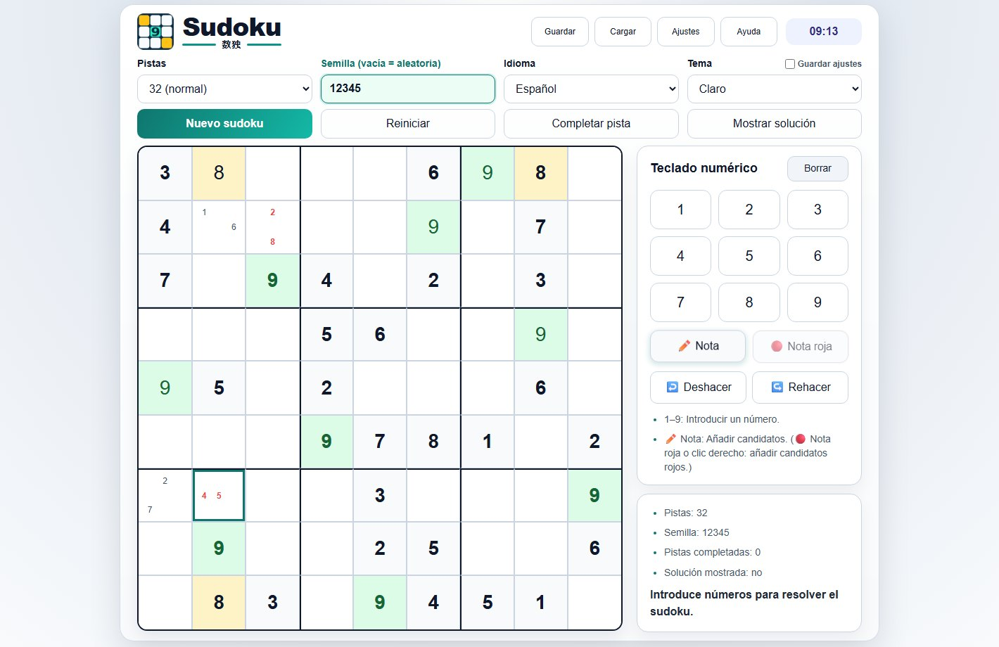
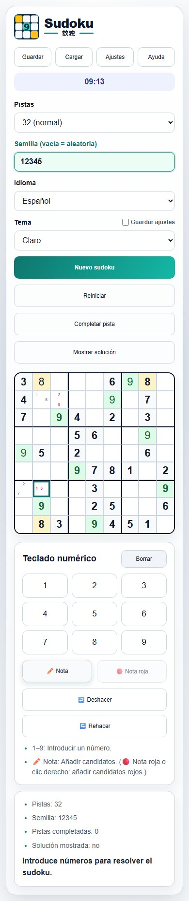

# Sudoku HTML

[日本語](./README.ja.md) | [English](../../README.md) | [简体中文](./README.zh-CN.md) | [हिन्दी](./README.hi.md) | [Español](./README.es.md) | [العربية](./README.ar.md) | [Français](./README.fr.md) | [Português (Brasil)](./README.pt-BR.md) | [Português (Portugal)](./README.pt-PT.md) | [Русский](./README.ru.md) | [Deutsch](./README.de.md) | [Bahasa Indonesia](./README.id.md) | [বাংলা](./README.bn.md) | [Türkçe](./README.tr.md) | [한국어](./README.ko.md) | [Tiếng Việt](./README.vi.md) | [Italiano](./README.it.md) | [Nederlands](./README.nl.md) | [Polski](./README.pl.md) | [ไทย](./README.th.md) | [اردو](./README.ur.md) | [فارسی](./README.fa.md) | [Kiswahili](./README.sw.md) | [繁體中文](./README.zh-TW.md) | [Українська](./README.uk.md)

Sudoku HTML es un juego de sudoku para navegador que puedes utilizar mediante un único archivo `Sudoku_v1.9.0.html`, la página en línea o una extensión de Chrome, Edge o Firefox.

| Escritorio | Móvil |
| --- | --- |
|  |  |

## Jugar

[Guía del juego](../game-guides/GAME_GUIDE.es.md)

Elige la versión que mejor se adapte a tu manera de jugar:

| Versión | Cómo jugar |
| --- | --- |
| **Descargar el archivo HTML** | [Sudoku_v1.9.0.html](https://github.com/piccoripico/sudoku-html/releases/latest/download/Sudoku_v1.9.0.html) Abre el archivo descargado directamente en el navegador para jugar sin conexión. |
| **Jugar en línea** | <https://piccoripico.github.io/sudoku-html/> Abre el mismo juego en línea. Una vez cargada la página, puedes seguir jugando sin internet durante esa sesión. |
| **Instalar la extensión del navegador** | Tras instalarla, haz clic en el icono de la barra de herramientas para abrir One-Click Sudoku en una pestaña normal y jugar sin conexión.     |

## Características

- **Portátil**: Toda la aplicación cabe en un único archivo `Sudoku_v1.9.0.html` que puedes guardar en el ordenador o móvil y llevar a cualquier parte.
- **Sin conexión**: La aplicación funciona sin internet tras descargar el archivo HTML o instalar la extensión de Chrome, Edge o Firefox.
- **Interfaz de escritorio y móvil**: El diseño funciona cómodamente tanto en pantallas anchas de escritorio como en pantallas verticales de móvil.
- **Temas claro y oscuro**: Elige Sistema, Claro u Oscuro; Sistema sigue automáticamente el esquema de colores del sistema operativo.
- **Reproducción de tableros**: La misma semilla y el mismo número de pistas reproducen exactamente la misma partida, incluida la posición de las pistas.
- **Notas, pistas e historial**: Utiliza notas normales, notas rojas, pistas, solución y Deshacer/Rehacer mientras juegas.
- **Guardar y continuar**: Guarda el tablero, las notas, el cronómetro y el historial de Deshacer/Rehacer en un JSON local; al cargarlo, retomas el mismo estado.
- **Sin cuentas ni servicios externos**: No hay anuncios, pagos, cuentas, análisis, subidas de datos de juego ni recopilación de datos personales.
- **Número de tableros completos**: Solo una familia de plantillas permite generar más de unos 609.500 millones de tableros completos transformados; el juego utiliza varias familias y ofrece aún más variedad.

## Desarrollo

1. Ejecuta `npm ci`.
2. Ejecuta `npm run typecheck`.
3. Ejecuta `npm test`.
4. Ejecuta `npm run build`.
5. La primera vez que utilices pruebas de navegador, ejecuta `npm run test:e2e:install`.
6. Ejecuta `npm run test:e2e` para las pruebas básicas del navegador/ejecución, o `npm run verify` para todas las comprobaciones locales.

`npm run build` genera el archivo autónomo `dist/Sudoku_v1.9.0.html` y los paquetes Manifest V3 descomprimidos `dist/extension-chromium` y `dist/extension-firefox`. `npm run verify` comprueba TypeScript, pruebas unitarias, contratos de artefactos y pruebas de navegador/ejecución.

## Automatización

GitHub Actions automatiza las pruebas, el despliegue de Pages y la creación de artefactos de las versiones.

- CI: [`.github/workflows/ci.yml`](../../.github/workflows/ci.yml) se ejecuta en solicitudes de incorporación dirigidas a `main` y también puede iniciarse manualmente desde la pestaña `Actions`.
- Pages: [`.github/workflows/pages.yml`](../../.github/workflows/pages.yml) se ejecuta al enviar cambios a `main`, compila `dist/Sudoku_v1.9.0.html` y lo publica en GitHub Pages: <https://piccoripico.github.io/sudoku-html/>.
- Release: [`.github/workflows/release.yml`](../../.github/workflows/release.yml) se ejecuta al publicar una etiqueta de versión como `v1.2.3` y adjunta automáticamente `Sudoku_v1.9.0.html` a GitHub Release.
