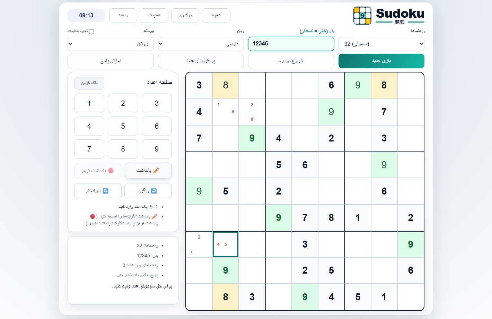
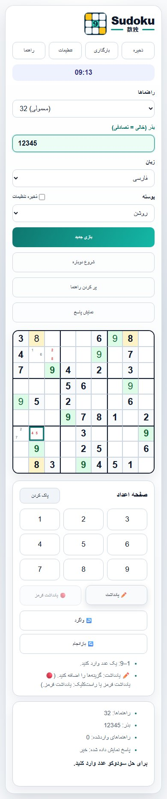

# Sudoku HTML — فارسی

[日本語](./README.ja.md) | [English](../../README.md) | [简体中文](./README.zh-CN.md) | [हिन्दी](./README.hi.md) | [Español](./README.es.md) | [العربية](./README.ar.md) | [Français](./README.fr.md) | [Português (Brasil)](./README.pt-BR.md) | [Português (Portugal)](./README.pt-PT.md) | [Русский](./README.ru.md) | [Deutsch](./README.de.md) | [Bahasa Indonesia](./README.id.md) | [বাংলা](./README.bn.md) | [Türkçe](./README.tr.md) | [한국어](./README.ko.md) | [Tiếng Việt](./README.vi.md) | [Italiano](./README.it.md) | [Nederlands](./README.nl.md) | [Polski](./README.pl.md) | [ไทย](./README.th.md) | [اردو](./README.ur.md) | [فارسی](./README.fa.md) | [Kiswahili](./README.sw.md) | [繁體中文](./README.zh-TW.md) | [Українська](./README.uk.md)

Sudoku HTML یک بازی سودوکو برای مرورگر است که می‌توان آن را به‌صورت یک فایل `Sudoku_v1.9.0.html`، صفحه آنلاین یا افزونه Chrome، Edge و Firefox اجرا کرد.

| رایانه | تلفن همراه |
| --- | --- |
|  |  |

## روش بازی

[راهنمای بازی](../game-guides/GAME_GUIDE.fa.md)

روش مناسب خود را برای بازی انتخاب کنید:

| نسخه | روش بازی |
| --- | --- |
| **دریافت فایل HTML** | [Sudoku_v1.9.0.html](https://github.com/piccoripico/sudoku-html/releases/latest/download/Sudoku_v1.9.0.html) فایل دریافت‌شده را مستقیماً در مرورگر باز کنید تا بدون اینترنت بازی کنید. |
| **بازی آنلاین** | <https://piccoripico.github.io/sudoku-html/> همان بازی را در صفحه آنلاین باز کنید. پس از بارگذاری صفحه، در همان نشست می‌توانید بدون اینترنت به بازی ادامه دهید. |
| **نصب افزونه مرورگر** | پس از نصب، روی نماد نوارابزار کلیک کنید تا One-Click Sudoku در یک برگه عادی مرورگر باز شود و بدون اینترنت بازی کنید.     |

## ویژگی‌ها

- **قابل حمل**: تمام برنامه در یک فایل `Sudoku_v1.9.0.html` قرار دارد و می‌توانید آن را در رایانه یا تلفن نگه دارید و همه‌جا همراه ببرید.
- **آفلاین**: پس از دریافت فایل HTML یا نصب افزونه Chrome، Edge یا Firefox، بازی بدون اتصال اینترنت اجرا می‌شود.
- **رابط رایانه و موبایل**: چیدمان برای صفحه‌های عریض رایانه و صفحه‌های عمودی تلفن مناسب طراحی شده است.
- **پوسته روشن و تاریک**: حالت سیستم، روشن یا تاریک را انتخاب کنید. حالت سیستم خودکار از رنگ‌بندی سیستم‌عامل پیروی می‌کند.
- **بازتولید جدول**: بذر و تعداد راهنمای یکسان همان معما را، از جمله جای خانه‌های راهنما، دوباره می‌سازند.
- **یادداشت، راهنما و تاریخچه**: از یادداشت عادی، یادداشت قرمز، پرکردن راهنما، نمایش پاسخ و بازگشت/تکرار استفاده کنید.
- **ذخیره و ادامه در آینده**: جدول، یادداشت‌ها، زمان‌سنج و تاریخچه بازگشت/تکرار را در فایل JSON محلی ذخیره کنید و با بارگذاری آن از همان وضعیت ادامه دهید.
- **بدون حساب و خدمات بیرونی**: هیچ تبلیغ، پرداخت، حساب، تحلیل، بارگذاری داده بازی یا گردآوری اطلاعات کاربر وجود ندارد.
- **تعداد جدول‌های کامل**: فقط یک خانواده الگو با تبدیل‌ها می‌تواند بیش از حدود 609.5 میلیارد جدول کامل تولید کند. برنامه از چند خانواده استفاده می‌کند و تنوع کل بیشتر است.

## توسعه

1. اجرا کنید: `npm ci`.
2. اجرا کنید: `npm run typecheck`.
3. اجرا کنید: `npm test`.
4. اجرا کنید: `npm run build`.
5. نخستین بار برای آزمون مرورگر، `npm run test:e2e:install` را اجرا کنید.
6. برای آزمون پایه مرورگر/اجرا `npm run test:e2e` یا برای بررسی کامل محلی `npm run verify` را اجرا کنید.

`npm run build` فایل مستقل `dist/Sudoku_v1.9.0.html` و بسته‌های بازشده Manifest V3 در `dist/extension-chromium` و `dist/extension-firefox` را تولید می‌کند. `npm run verify` بررسی TypeScript، آزمون‌های واحد، قراردادهای خروجی و آزمون‌های مرورگر/اجرا را انجام می‌دهد.

## خودکارسازی

GitHub Actions آزمون‌ها، استقرار Pages و ساخت فایل‌های انتشار را خودکار می‌کند.

- CI: [`.github/workflows/ci.yml`](../../.github/workflows/ci.yml) برای pull request های مقصد `main` اجرا می‌شود و از برگه `Actions` نیز دستی قابل اجرا است.
- Pages: [`.github/workflows/pages.yml`](../../.github/workflows/pages.yml) هنگام push به `main`، فایل `dist/Sudoku_v1.9.0.html` را می‌سازد و در GitHub Pages منتشر می‌کند: <https://piccoripico.github.io/sudoku-html/>.
- Release: [`.github/workflows/release.yml`](../../.github/workflows/release.yml) با push برچسب نسخه مانند `v1.2.3`، فایل `Sudoku_v1.9.0.html` را خودکار به GitHub Release پیوست می‌کند.
