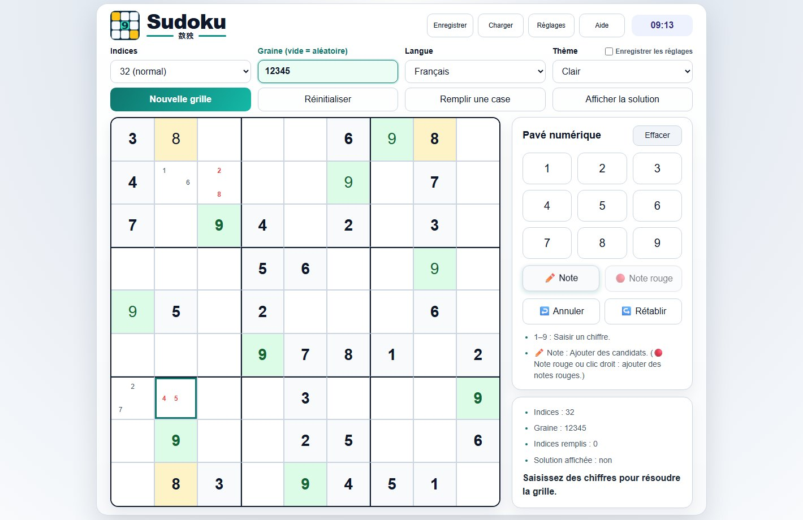
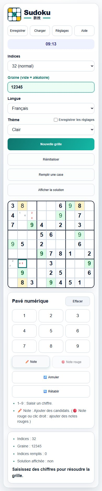

# Sudoku HTML

[日本語](./README.ja.md) | [English](../../README.md) | [简体中文](./README.zh-CN.md) | [हिन्दी](./README.hi.md) | [Español](./README.es.md) | [العربية](./README.ar.md) | [Français](./README.fr.md) | [Português (Brasil)](./README.pt-BR.md) | [Português (Portugal)](./README.pt-PT.md) | [Русский](./README.ru.md) | [Deutsch](./README.de.md) | [Bahasa Indonesia](./README.id.md) | [বাংলা](./README.bn.md) | [Türkçe](./README.tr.md) | [한국어](./README.ko.md) | [Tiếng Việt](./README.vi.md) | [Italiano](./README.it.md) | [Nederlands](./README.nl.md) | [Polski](./README.pl.md) | [ไทย](./README.th.md) | [اردو](./README.ur.md) | [فارسی](./README.fa.md) | [Kiswahili](./README.sw.md) | [繁體中文](./README.zh-TW.md) | [Українська](./README.uk.md)

Sudoku HTML est un jeu de sudoku dans le navigateur, accessible depuis le fichier unique `Sudoku_v1.9.0.html`, la page en ligne ou une extension Chrome, Edge ou Firefox.

| Ordinateur | Mobile |
| --- | --- |
|  |  |

## Jouer

[Guide du jeu](../game-guides/GAME_GUIDE.fr.md)

Choisissez la version qui correspond à votre façon de jouer :

| Version | Mode d’utilisation |
| --- | --- |
| **Télécharger le fichier HTML** | [Sudoku_v1.9.0.html](https://github.com/piccoripico/sudoku-html/releases/latest/download/Sudoku_v1.9.0.html) Ouvrez directement le fichier téléchargé dans votre navigateur pour jouer hors ligne. |
| **Jouer en ligne** | <https://piccoripico.github.io/sudoku-html/> Ouvrez le même jeu en ligne. Une fois la page chargée, vous pouvez continuer à jouer sans connexion pendant cette session. |
| **Installer l’extension du navigateur** | Après installation, cliquez sur l’icône de la barre d’outils pour ouvrir One-Click Sudoku dans un onglet classique et jouer sans connexion.     |

## Fonctionnalités

- **Portable** : Toute l’application tient dans un unique fichier `Sudoku_v1.9.0.html` à conserver sur votre ordinateur ou téléphone pour l’emporter partout.
- **Hors ligne** : Le jeu fonctionne sans Internet après téléchargement du HTML ou installation de l’extension Chrome, Edge ou Firefox.
- **Interface ordinateur/mobile** : La mise en page convient aussi bien aux écrans larges d’ordinateur qu’aux écrans verticaux des téléphones.
- **Thèmes clair et sombre** : Choisissez Système, Clair ou Sombre. Système suit automatiquement les couleurs de votre système d’exploitation.
- **Reproduction des grilles** : La même graine et le même nombre d’indices recréent exactement la même grille, y compris l’emplacement des indices.
- **Notes, indices et historique** : Utilisez notes normales, notes rouges, indices, affichage de la solution et Annuler/Rétablir pendant la résolution.
- **Sauvegarder et reprendre** : Enregistrez grille, notes, chronomètre et historique Annuler/Rétablir dans un JSON local ; chargez-le pour reprendre exactement au même état.
- **Sans compte ni service externe** : Ni publicités, ni paiements, ni comptes, ni statistiques d’usage, ni transmission de données de jeu, ni collecte de données utilisateur.
- **Nombre de grilles complètes** : Une seule famille de modèles permet de générer plus d’environ 609,5 milliards de grilles complètes transformées. Le jeu utilise plusieurs familles, donc la variété totale est encore supérieure.

## Développement

1. Exécutez `npm ci`.
2. Exécutez `npm run typecheck`.
3. Exécutez `npm test`.
4. Exécutez `npm run build`.
5. Avant votre première exécution des tests de navigateur, lancez `npm run test:e2e:install`.
6. Lancez `npm run test:e2e` pour les tests rapides de navigateur/exécution, ou `npm run verify` pour l’ensemble des contrôles locaux.

`npm run build` produit `dist/Sudoku_v1.9.0.html`, fichier autonome, ainsi que les packages Manifest V3 non compressés `dist/extension-chromium` et `dist/extension-firefox`. `npm run verify` vérifie TypeScript, les tests unitaires, les contrats de compilation et les tests de navigateur/exécution.

## Automatisation

GitHub Actions automatise les tests, le déploiement Pages et la génération des artefacts de version.

- CI: [`.github/workflows/ci.yml`](../../.github/workflows/ci.yml) s’exécute pour les pull requests ciblant `main` et peut aussi être lancé manuellement depuis l’onglet `Actions`.
- Pages: [`.github/workflows/pages.yml`](../../.github/workflows/pages.yml) s’exécute lors d’un push vers `main`, compile `dist/Sudoku_v1.9.0.html` et le publie sur GitHub Pages : <https://piccoripico.github.io/sudoku-html/>.
- Release: [`.github/workflows/release.yml`](../../.github/workflows/release.yml) s’exécute lors du push d’une étiquette de version telle que `v1.2.3` et joint automatiquement `Sudoku_v1.9.0.html` à la GitHub Release.
