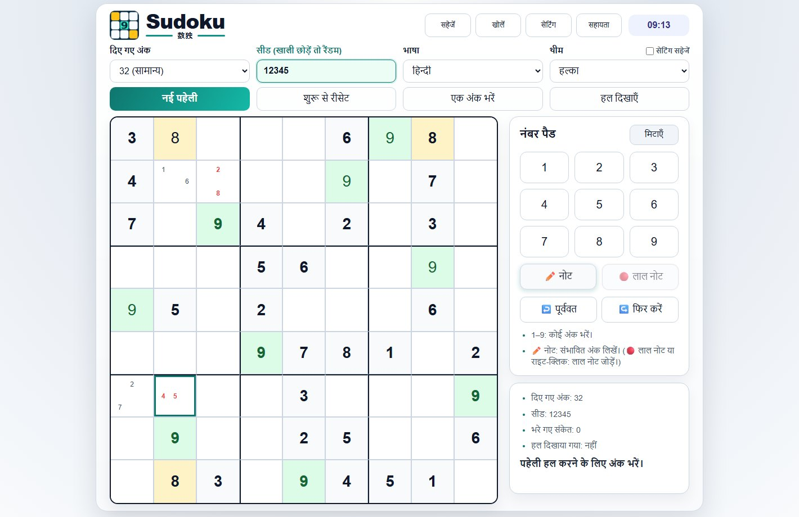
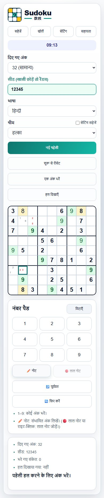

# Sudoku HTML — सुडोकू

[日本語](./README.ja.md) | [English](../../README.md) | [简体中文](./README.zh-CN.md) | [हिन्दी](./README.hi.md) | [Español](./README.es.md) | [العربية](./README.ar.md) | [Français](./README.fr.md) | [Português (Brasil)](./README.pt-BR.md) | [Português (Portugal)](./README.pt-PT.md) | [Русский](./README.ru.md) | [Deutsch](./README.de.md) | [Bahasa Indonesia](./README.id.md) | [বাংলা](./README.bn.md) | [Türkçe](./README.tr.md) | [한국어](./README.ko.md) | [Tiếng Việt](./README.vi.md) | [Italiano](./README.it.md) | [Nederlands](./README.nl.md) | [Polski](./README.pl.md) | [ไทย](./README.th.md) | [اردو](./README.ur.md) | [فارسی](./README.fa.md) | [Kiswahili](./README.sw.md) | [繁體中文](./README.zh-TW.md) | [Українська](./README.uk.md)

Sudoku HTML एक ब्राउज़र-आधारित सुडोकू गेम है जिसे एकल `Sudoku_v1.9.0.html` फ़ाइल, ऑनलाइन पेज या Chrome/Edge/Firefox एक्सटेंशन के रूप में खेल सकते हैं।

| डेस्कटॉप | मोबाइल |
| --- | --- |
|  |  |

## गेम खेलें

[गेम गाइड](../game-guides/GAME_GUIDE.hi.md)

खेलने के लिए अपनी पसंद का संस्करण चुनें:

| संस्करण | कैसे खेलें |
| --- | --- |
| **HTML फ़ाइल डाउनलोड करें** | [Sudoku_v1.9.0.html](https://github.com/piccoripico/sudoku-html/releases/latest/download/Sudoku_v1.9.0.html) डाउनलोड की गई फ़ाइल ब्राउज़र में सीधे खोलकर ऑफ़लाइन खेलें। |
| **ऑनलाइन खेलें** | <https://piccoripico.github.io/sudoku-html/> उसी गेम को ऑनलाइन खोलें। पेज लोड हो जाने के बाद उस सत्र में इंटरनेट के बिना भी खेल जारी रख सकते हैं। |
| **ब्राउज़र एक्सटेंशन इंस्टॉल करें** | इंस्टॉल होने पर टूलबार आइकन पर क्लिक करके One-Click Sudoku को सामान्य ब्राउज़र टैब में खोलें और ऑफ़लाइन खेलें।     |

## मुख्य विशेषताएँ

- **साथ ले जाने योग्य**: पूरा ऐप एक ही `Sudoku_v1.9.0.html` फ़ाइल में है, जिसे कंप्यूटर या फ़ोन में रखकर कहीं भी ले जा सकते हैं।
- **ऑफ़लाइन**: ऐप इंटरनेट के बिना चलता है; HTML डाउनलोड करने या Chrome/Edge/Firefox एक्सटेंशन इंस्टॉल करने के बाद बिना कनेक्शन खेल सकते हैं।
- **डेस्कटॉप/मोबाइल UI**: लेआउट चौड़ी डेस्कटॉप स्क्रीन और लंबी मोबाइल स्क्रीन, दोनों के लिए बनाया गया है।
- **लाइट और डार्क थीम**: सिस्टम, लाइट या डार्क चुनें; सिस्टम मोड अपने आप ऑपरेटिंग सिस्टम की रंग योजना अपनाता है।
- **बोर्ड दोबारा बनाना**: समान सीड और समान संकेत संख्या डालने से शुरुआती संकेतों की स्थिति सहित ठीक वही पहेली फिर बनती है।
- **नोट, संकेत और इतिहास**: सामान्य नोट, लाल नोट, संकेत भरना, समाधान दिखाना और Undo/Redo इस्तेमाल करें।
- **सहेजें और बाद में खेलें**: मौजूदा बोर्ड, नोट, टाइमर और Undo/Redo इतिहास को स्थानीय JSON फ़ाइल में सहेजें; फ़ाइल खोलने पर वही स्थिति लौटती है।
- **खाता या बाहरी सेवा नहीं**: कोई विज्ञापन, भुगतान, खाता, विश्लेषण, गेमप्ले डेटा अपलोड या उपयोगकर्ता डेटा संग्रह नहीं।
- **पूर्ण बोर्डों की संख्या**: केवल एक टेम्पलेट परिवार से रूपांतरण द्वारा लगभग 609.5 अरब से अधिक पूर्ण बोर्ड बन सकते हैं। ऐप कई टेम्पलेट परिवार इस्तेमाल करता है, इसलिए कुल विविधता और अधिक है।

## विकास

1. चलाएँ `npm ci`.
2. चलाएँ `npm run typecheck`.
3. चलाएँ `npm test`.
4. चलाएँ `npm run build`.
5. ब्राउज़र टेस्ट पहली बार चलाने से पहले `npm run test:e2e:install` चलाएँ।
6. ब्राउज़र/रनटाइम की बुनियादी जाँच के लिए `npm run test:e2e` या सभी स्थानीय जाँचों के लिए `npm run verify` चलाएँ।

`npm run build` स्वतंत्र `dist/Sudoku_v1.9.0.html` और Manifest V3 के विस्तारित पैकेज `dist/extension-chromium` तथा `dist/extension-firefox` बनाता है। `npm run verify` TypeScript, यूनिट टेस्ट, बिल्ड आउटपुट नियम और ब्राउज़र/रनटाइम टेस्ट जाँचता है।

## स्वचालन

GitHub Actions टेस्ट, Pages पर डिप्लॉय और रिलीज़ फ़ाइलें बनाना स्वचालित करता है।

- CI: [`.github/workflows/ci.yml`](../../.github/workflows/ci.yml) `main` पर लक्षित पुल रिक्वेस्ट पर चलता है; `Actions` टैब से मैन्युअली भी शुरू कर सकते हैं।
- Pages: [`.github/workflows/pages.yml`](../../.github/workflows/pages.yml) `main` पर Push होने पर चलता है, `dist/Sudoku_v1.9.0.html` बनाकर GitHub Pages पर प्रकाशित करता है: <https://piccoripico.github.io/sudoku-html/>।
- Release: [`.github/workflows/release.yml`](../../.github/workflows/release.yml) `v1.2.3` जैसे संस्करण टैग पर चलता है और `Sudoku_v1.9.0.html` को GitHub Release में अपने आप जोड़ता है।
