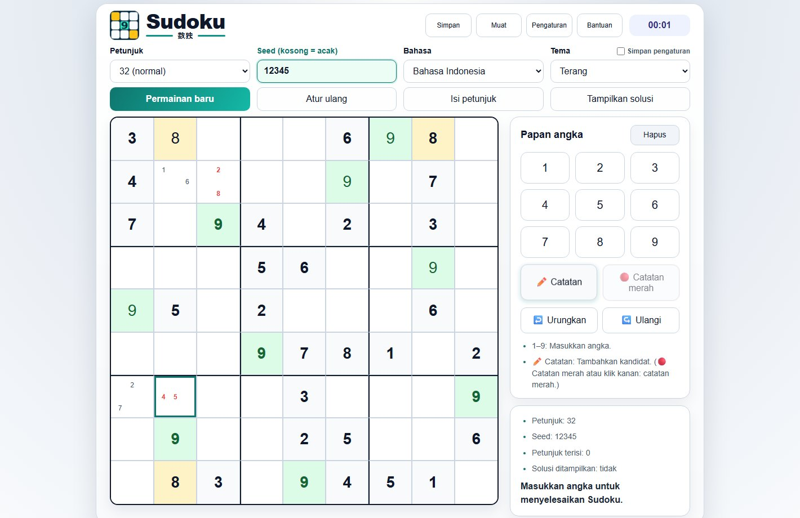
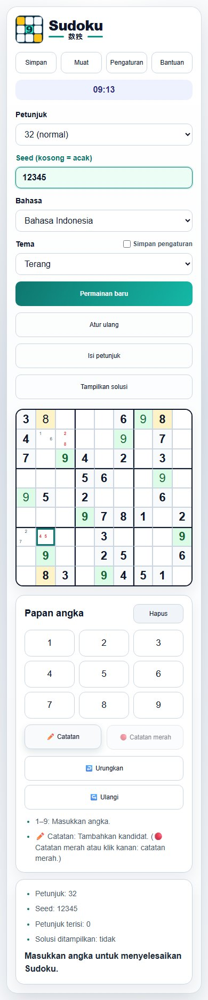

# Sudoku HTML — Bahasa Indonesia

[日本語](./README.ja.md) | [English](../../README.md) | [简体中文](./README.zh-CN.md) | [हिन्दी](./README.hi.md) | [Español](./README.es.md) | [العربية](./README.ar.md) | [Français](./README.fr.md) | [Português (Brasil)](./README.pt-BR.md) | [Português (Portugal)](./README.pt-PT.md) | [Русский](./README.ru.md) | [Deutsch](./README.de.md) | [Bahasa Indonesia](./README.id.md) | [বাংলা](./README.bn.md) | [Türkçe](./README.tr.md) | [한국어](./README.ko.md) | [Tiếng Việt](./README.vi.md) | [Italiano](./README.it.md) | [Nederlands](./README.nl.md) | [Polski](./README.pl.md) | [ไทย](./README.th.md) | [اردو](./README.ur.md) | [فارسی](./README.fa.md) | [Kiswahili](./README.sw.md) | [繁體中文](./README.zh-TW.md) | [Українська](./README.uk.md)

Sudoku HTML adalah permainan Sudoku berbasis peramban yang dapat dimainkan melalui satu berkas `Sudoku_v1.9.0.html`, halaman daring, atau ekstensi Chrome, Edge, maupun Firefox.

| Komputer | Ponsel |
| --- | --- |
|  |  |

## Cara bermain

[Panduan permainan](../game-guides/GAME_GUIDE.id.md)

Pilih versi yang sesuai dengan cara Anda bermain:

| Versi | Cara bermain |
| --- | --- |
| **Unduh berkas HTML** | [Sudoku_v1.9.0.html](https://github.com/piccoripico/sudoku-html/releases/latest/download/Sudoku_v1.9.0.html) Buka berkas yang telah diunduh langsung di peramban untuk bermain tanpa internet. |
| **Mainkan secara daring** | <https://piccoripico.github.io/sudoku-html/> Buka permainan yang sama secara daring. Setelah halaman dimuat, Anda dapat terus bermain tanpa koneksi internet selama sesi tersebut. |
| **Pasang ekstensi peramban** | Setelah dipasang, klik ikon bilah alat untuk membuka One-Click Sudoku di tab biasa dan bermain tanpa internet.     |

## Fitur

- **Portabel**: Seluruh aplikasi dikemas dalam satu berkas `Sudoku_v1.9.0.html`, sehingga dapat disimpan di komputer atau ponsel dan dibawa ke mana pun.
- **Tanpa internet**: Aplikasi berjalan offline setelah berkas HTML diunduh atau ekstensi Chrome, Edge, atau Firefox dipasang.
- **Antarmuka desktop dan seluler**: Tata letak nyaman untuk layar komputer yang lebar maupun layar ponsel yang tinggi.
- **Tema terang dan gelap**: Pilih Sistem, Terang, atau Gelap; mode Sistem otomatis mengikuti skema warna sistem operasi.
- **Papan dapat direproduksi**: Seed dan jumlah petunjuk yang sama menghasilkan teka-teki yang sama, termasuk letak angka awal.
- **Catatan, petunjuk, dan riwayat**: Gunakan catatan biasa, catatan merah, pengisian petunjuk, tampilan solusi, serta urungkan/ulangi saat bermain.
- **Simpan dan lanjutkan**: Simpan papan, catatan, pengatur waktu, dan riwayat urungkan/ulangi dalam berkas JSON lokal; muat kembali untuk meneruskan keadaan yang sama.
- **Tanpa akun atau layanan eksternal**: Tidak ada iklan, pembayaran, akun, analitik, unggahan data permainan, atau pengumpulan data pengguna.
- **Jumlah papan lengkap**: Satu keluarga templat saja dapat menghasilkan lebih dari sekitar 609,5 miliar papan lengkap melalui transformasi. Aplikasi menggunakan beberapa keluarga templat, sehingga variasinya lebih banyak.

## Pengembangan

1. Jalankan `npm ci`.
2. Jalankan `npm run typecheck`.
3. Jalankan `npm test`.
4. Jalankan `npm run build`.
5. Saat pertama memakai pengujian peramban, jalankan `npm run test:e2e:install`.
6. Jalankan `npm run test:e2e` untuk pengujian dasar peramban/runtime, atau `npm run verify` untuk seluruh pemeriksaan lokal.

`npm run build` menghasilkan berkas mandiri `dist/Sudoku_v1.9.0.html` dan paket Manifest V3 yang sudah diekstrak di `dist/extension-chromium` serta `dist/extension-firefox`. `npm run verify` memeriksa TypeScript, pengujian unit, kontrak artefak, dan pengujian peramban/runtime.

## Otomatisasi

GitHub Actions mengotomatiskan pengujian, penerapan Pages, dan pembuatan artefak rilis.

- CI: [`.github/workflows/ci.yml`](../../.github/workflows/ci.yml) berjalan untuk pull request menuju `main` dan dapat dijalankan secara manual dari tab `Actions`.
- Pages: [`.github/workflows/pages.yml`](../../.github/workflows/pages.yml) berjalan saat push ke `main`, membangun `dist/Sudoku_v1.9.0.html`, dan menerbitkannya di GitHub Pages: <https://piccoripico.github.io/sudoku-html/>.
- Release: [`.github/workflows/release.yml`](../../.github/workflows/release.yml) berjalan ketika tag versi seperti `v1.2.3` dikirim dan otomatis melampirkan `Sudoku_v1.9.0.html` ke GitHub Release.
