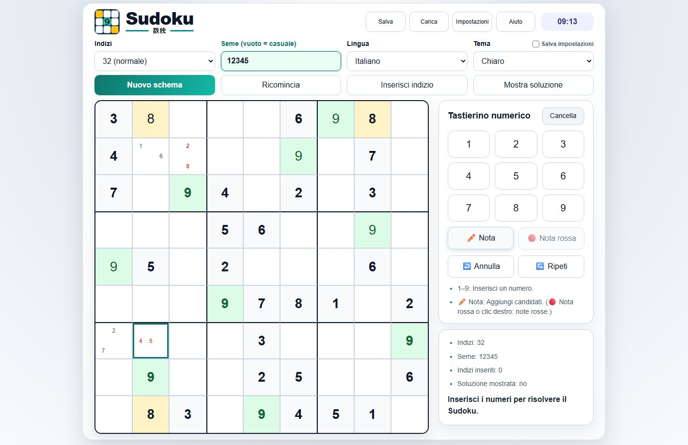
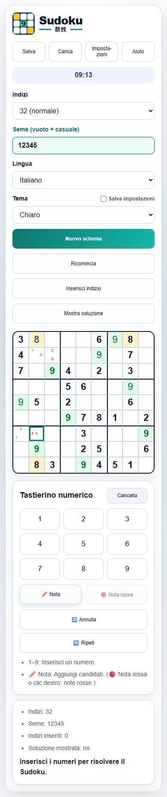

# Sudoku HTML — Italiano

[日本語](./README.ja.md) | [English](../../README.md) | [简体中文](./README.zh-CN.md) | [हिन्दी](./README.hi.md) | [Español](./README.es.md) | [العربية](./README.ar.md) | [Français](./README.fr.md) | [Português (Brasil)](./README.pt-BR.md) | [Português (Portugal)](./README.pt-PT.md) | [Русский](./README.ru.md) | [Deutsch](./README.de.md) | [Bahasa Indonesia](./README.id.md) | [বাংলা](./README.bn.md) | [Türkçe](./README.tr.md) | [한국어](./README.ko.md) | [Tiếng Việt](./README.vi.md) | [Italiano](./README.it.md) | [Nederlands](./README.nl.md) | [Polski](./README.pl.md) | [ไทย](./README.th.md) | [اردو](./README.ur.md) | [فارسی](./README.fa.md) | [Kiswahili](./README.sw.md) | [繁體中文](./README.zh-TW.md) | [Українська](./README.uk.md)

Sudoku HTML è un gioco di Sudoku per browser, utilizzabile da un unico file `Sudoku_v1.9.0.html`, dalla pagina online oppure come estensione Chrome, Edge o Firefox.

| Computer | Cellulare |
| --- | --- |
|  |  |

## Come giocare

[Guida al gioco](../game-guides/GAME_GUIDE.it.md)

Scegli la versione più adatta al tuo modo di giocare:

| Versione | Come giocare |
| --- | --- |
| **Scaricare il file HTML** | [Sudoku_v1.9.0.html](https://github.com/piccoripico/sudoku-html/releases/latest/download/Sudoku_v1.9.0.html) Apri direttamente il file scaricato nel browser per giocare senza connessione. |
| **Giocare online** | <https://piccoripico.github.io/sudoku-html/> Apri lo stesso gioco online. Una volta caricata la pagina, puoi continuare a giocare senza Internet per tutta quella sessione. |
| **Installare l’estensione del browser** | Una volta installata, fai clic sull’icona della barra degli strumenti per aprire One-Click Sudoku in una normale scheda e giocare senza connessione.     |

## Funzionalità

- **Portatile**: L’intera app è in un solo file `Sudoku_v1.9.0.html`, da conservare sul computer o sul telefono e portare ovunque.
- **Offline**: Dopo il download dell’HTML o l’installazione dell’estensione Chrome, Edge o Firefox, il gioco funziona senza Internet.
- **Interfaccia desktop e mobile**: Il layout è adatto sia agli schermi larghi dei computer sia agli schermi verticali degli smartphone.
- **Temi chiaro e scuro**: Scegli Sistema, Chiaro o Scuro. La modalità Sistema segue automaticamente i colori del sistema operativo.
- **Griglie riproducibili**: Lo stesso seme e lo stesso numero di indizi ricreano esattamente lo stesso puzzle, comprese le posizioni degli indizi.
- **Note, indizi e cronologia**: Usa note normali, note rosse, indizi, visualizzazione della soluzione e Annulla/Ripeti durante il gioco.
- **Salva e riprendi**: Salva griglia, note, timer e cronologia Annulla/Ripeti in un file JSON locale; caricandolo riprendi dallo stesso stato.
- **Nessun account o servizio esterno**: Niente pubblicità, pagamenti, account, analisi, caricamento di dati di gioco o raccolta di dati degli utenti.
- **Numero di griglie complete**: Una sola famiglia di modelli consente di generare tramite trasformazioni più di circa 609,5 miliardi di griglie complete. L’app usa più famiglie e la varietà complessiva è ancora maggiore.

## Sviluppo

1. Esegui `npm ci`.
2. Esegui `npm run typecheck`.
3. Esegui `npm test`.
4. Esegui `npm run build`.
5. La prima volta che usi i test del browser, esegui `npm run test:e2e:install`.
6. Esegui `npm run test:e2e` per i test rapidi del browser/runtime oppure `npm run verify` per tutti i controlli locali.

`npm run build` genera il file autonomo `dist/Sudoku_v1.9.0.html` e i pacchetti Manifest V3 estratti in `dist/extension-chromium` e `dist/extension-firefox`. `npm run verify` controlla TypeScript, unit test, vincoli degli artefatti e test del browser/runtime.

## Automazione

GitHub Actions automatizza test, distribuzione su Pages e creazione dei file di rilascio.

- CI: [`.github/workflows/ci.yml`](../../.github/workflows/ci.yml) viene eseguito per le pull request verso `main` e può essere avviato manualmente dalla scheda `Actions`.
- Pages: [`.github/workflows/pages.yml`](../../.github/workflows/pages.yml) viene eseguito dopo un push su `main`, compila `dist/Sudoku_v1.9.0.html` e lo pubblica su GitHub Pages: <https://piccoripico.github.io/sudoku-html/>.
- Release: [`.github/workflows/release.yml`](../../.github/workflows/release.yml) viene eseguito al push di un tag come `v1.2.3` e allega automaticamente `Sudoku_v1.9.0.html` alla GitHub Release.
