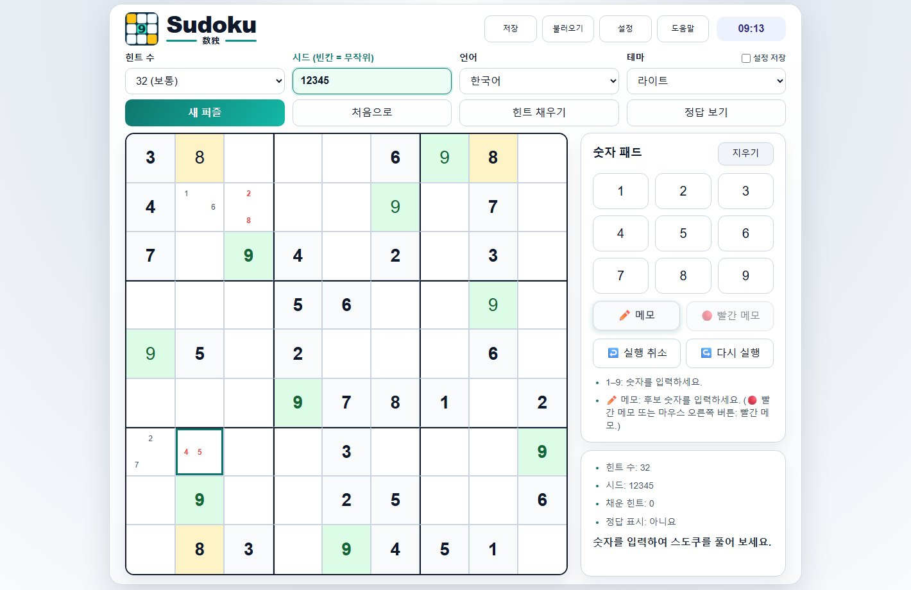
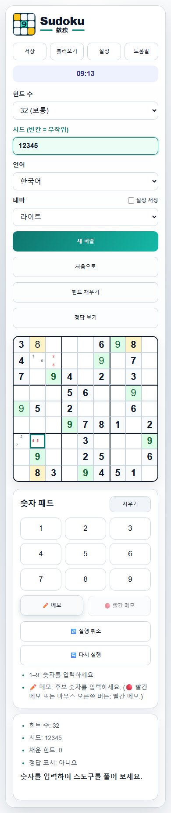

# Sudoku HTML — 한국어

[日本語](./README.ja.md) | [English](../../README.md) | [简体中文](./README.zh-CN.md) | [हिन्दी](./README.hi.md) | [Español](./README.es.md) | [العربية](./README.ar.md) | [Français](./README.fr.md) | [Português (Brasil)](./README.pt-BR.md) | [Português (Portugal)](./README.pt-PT.md) | [Русский](./README.ru.md) | [Deutsch](./README.de.md) | [Bahasa Indonesia](./README.id.md) | [বাংলা](./README.bn.md) | [Türkçe](./README.tr.md) | [한국어](./README.ko.md) | [Tiếng Việt](./README.vi.md) | [Italiano](./README.it.md) | [Nederlands](./README.nl.md) | [Polski](./README.pl.md) | [ไทย](./README.th.md) | [اردو](./README.ur.md) | [فارسی](./README.fa.md) | [Kiswahili](./README.sw.md) | [繁體中文](./README.zh-TW.md) | [Українська](./README.uk.md)

Sudoku HTML은 하나의 `Sudoku_v1.9.0.html` 파일, 온라인 페이지 또는 Chrome·Edge·Firefox 확장 기능으로 즐길 수 있는 브라우저 기반 스도쿠 게임입니다.

| 데스크톱 | 모바일 |
| --- | --- |
|  |  |

## 게임 방법

[게임 가이드](../game-guides/GAME_GUIDE.ko.md)

원하는 플레이 방식에 맞춰 버전을 선택하세요.

| 버전 | 플레이 방법 |
| --- | --- |
| **HTML 파일 다운로드** | [Sudoku_v1.9.0.html](https://github.com/piccoripico/sudoku-html/releases/latest/download/Sudoku_v1.9.0.html) 다운로드한 파일을 브라우저에서 직접 열어 오프라인으로 플레이할 수 있습니다. |
| **온라인 플레이** | <https://piccoripico.github.io/sudoku-html/> 온라인에서 같은 게임을 엽니다. 페이지 로딩 후에는 해당 세션 중 인터넷 연결 없이도 계속할 수 있습니다. |
| **브라우저 확장 기능 설치** | 설치 후 도구 모음 아이콘을 클릭하면 One-Click Sudoku가 일반 브라우저 탭에서 열리고 오프라인으로 플레이할 수 있습니다.     |

## 주요 기능

- **휴대성**: 앱 전체가 하나의 `Sudoku_v1.9.0.html` 파일에 들어 있어 컴퓨터나 휴대전화에 저장하고 어디서나 사용할 수 있습니다.
- **오프라인**: HTML 파일을 다운로드하거나 Chrome·Edge·Firefox 확장 기능을 설치한 뒤에는 인터넷 없이 플레이할 수 있습니다.
- **데스크톱/모바일 UI**: 넓은 데스크톱 화면과 세로로 긴 모바일 화면 모두에서 편리하도록 설계했습니다.
- **라이트/다크 테마**: 시스템, 라이트, 다크 중 선택하며 시스템 모드는 운영체제의 색 구성표를 자동으로 따릅니다.
- **보드 재현**: 같은 시드와 힌트 수를 입력하면 힌트 배치까지 동일한 퍼즐을 다시 만듭니다.
- **메모·힌트·작업 기록**: 일반 메모, 빨간 메모, 힌트 채우기, 정답 표시, 실행 취소/다시 실행을 사용할 수 있습니다.
- **저장하고 이어하기**: 현재 보드, 메모, 타이머, 실행 취소/다시 실행 기록을 로컬 JSON 파일에 저장하고 나중에 불러와 같은 상태에서 이어할 수 있습니다.
- **계정 및 외부 서비스 불필요**: 광고, 결제, 계정, 분석, 게임 데이터 업로드, 사용자 정보 수집이 없습니다.
- **완성 보드의 수**: 템플릿 계열 하나만으로 변환을 통해 약 6,095억 개가 넘는 완성 보드를 만들 수 있습니다. 앱은 여러 계열을 사용하므로 전체 변화는 더 많습니다.

## 개발

1. 실행: `npm ci`.
2. 실행: `npm run typecheck`.
3. 실행: `npm test`.
4. 실행: `npm run build`.
5. 브라우저 테스트를 처음 실행할 때는 `npm run test:e2e:install`을 실행합니다.
6. 브라우저/런타임 스모크 테스트는 `npm run test:e2e`, 전체 로컬 검증은 `npm run verify`를 실행합니다.

`npm run build`는 독립 실행형 `dist/Sudoku_v1.9.0.html`과 압축 해제된 Manifest V3 확장 기능 `dist/extension-chromium`, `dist/extension-firefox`를 만듭니다. `npm run verify`는 TypeScript, 단위 테스트, 빌드 결과 검증, 브라우저/런타임 테스트를 수행합니다.

## 자동화

GitHub Actions는 테스트, Pages 배포 및 릴리스 파일 생성을 자동화합니다.

- CI: [`.github/workflows/ci.yml`](../../.github/workflows/ci.yml) `main`을 대상으로 하는 pull request에서 실행되며 `Actions` 탭에서 수동 실행할 수도 있습니다.
- Pages: [`.github/workflows/pages.yml`](../../.github/workflows/pages.yml) `main`에 push하면 `dist/Sudoku_v1.9.0.html`을 빌드하여 GitHub Pages에 배포합니다: <https://piccoripico.github.io/sudoku-html/>.
- Release: [`.github/workflows/release.yml`](../../.github/workflows/release.yml) `v1.2.3` 같은 버전 태그를 push하면 `Sudoku_v1.9.0.html`을 GitHub Release에 자동 첨부합니다.
