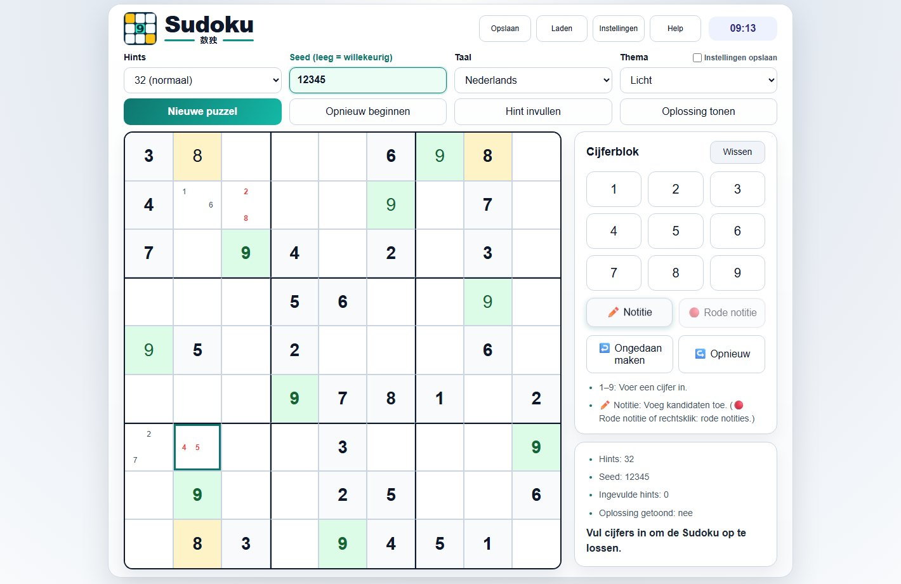
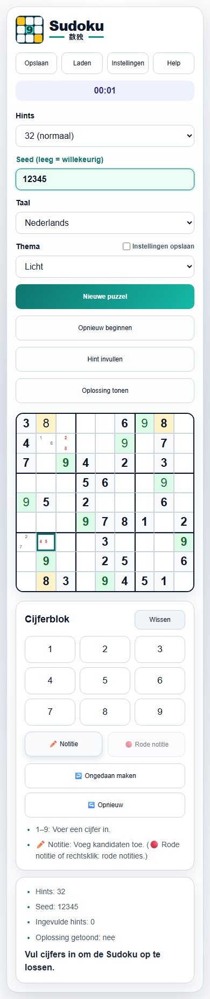

# Sudoku HTML — Nederlands

[日本語](./README.ja.md) | [English](../../README.md) | [简体中文](./README.zh-CN.md) | [हिन्दी](./README.hi.md) | [Español](./README.es.md) | [العربية](./README.ar.md) | [Français](./README.fr.md) | [Português (Brasil)](./README.pt-BR.md) | [Português (Portugal)](./README.pt-PT.md) | [Русский](./README.ru.md) | [Deutsch](./README.de.md) | [Bahasa Indonesia](./README.id.md) | [বাংলা](./README.bn.md) | [Türkçe](./README.tr.md) | [한국어](./README.ko.md) | [Tiếng Việt](./README.vi.md) | [Italiano](./README.it.md) | [Nederlands](./README.nl.md) | [Polski](./README.pl.md) | [ไทย](./README.th.md) | [اردو](./README.ur.md) | [فارسی](./README.fa.md) | [Kiswahili](./README.sw.md) | [繁體中文](./README.zh-TW.md) | [Українська](./README.uk.md)

Sudoku HTML is een Sudoku-spel voor de browser dat u kunt spelen vanuit één bestand `Sudoku_v1.9.0.html`, via de onlinepagina of als Chrome-, Edge- of Firefox-extensie.

| Desktop | Mobiel |
| --- | --- |
|  |  |

## Speluitleg

[Speluitleg](../game-guides/GAME_GUIDE.nl.md)

Kies de versie die past bij uw manier van spelen:

| Versie | Spelwijze |
| --- | --- |
| **HTML-bestand downloaden** | [Sudoku_v1.9.0.html](https://github.com/piccoripico/sudoku-html/releases/latest/download/Sudoku_v1.9.0.html) Open het gedownloade bestand rechtstreeks in de browser om offline te spelen. |
| **Online spelen** | <https://piccoripico.github.io/sudoku-html/> Open hetzelfde spel online. Zodra de pagina is geladen, kunt u tijdens die sessie zonder internet verder spelen. |
| **Browserextensie installeren** | Klik na installatie op het pictogram in de werkbalk om One-Click Sudoku in een gewoon tabblad te openen en offline te spelen.     |

## Functies

- **Draagbaar**: De hele app zit in één bestand `Sudoku_v1.9.0.html` dat u op uw computer of telefoon kunt bewaren en overal mee naartoe kunt nemen.
- **Offline**: Na het downloaden van het HTML-bestand of het installeren van de Chrome-, Edge- of Firefox-extensie is geen internet meer nodig.
- **Desktop- en mobiele weergave**: De lay-out werkt prettig op brede computerschermen en hoge telefoonschermen.
- **Lichte en donkere thema’s**: Kies Systeem, Licht of Donker. De systeemmodus volgt automatisch de kleuren van het besturingssysteem.
- **Rooster opnieuw maken**: Dezelfde seed en hetzelfde aantal aanwijzingen geven dezelfde puzzel, inclusief de plaatsen van de begincijfers.
- **Notities, hints en geschiedenis**: Gebruik gewone en rode notities, hints, oplossing tonen en Ongedaan maken/Opnieuw.
- **Opslaan en later verdergaan**: Sla rooster, notities, timer en geschiedenis in een lokaal JSON-bestand op; laad het bestand om precies verder te gaan.
- **Geen account of externe dienst**: Geen advertenties, betalingen, accounts, analytics, uploads van spelgegevens of verzameling van gebruikersgegevens.
- **Aantal voltooide roosters**: Eén familie van sjablonen kan via transformaties al meer dan ongeveer 609,5 miljard voltooide roosters opleveren. De app gebruikt meerdere families, dus er zijn nog veel meer variaties.

## Ontwikkeling

1. Voer uit: `npm ci`.
2. Voer uit: `npm run typecheck`.
3. Voer uit: `npm test`.
4. Voer uit: `npm run build`.
5. Voer bij het eerste gebruik van browsertests `npm run test:e2e:install` uit.
6. Voer `npm run test:e2e` uit voor snelle browser-/runtimetests of `npm run verify` voor de volledige lokale controle.

`npm run build` genereert het zelfstandige bestand `dist/Sudoku_v1.9.0.html` en de uitgepakte Manifest V3-extensies `dist/extension-chromium` en `dist/extension-firefox`. `npm run verify` controleert TypeScript, unit-tests, artefactvereisten en browser-/runtimetests.

## Automatisering

GitHub Actions automatiseert tests, Pages-publicatie en het maken van releasebestanden.

- CI: [`.github/workflows/ci.yml`](../../.github/workflows/ci.yml) wordt uitgevoerd voor pull requests naar `main` en kan ook handmatig via het tabblad `Actions` worden gestart.
- Pages: [`.github/workflows/pages.yml`](../../.github/workflows/pages.yml) draait bij push naar `main`, bouwt `dist/Sudoku_v1.9.0.html` en publiceert het via GitHub Pages: <https://piccoripico.github.io/sudoku-html/>.
- Release: [`.github/workflows/release.yml`](../../.github/workflows/release.yml) draait bij een versietag zoals `v1.2.3` en voegt `Sudoku_v1.9.0.html` automatisch toe aan de GitHub Release.
