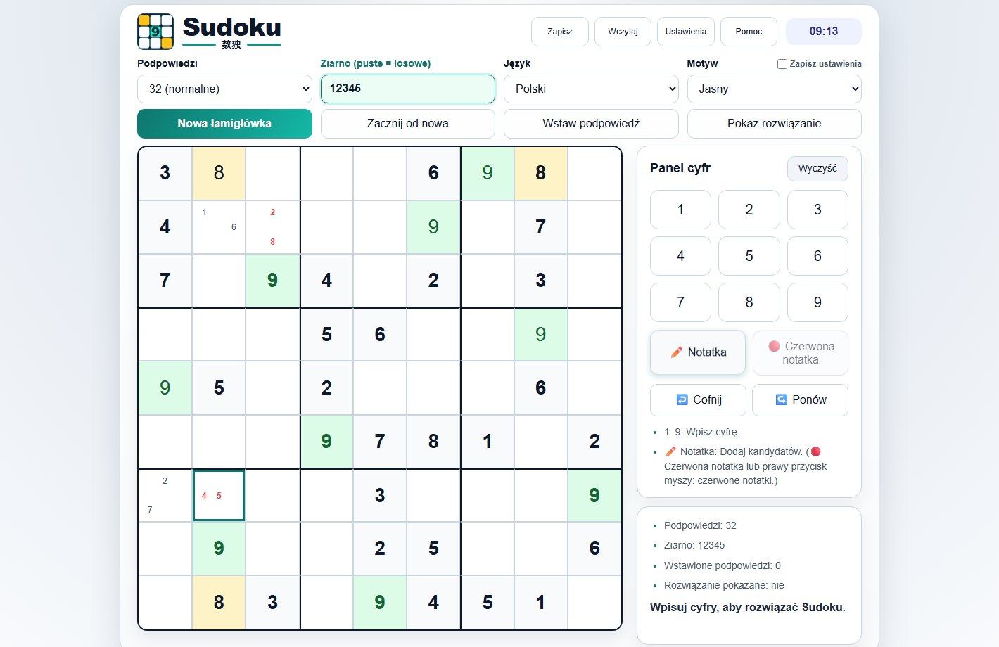
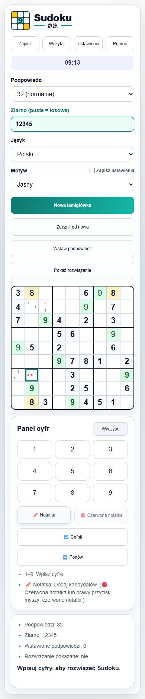

# Sudoku HTML — Polski

[日本語](./README.ja.md) | [English](../../README.md) | [简体中文](./README.zh-CN.md) | [हिन्दी](./README.hi.md) | [Español](./README.es.md) | [العربية](./README.ar.md) | [Français](./README.fr.md) | [Português (Brasil)](./README.pt-BR.md) | [Português (Portugal)](./README.pt-PT.md) | [Русский](./README.ru.md) | [Deutsch](./README.de.md) | [Bahasa Indonesia](./README.id.md) | [বাংলা](./README.bn.md) | [Türkçe](./README.tr.md) | [한국어](./README.ko.md) | [Tiếng Việt](./README.vi.md) | [Italiano](./README.it.md) | [Nederlands](./README.nl.md) | [Polski](./README.pl.md) | [ไทย](./README.th.md) | [اردو](./README.ur.md) | [فارسی](./README.fa.md) | [Kiswahili](./README.sw.md) | [繁體中文](./README.zh-TW.md) | [Українська](./README.uk.md)

Sudoku HTML to gra Sudoku w przeglądarce, dostępna jako pojedynczy plik `Sudoku_v1.9.0.html`, strona internetowa lub rozszerzenie Chrome, Edge bądź Firefox.

| Komputer | Telefon |
| --- | --- |
|  |  |

## Jak grać

[Instrukcja gry](../game-guides/GAME_GUIDE.pl.md)

Wybierz sposób gry, który najbardziej Ci odpowiada:

| Wersja | Jak grać |
| --- | --- |
| **Pobierz plik HTML** | [Sudoku_v1.9.0.html](https://github.com/piccoripico/sudoku-html/releases/latest/download/Sudoku_v1.9.0.html) Otwórz pobrany plik bezpośrednio w przeglądarce, aby grać bez internetu. |
| **Graj online** | <https://piccoripico.github.io/sudoku-html/> Otwórz tę samą grę online. Po wczytaniu strony możesz nadal grać bez internetu w ramach tej sesji. |
| **Zainstaluj rozszerzenie** | Po instalacji kliknij ikonę paska narzędzi, aby otworzyć One-Click Sudoku w zwykłej karcie i grać offline.     |

## Funkcje

- **Przenośność**: Cała aplikacja mieści się w jednym pliku `Sudoku_v1.9.0.html`, który możesz trzymać na komputerze lub telefonie i zabierać wszędzie.
- **Offline**: Po pobraniu pliku HTML lub zainstalowaniu rozszerzenia Chrome, Edge albo Firefox gra działa bez połączenia z internetem.
- **Interfejs na komputer i telefon**: Układ dopasowuje się zarówno do szerokich ekranów komputerowych, jak i pionowych wyświetlaczy telefonów.
- **Jasny i ciemny motyw**: Wybierz Systemowy, Jasny lub Ciemny. Tryb systemowy automatycznie używa kolorów systemu operacyjnego.
- **Powtarzalne plansze**: To samo ziarno i ta sama liczba wskazówek odtwarzają identyczną łamigłówkę, także układ wskazówek.
- **Notatki, wskazówki i historia**: Używaj notatek zwykłych i czerwonych, podpowiedzi, wyświetlania rozwiązania oraz Cofnij/Ponów.
- **Zapis i wznowienie**: Zapisz planszę, notatki, licznik czasu i historię Cofnij/Ponów w lokalnym pliku JSON, a następnie go wczytaj, by wznowić ten sam stan.
- **Bez konta i usług zewnętrznych**: Bez reklam, płatności, kont, analityki, wysyłania danych rozgrywki i gromadzenia danych użytkowników.
- **Liczba ukończonych plansz**: Już jedna rodzina szablonów może dać po przekształceniach ponad około 609,5 mld pełnych plansz. Aplikacja korzysta z wielu rodzin, więc całkowita różnorodność jest większa.

## Programowanie

1. Uruchom `npm ci`.
2. Uruchom `npm run typecheck`.
3. Uruchom `npm test`.
4. Uruchom `npm run build`.
5. Przed pierwszym uruchomieniem testów przeglądarki wykonaj `npm run test:e2e:install`.
6. Uruchom `npm run test:e2e` dla testów przeglądarki albo `npm run verify` dla pełnej lokalnej kontroli.

`npm run build` tworzy samodzielny `dist/Sudoku_v1.9.0.html` i rozpakowane pakiety Manifest V3 w `dist/extension-chromium` oraz `dist/extension-firefox`. `npm run verify` sprawdza TypeScript, testy jednostkowe, wymagania dotyczące artefaktów i testy przeglądarki/środowiska uruchomieniowego.

## Automatyzacja

GitHub Actions automatyzuje testowanie, wdrażanie Pages i tworzenie plików wydania.

- CI: [`.github/workflows/ci.yml`](../../.github/workflows/ci.yml) działa dla pull requestów do `main` i można go ręcznie uruchomić na karcie `Actions`.
- Pages: [`.github/workflows/pages.yml`](../../.github/workflows/pages.yml) działa po push do `main`, buduje `dist/Sudoku_v1.9.0.html` i publikuje go na GitHub Pages: <https://piccoripico.github.io/sudoku-html/>.
- Release: [`.github/workflows/release.yml`](../../.github/workflows/release.yml) działa po push taga wersji, np. `v1.2.3`, i automatycznie dołącza `Sudoku_v1.9.0.html` do GitHub Release.
