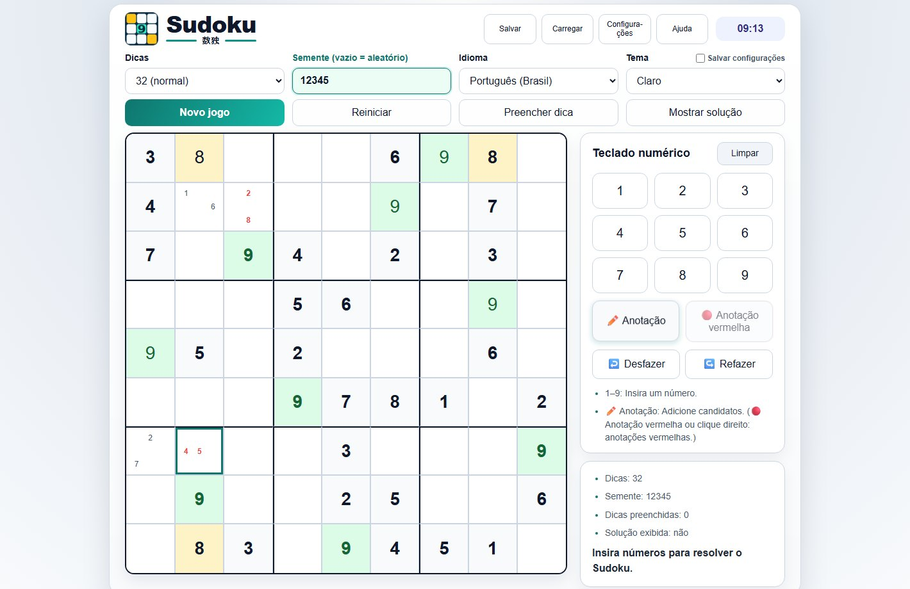
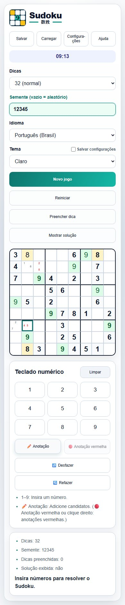

# Sudoku HTML — Português (Brasil)

[日本語](./README.ja.md) | [English](../../README.md) | [简体中文](./README.zh-CN.md) | [हिन्दी](./README.hi.md) | [Español](./README.es.md) | [العربية](./README.ar.md) | [Français](./README.fr.md) | [Português (Brasil)](./README.pt-BR.md) | [Português (Portugal)](./README.pt-PT.md) | [Русский](./README.ru.md) | [Deutsch](./README.de.md) | [Bahasa Indonesia](./README.id.md) | [বাংলা](./README.bn.md) | [Türkçe](./README.tr.md) | [한국어](./README.ko.md) | [Tiếng Việt](./README.vi.md) | [Italiano](./README.it.md) | [Nederlands](./README.nl.md) | [Polski](./README.pl.md) | [ไทย](./README.th.md) | [اردو](./README.ur.md) | [فارسی](./README.fa.md) | [Kiswahili](./README.sw.md) | [繁體中文](./README.zh-TW.md) | [Українська](./README.uk.md)

Sudoku HTML é um jogo de Sudoku para navegador que funciona como um único arquivo `Sudoku_v1.9.0.html`, na página on-line ou como extensão do Chrome, Edge ou Firefox.

| Computador | Celular |
| --- | --- |
|  |  |

## Como jogar

[Guia do jogo](../game-guides/GAME_GUIDE.pt-BR.md)

Escolha a versão que combina com a sua forma de jogar:

| Versão | Como jogar |
| --- | --- |
| **Baixar o arquivo HTML** | [Sudoku_v1.9.0.html](https://github.com/piccoripico/sudoku-html/releases/latest/download/Sudoku_v1.9.0.html) Abra o arquivo baixado diretamente no navegador para jogar sem conexão. |
| **Jogar on-line** | <https://piccoripico.github.io/sudoku-html/> Abra o mesmo jogo on-line. Depois que a página carregar, você pode continuar jogando sem internet durante essa sessão. |
| **Instalar a extensão do navegador** | Após a instalação, clique no ícone da barra de ferramentas para abrir One-Click Sudoku em uma aba normal do navegador e jogar sem conexão.     |

## Destaques

- **Portátil**: Todo o aplicativo está em um único arquivo `Sudoku_v1.9.0.html`, para guardar no computador ou celular e levar a qualquer lugar.
- **Sem conexão**: O aplicativo funciona off-line após baixar o arquivo HTML ou instalar a extensão para Chrome, Edge ou Firefox.
- **Interface para computador e celular**: O layout foi projetado para telas largas de computadores e telas verticais de celulares.
- **Temas claro e escuro**: Escolha Sistema, Claro ou Escuro. Sistema acompanha automaticamente as cores do sistema operacional.
- **Reproduzir tabuleiros**: A mesma semente com a mesma quantidade de dicas recria exatamente o mesmo Sudoku, incluindo a posição das dicas.
- **Notas, dicas e histórico**: Use notas normais, notas vermelhas, dicas, exibição da solução e desfazer/refazer ao resolver.
- **Salvar e continuar depois**: Salve tabuleiro, notas, cronômetro e histórico de desfazer/refazer em um JSON local. Ao carregar o arquivo, você volta ao mesmo estado.
- **Sem conta nem serviço externo**: Não há anúncios, pagamentos, contas, análises, envio de dados de jogo nem coleta de dados de usuários.
- **Quantidade de tabuleiros completos**: Uma única família de modelos permite gerar mais de aproximadamente 609,5 bilhões de tabuleiros completos transformados. O aplicativo utiliza várias famílias, oferecendo ainda mais variações.

## Desenvolvimento

1. Execute `npm ci`.
2. Execute `npm run typecheck`.
3. Execute `npm test`.
4. Execute `npm run build`.
5. Na primeira execução dos testes de navegador, execute `npm run test:e2e:install`.
6. Execute `npm run test:e2e` para testes rápidos de navegador/execução ou `npm run verify` para todas as verificações locais.

`npm run build` gera o arquivo independente `dist/Sudoku_v1.9.0.html` e os pacotes Manifest V3 descompactados em `dist/extension-chromium` e `dist/extension-firefox`. `npm run verify` verifica TypeScript, testes unitários, contratos dos artefatos e testes de navegador/execução.

## Automação

O GitHub Actions automatiza testes, implantação no Pages e geração de artefatos de versões.

- CI: [`.github/workflows/ci.yml`](../../.github/workflows/ci.yml) é executado nas pull requests destinadas a `main` e também pode ser iniciado manualmente pela aba `Actions`.
- Pages: [`.github/workflows/pages.yml`](../../.github/workflows/pages.yml) é executado após um push em `main`, compila `dist/Sudoku_v1.9.0.html` e publica no GitHub Pages: <https://piccoripico.github.io/sudoku-html/>.
- Release: [`.github/workflows/release.yml`](../../.github/workflows/release.yml) é executado ao enviar uma tag de versão como `v1.2.3` e anexa automaticamente `Sudoku_v1.9.0.html` ao GitHub Release.
