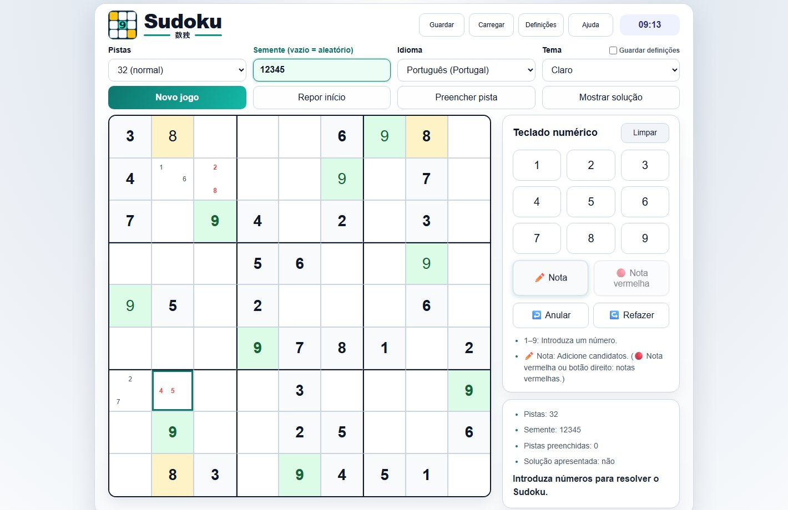
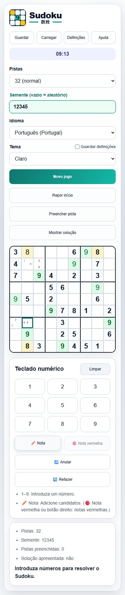

# Sudoku HTML — Português (Portugal)

[日本語](./README.ja.md) | [English](../../README.md) | [简体中文](./README.zh-CN.md) | [हिन्दी](./README.hi.md) | [Español](./README.es.md) | [العربية](./README.ar.md) | [Français](./README.fr.md) | [Português (Brasil)](./README.pt-BR.md) | [Português (Portugal)](./README.pt-PT.md) | [Русский](./README.ru.md) | [Deutsch](./README.de.md) | [Bahasa Indonesia](./README.id.md) | [বাংলা](./README.bn.md) | [Türkçe](./README.tr.md) | [한국어](./README.ko.md) | [Tiếng Việt](./README.vi.md) | [Italiano](./README.it.md) | [Nederlands](./README.nl.md) | [Polski](./README.pl.md) | [ไทย](./README.th.md) | [اردو](./README.ur.md) | [فارسی](./README.fa.md) | [Kiswahili](./README.sw.md) | [繁體中文](./README.zh-TW.md) | [Українська](./README.uk.md)

Sudoku HTML é um jogo de Sudoku para navegador que pode ser jogado através de um único ficheiro `Sudoku_v1.9.0.html`, da página online ou de uma extensão Chrome, Edge ou Firefox.

| Computador | Telemóvel |
| --- | --- |
|  |  |

## Como jogar

[Guia do jogo](../game-guides/GAME_GUIDE.pt-PT.md)

Escolha a versão que melhor corresponde à sua forma de jogar:

| Versão | Modo de jogar |
| --- | --- |
| **Transferir o ficheiro HTML** | [Sudoku_v1.9.0.html](https://github.com/piccoripico/sudoku-html/releases/latest/download/Sudoku_v1.9.0.html) Abra o ficheiro transferido diretamente no navegador para jogar sem ligação. |
| **Jogar online** | <https://piccoripico.github.io/sudoku-html/> Abra o mesmo jogo online. Depois de carregar a página, pode continuar a jogar sem internet durante essa sessão. |
| **Instalar a extensão do navegador** | Após instalar, clique no ícone da barra de ferramentas para abrir One-Click Sudoku num separador normal do navegador e jogar sem ligação.     |

## Destaques

- **Portátil**: Toda a aplicação cabe num único ficheiro `Sudoku_v1.9.0.html`, que pode guardar no computador ou telemóvel para levar consigo.
- **Sem ligação**: A aplicação funciona offline depois de transferir o HTML ou instalar a extensão para Chrome, Edge ou Firefox.
- **Interface para computador e telemóvel**: O desenho adapta-se a ecrãs largos de computador e ecrãs verticais de telemóvel.
- **Temas claro e escuro**: Escolha Sistema, Claro ou Escuro. Sistema acompanha automaticamente as cores do sistema operativo.
- **Reprodução da grelha**: A mesma semente e quantidade de pistas recriam o mesmo puzzle, incluindo a localização das pistas.
- **Notas, pistas e histórico**: Utilize notas normais e vermelhas, pistas, apresentação da solução e anular/refazer durante a resolução.
- **Guardar e retomar**: Guarde grelha, notas, cronómetro e histórico de anular/refazer num JSON local; ao carregar esse ficheiro, retoma o mesmo estado.
- **Sem conta nem serviço externo**: Sem publicidade, pagamentos, contas, análises, envio de dados de jogo ou recolha de dados de utilizadores.
- **Quantidade de grelhas completas**: Uma única família de modelos permite gerar mais de aproximadamente 609,5 mil milhões de grelhas completas transformadas; a aplicação usa várias famílias e oferece ainda mais variedade.

## Desenvolvimento

1. Execute `npm ci`.
2. Execute `npm run typecheck`.
3. Execute `npm test`.
4. Execute `npm run build`.
5. Na primeira utilização dos testes de navegador, execute `npm run test:e2e:install`.
6. Execute `npm run test:e2e` para testes rápidos de navegador/execução ou `npm run verify` para o conjunto completo de verificações locais.

`npm run build` produz `dist/Sudoku_v1.9.0.html` autónomo e os pacotes Manifest V3 descompactados `dist/extension-chromium` e `dist/extension-firefox`. `npm run verify` verifica TypeScript, testes unitários, requisitos dos artefactos e testes de navegador/execução.

## Automatização

O GitHub Actions automatiza os testes, a publicação no Pages e a geração de artefactos das versões.

- CI: [`.github/workflows/ci.yml`](../../.github/workflows/ci.yml) é executado em pull requests para `main` e pode também ser iniciado manualmente no separador `Actions`.
- Pages: [`.github/workflows/pages.yml`](../../.github/workflows/pages.yml) é executado após um push para `main`, compila `dist/Sudoku_v1.9.0.html` e publica-o no GitHub Pages: <https://piccoripico.github.io/sudoku-html/>.
- Release: [`.github/workflows/release.yml`](../../.github/workflows/release.yml) é executado ao enviar uma etiqueta de versão como `v1.2.3` e anexa automaticamente `Sudoku_v1.9.0.html` à GitHub Release.
