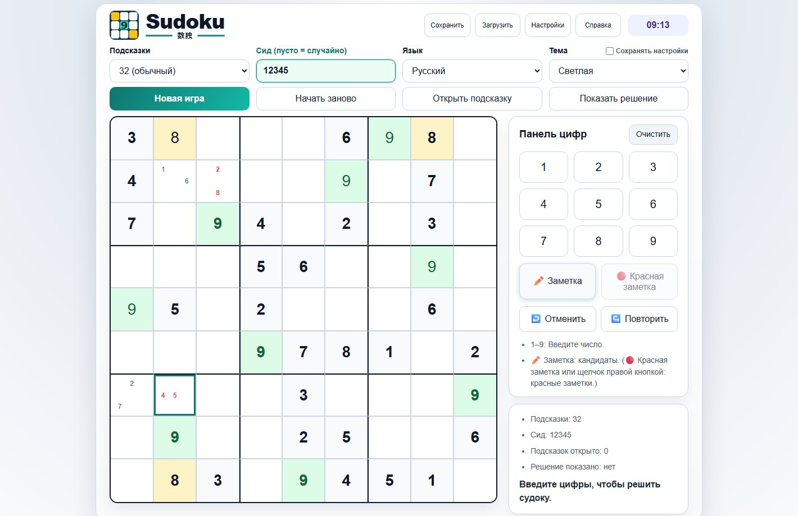
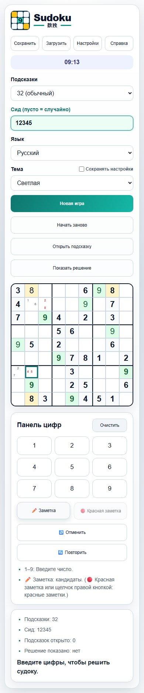

# Sudoku HTML — Русский

[日本語](./README.ja.md) | [English](../../README.md) | [简体中文](./README.zh-CN.md) | [हिन्दी](./README.hi.md) | [Español](./README.es.md) | [العربية](./README.ar.md) | [Français](./README.fr.md) | [Português (Brasil)](./README.pt-BR.md) | [Português (Portugal)](./README.pt-PT.md) | [Русский](./README.ru.md) | [Deutsch](./README.de.md) | [Bahasa Indonesia](./README.id.md) | [বাংলা](./README.bn.md) | [Türkçe](./README.tr.md) | [한국어](./README.ko.md) | [Tiếng Việt](./README.vi.md) | [Italiano](./README.it.md) | [Nederlands](./README.nl.md) | [Polski](./README.pl.md) | [ไทย](./README.th.md) | [اردو](./README.ur.md) | [فارسی](./README.fa.md) | [Kiswahili](./README.sw.md) | [繁體中文](./README.zh-TW.md) | [Українська](./README.uk.md)

Sudoku HTML — игра в судоку для браузера: её можно запускать из одного файла `Sudoku_v1.9.0.html`, через онлайн-страницу или как расширение Chrome, Edge и Firefox.

| Компьютер | Телефон |
| --- | --- |
|  |  |

## Как играть

[Руководство по игре](../game-guides/GAME_GUIDE.ru.md)

Выберите подходящий способ игры:

| Версия | Как играть |
| --- | --- |
| **Скачать HTML-файл** | [Sudoku_v1.9.0.html](https://github.com/piccoripico/sudoku-html/releases/latest/download/Sudoku_v1.9.0.html) Откройте скачанный файл прямо в браузере, чтобы играть без интернета. |
| **Играть онлайн** | <https://piccoripico.github.io/sudoku-html/> Откройте ту же игру в сети. После загрузки страницы в течение этой сессии можно продолжать играть без подключения. |
| **Установить расширение** | После установки нажмите значок на панели инструментов, чтобы открыть One-Click Sudoku в обычной вкладке и играть без интернета.     |

## Возможности

- **Переносимость**: Вся игра помещается в одном файле `Sudoku_v1.9.0.html`, который можно хранить на компьютере или телефоне и брать с собой.
- **Без интернета**: После загрузки HTML-файла или установки расширения Chrome, Edge либо Firefox игра работает автономно.
- **Для компьютера и телефона**: Интерфейс удобен на широких настольных и вертикальных мобильных экранах.
- **Светлая и тёмная темы**: Выбирайте Системную, Светлую или Тёмную тему. Системная автоматически повторяет цветовую схему ОС.
- **Воспроизводимость**: Одинаковый сид и число подсказок создают ту же головоломку, включая положение исходных цифр.
- **Заметки, подсказки и история**: Пользуйтесь обычными и красными заметками, подсказками, показом решения и отменой/повтором действий.
- **Сохранить и продолжить**: Сохраните поле, заметки, таймер и историю отмены/повтора в локальный JSON-файл; загрузите его для продолжения с того же места.
- **Без аккаунтов и внешних служб**: Нет рекламы, платежей, аккаунтов, аналитики, отправки игровых данных или сбора персональных данных.
- **Число готовых полей**: Даже одна серия шаблонов может дать более 609,5 млрд преобразованных завершённых полей. Игра использует несколько серий, поэтому общее разнообразие больше.

## Разработка

1. Выполните `npm ci`.
2. Выполните `npm run typecheck`.
3. Выполните `npm test`.
4. Выполните `npm run build`.
5. При первом запуске браузерных тестов выполните `npm run test:e2e:install`.
6. Запустите `npm run test:e2e` для базовых браузерных тестов или `npm run verify` для полного набора локальных проверок.

`npm run build` создаёт автономный `dist/Sudoku_v1.9.0.html` и распакованные пакеты Manifest V3 в `dist/extension-chromium` и `dist/extension-firefox`. `npm run verify` проверяет TypeScript, модульные тесты, требования к артефактам и браузерные тесты.

## Автоматизация

GitHub Actions автоматизирует тесты, развёртывание Pages и создание файлов выпуска.

- CI: [`.github/workflows/ci.yml`](../../.github/workflows/ci.yml) запускается для pull request в `main`; его также можно запустить вручную на вкладке `Actions`.
- Pages: [`.github/workflows/pages.yml`](../../.github/workflows/pages.yml) запускается после push в `main`, собирает `dist/Sudoku_v1.9.0.html` и публикует его в GitHub Pages: <https://piccoripico.github.io/sudoku-html/>.
- Release: [`.github/workflows/release.yml`](../../.github/workflows/release.yml) запускается при push тега вроде `v1.2.3` и автоматически прикрепляет `Sudoku_v1.9.0.html` к GitHub Release.
