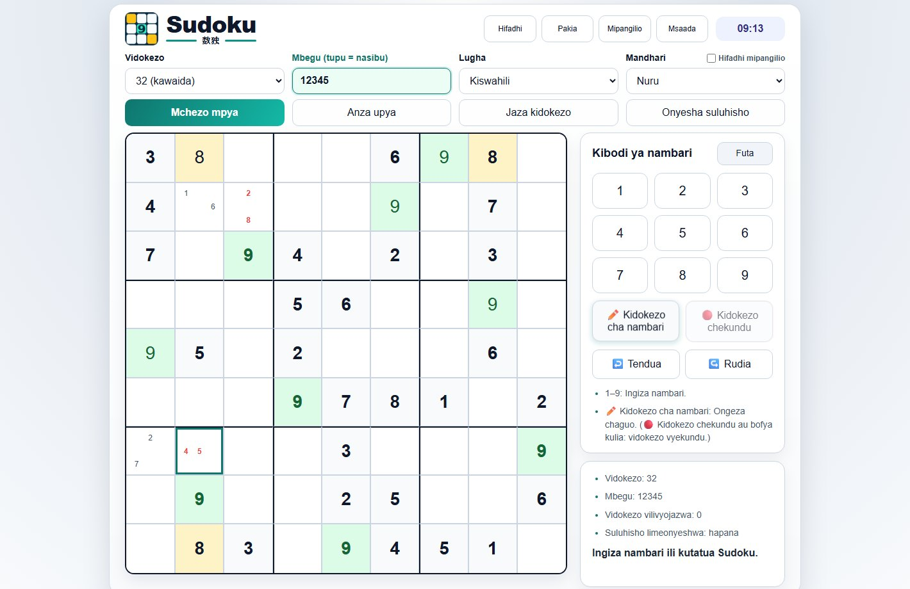
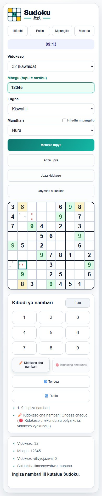

# Sudoku HTML — Kiswahili

[日本語](./README.ja.md) | [English](../../README.md) | [简体中文](./README.zh-CN.md) | [हिन्दी](./README.hi.md) | [Español](./README.es.md) | [العربية](./README.ar.md) | [Français](./README.fr.md) | [Português (Brasil)](./README.pt-BR.md) | [Português (Portugal)](./README.pt-PT.md) | [Русский](./README.ru.md) | [Deutsch](./README.de.md) | [Bahasa Indonesia](./README.id.md) | [বাংলা](./README.bn.md) | [Türkçe](./README.tr.md) | [한국어](./README.ko.md) | [Tiếng Việt](./README.vi.md) | [Italiano](./README.it.md) | [Nederlands](./README.nl.md) | [Polski](./README.pl.md) | [ไทย](./README.th.md) | [اردو](./README.ur.md) | [فارسی](./README.fa.md) | [Kiswahili](./README.sw.md) | [繁體中文](./README.zh-TW.md) | [Українська](./README.uk.md)

Sudoku HTML ni mchezo wa Sudoku unaofanya kazi kwenye kivinjari, kupitia faili moja `Sudoku_v1.9.0.html`, ukurasa wa mtandaoni au kiendelezi cha Chrome, Edge au Firefox.

| Kompyuta | Simu |
| --- | --- |
|  |  |

## Jinsi ya kucheza

[Mwongozo wa mchezo](../game-guides/GAME_GUIDE.sw.md)

Chagua namna ya kucheza inayokufaa:

| Toleo | Jinsi ya kucheza |
| --- | --- |
| **Pakua faili ya HTML** | [Sudoku_v1.9.0.html](https://github.com/piccoripico/sudoku-html/releases/latest/download/Sudoku_v1.9.0.html) Fungua faili uliyopakua moja kwa moja kwenye kivinjari ili kucheza bila intaneti. |
| **Cheza mtandaoni** | <https://piccoripico.github.io/sudoku-html/> Fungua mchezo huohuo mtandaoni. Baada ya ukurasa kupakiwa, unaweza kuendelea kucheza bila intaneti ndani ya kipindi hicho. |
| **Sakinisha kiendelezi cha kivinjari** | Baada ya kusakinisha, bofya ikoni kwenye upau wa zana ili kufungua One-Click Sudoku katika kichupo cha kawaida na kucheza bila intaneti.     |

## Vipengele

- **Rahisi kubeba**: Programu nzima ipo kwenye faili moja `Sudoku_v1.9.0.html`; unaweza kuihifadhi kwenye kompyuta au simu na kwenda nayo popote.
- **Bila intaneti**: Baada ya kupakua faili ya HTML au kusakinisha kiendelezi cha Chrome, Edge au Firefox, mchezo hufanya kazi bila muunganisho.
- **Muonekano wa kompyuta na simu**: Mpangilio umebuniwa kwa skrini pana za kompyuta na skrini ndefu za simu.
- **Mandhari angavu na giza**: Chagua Mfumo, Angavu au Giza; hali ya Mfumo hufuata rangi za mfumo wa uendeshaji kiotomatiki.
- **Kuzalisha ubao uleule**: Mbegu na idadi ya vidokezo vinapofanana, fumbo lilelile huzalishwa tena pamoja na nafasi za vidokezo.
- **Madokezo, vidokezo na historia**: Tumia madokezo ya kawaida, madokezo mekundu, kuweka kidokezo, kuonyesha jibu na kutendua/kurudia.
- **Hifadhi na uendelee baadaye**: Hifadhi ubao, madokezo, kipima muda na historia ya kutendua/kurudia katika JSON ya ndani; pakia faili ili kuendelea na hali ileile.
- **Hakuna akaunti wala huduma ya nje**: Hakuna matangazo, malipo, akaunti, uchanganuzi, kutuma data za mchezo au kukusanya data za watumiaji.
- **Idadi ya mbao zilizokamilika**: Familia moja ya violezo inaweza kutoa zaidi ya takribani bilioni 609.5 za mbao kamili kwa mabadiliko. Programu hutumia familia nyingi, kwa hiyo tofauti zake ni nyingi zaidi.

## Uendelezaji

1. Endesha `npm ci`.
2. Endesha `npm run typecheck`.
3. Endesha `npm test`.
4. Endesha `npm run build`.
5. Mara ya kwanza kutumia majaribio ya kivinjari, endesha `npm run test:e2e:install`.
6. Endesha `npm run test:e2e` kwa majaribio ya msingi ya kivinjari au `npm run verify` kwa ukaguzi wote wa ndani.

`npm run build` huunda `dist/Sudoku_v1.9.0.html` inayojitegemea na vifurushi vya Manifest V3 vilivyofunguliwa katika `dist/extension-chromium` na `dist/extension-firefox`. `npm run verify` hukagua TypeScript, majaribio ya vitengo, masharti ya matokeo na majaribio ya kivinjari/utekelezaji.

## Uendeshaji otomatiki

GitHub Actions huendesha kiotomatiki majaribio, uchapishaji wa Pages na utengenezaji wa faili za matoleo.

- CI: [`.github/workflows/ci.yml`](../../.github/workflows/ci.yml) huanza kwa pull request zinazoelekezwa `main`, na inaweza kuanzishwa mwenyewe kutoka kichupo cha `Actions`.
- Pages: [`.github/workflows/pages.yml`](../../.github/workflows/pages.yml) huendeshwa baada ya push kwenda `main`, hujenga `dist/Sudoku_v1.9.0.html` na kuchapisha kwenye GitHub Pages: <https://piccoripico.github.io/sudoku-html/>.
- Release: [`.github/workflows/release.yml`](../../.github/workflows/release.yml) huendeshwa wakati wa push ya lebo ya toleo kama `v1.2.3` na kuambatanisha `Sudoku_v1.9.0.html` kwenye GitHub Release kiotomatiki.
