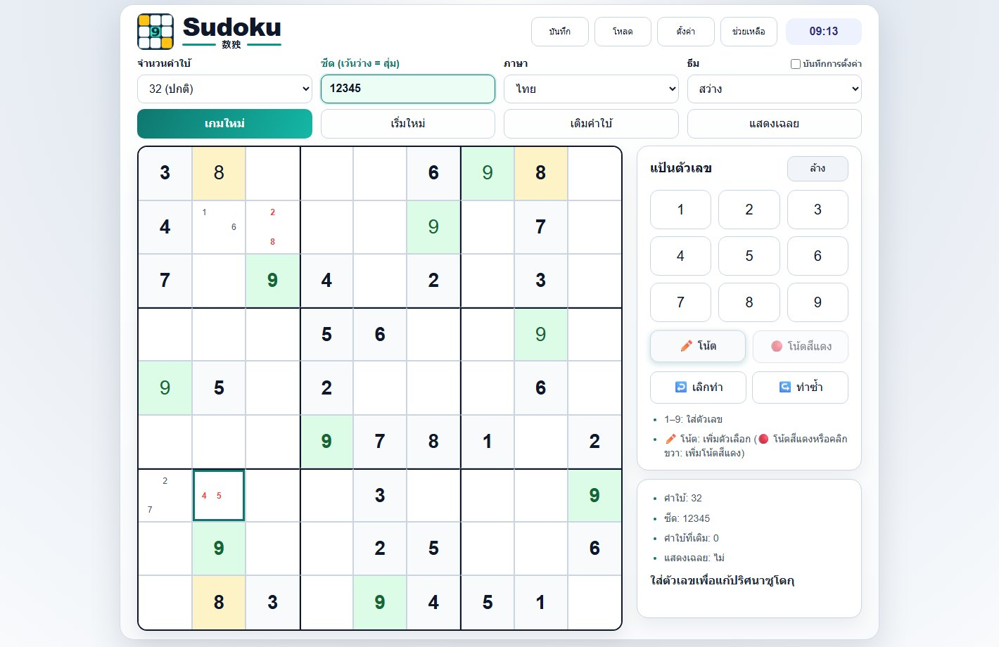
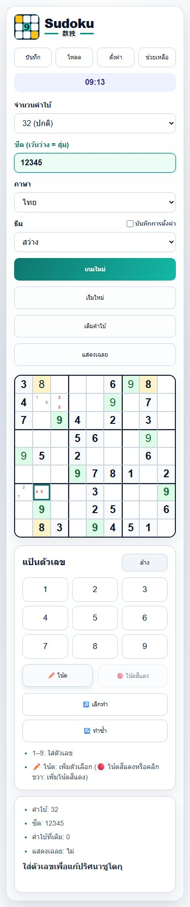

# Sudoku HTML — ไทย

[日本語](./README.ja.md) | [English](../../README.md) | [简体中文](./README.zh-CN.md) | [हिन्दी](./README.hi.md) | [Español](./README.es.md) | [العربية](./README.ar.md) | [Français](./README.fr.md) | [Português (Brasil)](./README.pt-BR.md) | [Português (Portugal)](./README.pt-PT.md) | [Русский](./README.ru.md) | [Deutsch](./README.de.md) | [Bahasa Indonesia](./README.id.md) | [বাংলা](./README.bn.md) | [Türkçe](./README.tr.md) | [한국어](./README.ko.md) | [Tiếng Việt](./README.vi.md) | [Italiano](./README.it.md) | [Nederlands](./README.nl.md) | [Polski](./README.pl.md) | [ไทย](./README.th.md) | [اردو](./README.ur.md) | [فارسی](./README.fa.md) | [Kiswahili](./README.sw.md) | [繁體中文](./README.zh-TW.md) | [Українська](./README.uk.md)

Sudoku HTML เป็นเกมซูโดกุบนเบราว์เซอร์ที่เล่นได้ผ่านไฟล์เดียว `Sudoku_v1.9.0.html` หน้าเว็บออนไลน์ หรือส่วนขยาย Chrome, Edge และ Firefox

| คอมพิวเตอร์ | มือถือ |
| --- | --- |
|  |  |

## วิธีเล่น

[คู่มือเกม](../game-guides/GAME_GUIDE.th.md)

เลือกรูปแบบการเล่นที่เหมาะกับคุณ:

| เวอร์ชัน | วิธีเล่น |
| --- | --- |
| **ดาวน์โหลดไฟล์ HTML** | [Sudoku_v1.9.0.html](https://github.com/piccoripico/sudoku-html/releases/latest/download/Sudoku_v1.9.0.html) เปิดไฟล์ที่ดาวน์โหลดโดยตรงในเบราว์เซอร์เพื่อเล่นแบบออฟไลน์ |
| **เล่นออนไลน์** | <https://piccoripico.github.io/sudoku-html/> เปิดเกมเดียวกันบนเว็บไซต์ เมื่อหน้าโหลดแล้วจะเล่นต่อได้โดยไม่ใช้อินเทอร์เน็ตตลอดเซสชันนั้น |
| **ติดตั้งส่วนขยายเบราว์เซอร์** | เมื่อติดตั้งแล้ว คลิกไอคอนแถบเครื่องมือเพื่อเปิด One-Click Sudoku ในแท็บเบราว์เซอร์ปกติและเล่นแบบออฟไลน์     |

## คุณสมบัติ

- **พกพาสะดวก**: แอปทั้งหมดอยู่ในไฟล์ `Sudoku_v1.9.0.html` เพียงไฟล์เดียว เก็บไว้ในคอมพิวเตอร์หรือโทรศัพท์เพื่อใช้ได้ทุกที่
- **ออฟไลน์**: หลังดาวน์โหลดไฟล์ HTML หรือติดตั้งส่วนขยาย Chrome, Edge หรือ Firefox ก็เล่นได้โดยไม่ต้องเชื่อมต่ออินเทอร์เน็ต
- **หน้าจอเดสก์ท็อปและมือถือ**: เลย์เอาต์ออกแบบให้เหมาะทั้งหน้าจอคอมพิวเตอร์แนวนอนกว้างและหน้าจอโทรศัพท์แนวตั้ง
- **ธีมสว่างและมืด**: เลือกตามระบบ สว่าง หรือมืด โหมดตามระบบจะใช้ชุดสีของระบบปฏิบัติการโดยอัตโนมัติ
- **สร้างกระดานเดิมซ้ำ**: ใช้ Seed เดิมกับจำนวนคำใบ้เท่ากันเพื่อสร้างปริศนาเดิม รวมทั้งตำแหน่งตัวเลขที่ให้มา
- **โน้ต คำใบ้ และประวัติ**: ใช้โน้ตปกติ โน้ตสีแดง เติมคำใบ้ แสดงเฉลย และเลิกทำ/ทำซ้ำขณะเล่น
- **บันทึกและเล่นต่อภายหลัง**: บันทึกกระดาน โน้ต ตัวจับเวลา และประวัติเลิกทำ/ทำซ้ำในไฟล์ JSON ภายในเครื่อง แล้วโหลดเพื่อกลับสู่สถานะเดิม
- **ไม่มีบัญชีหรือบริการภายนอก**: ไม่มีโฆษณา การชำระเงิน บัญชี การวิเคราะห์ การอัปโหลดข้อมูลการเล่น หรือการเก็บข้อมูลผู้ใช้
- **จำนวนกระดานที่สมบูรณ์**: แม่แบบเพียงกลุ่มเดียวสามารถแปลงเป็นกระดานที่เสร็จสมบูรณ์มากกว่าประมาณ 609.5 พันล้านแบบ แอปใช้แม่แบบหลายกลุ่มจึงมีความหลากหลายมากกว่า

## การพัฒนา

1. รัน `npm ci`.
2. รัน `npm run typecheck`.
3. รัน `npm test`.
4. รัน `npm run build`.
5. เมื่อใช้การทดสอบเบราว์เซอร์ครั้งแรก ให้รัน `npm run test:e2e:install`
6. รัน `npm run test:e2e` สำหรับตรวจการทำงานพื้นฐานของเบราว์เซอร์/รันไทม์ หรือ `npm run verify` สำหรับการตรวจทั้งหมดในเครื่อง

`npm run build` สร้างไฟล์ทำงานเดี่ยว `dist/Sudoku_v1.9.0.html` และแพ็กเกจ Manifest V3 ที่แตกไฟล์แล้วใน `dist/extension-chromium` กับ `dist/extension-firefox` ส่วน `npm run verify` ตรวจ TypeScript ยูนิตเทสต์ เงื่อนไขไฟล์ผลลัพธ์ และการทดสอบเบราว์เซอร์/รันไทม์

## ระบบอัตโนมัติ

GitHub Actions ทำงานทดสอบ เผยแพร่ Pages และสร้างไฟล์รุ่นเผยแพร่โดยอัตโนมัติ

- CI: [`.github/workflows/ci.yml`](../../.github/workflows/ci.yml) ทำงานกับ pull request ที่มุ่งไปยัง `main` และเริ่มเองได้จากแท็บ `Actions`
- Pages: [`.github/workflows/pages.yml`](../../.github/workflows/pages.yml) ทำงานเมื่อ push ไปที่ `main` สร้าง `dist/Sudoku_v1.9.0.html` และเผยแพร่บน GitHub Pages: <https://piccoripico.github.io/sudoku-html/>
- Release: [`.github/workflows/release.yml`](../../.github/workflows/release.yml) ทำงานเมื่อ push แท็กเวอร์ชัน เช่น `v1.2.3` และแนบ `Sudoku_v1.9.0.html` ไปยัง GitHub Release อัตโนมัติ
