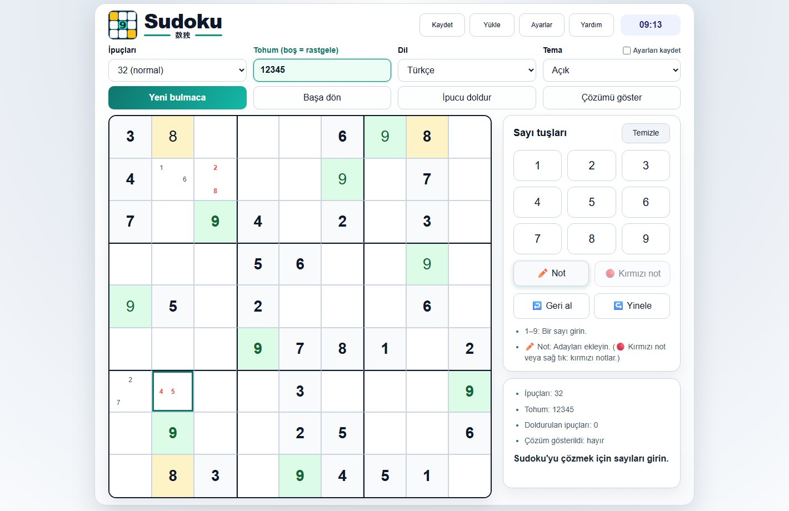
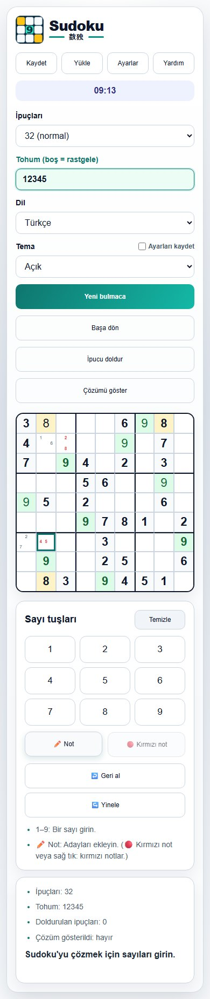

# Sudoku HTML — Türkçe

[日本語](./README.ja.md) | [English](../../README.md) | [简体中文](./README.zh-CN.md) | [हिन्दी](./README.hi.md) | [Español](./README.es.md) | [العربية](./README.ar.md) | [Français](./README.fr.md) | [Português (Brasil)](./README.pt-BR.md) | [Português (Portugal)](./README.pt-PT.md) | [Русский](./README.ru.md) | [Deutsch](./README.de.md) | [Bahasa Indonesia](./README.id.md) | [বাংলা](./README.bn.md) | [Türkçe](./README.tr.md) | [한국어](./README.ko.md) | [Tiếng Việt](./README.vi.md) | [Italiano](./README.it.md) | [Nederlands](./README.nl.md) | [Polski](./README.pl.md) | [ไทย](./README.th.md) | [اردو](./README.ur.md) | [فارسی](./README.fa.md) | [Kiswahili](./README.sw.md) | [繁體中文](./README.zh-TW.md) | [Українська](./README.uk.md)

Sudoku HTML, tek bir `Sudoku_v1.9.0.html` dosyası, çevrimiçi sayfa veya Chrome/Edge/Firefox eklentisi olarak oynanabilen tarayıcı tabanlı bir Sudoku oyunudur.

| Bilgisayar | Telefon |
| --- | --- |
|  |  |

## Nasıl oynanır

[Oyun rehberi](../game-guides/GAME_GUIDE.tr.md)

Oynamak istediğiniz yönteme uygun sürümü seçin:

| Sürüm | Oynama yöntemi |
| --- | --- |
| **HTML dosyasını indirin** | [Sudoku_v1.9.0.html](https://github.com/piccoripico/sudoku-html/releases/latest/download/Sudoku_v1.9.0.html) İndirdiğiniz dosyayı tarayıcıda doğrudan açarak çevrimdışı oynayın. |
| **Çevrimiçi oynayın** | <https://piccoripico.github.io/sudoku-html/> Aynı oyunu çevrimiçi açın. Sayfa yüklendikten sonra bu oturumda internet olmadan oynamaya devam edebilirsiniz. |
| **Tarayıcı eklentisini yükleyin** | Yükledikten sonra araç çubuğu simgesine tıklayarak One-Click Sudoku oyununu normal tarayıcı sekmesinde açıp çevrimdışı oynayın.     |

## Özellikler

- **Taşınabilir**: Uygulamanın tamamı tek bir `Sudoku_v1.9.0.html` dosyasındadır; bilgisayarınıza veya telefonunuza kaydedip her yere götürebilirsiniz.
- **Çevrimdışı**: HTML dosyasını indirdikten veya Chrome/Edge/Firefox eklentisini yükledikten sonra internet olmadan oynayabilirsiniz.
- **Masaüstü/mobil arayüz**: Düzen hem geniş masaüstü ekranlarında hem de dikey telefon ekranlarında rahat kullanılmak üzere tasarlandı.
- **Açık ve koyu temalar**: Sistem, Açık veya Koyu seçin. Sistem modu işletim sisteminin renk düzenini otomatik izler.
- **Tahtayı yeniden oluşturma**: Aynı tohum ve ipucu sayısıyla ipuçlarının konumları da dahil aynı bulmaca yeniden oluşur.
- **Notlar, ipuçları ve geçmiş**: Normal notlar, kırmızı notlar, ipucu doldurma, çözümü gösterme ve Geri al/Yinele özelliklerini kullanın.
- **Kaydedip sonra devam etme**: Tahta, notlar, zamanlayıcı ve Geri al/Yinele geçmişini yerel JSON dosyasına kaydedin; dosyayı yükleyince aynı yerden devam edin.
- **Hesap veya dış hizmet yok**: Reklam, ödeme, hesap, analiz, oyun verisi gönderme veya kullanıcı verisi toplama yoktur.
- **Tamamlanmış tahtaların sayısı**: Tek bir şablon ailesinden dönüşümlerle yaklaşık 609,5 milyardan fazla tamamlanmış tahta üretilebilir. Uygulama birden fazla aile kullanır, böylece çeşitlilik daha fazladır.

## Geliştirme

1. Çalıştırın `npm ci`.
2. Çalıştırın `npm run typecheck`.
3. Çalıştırın `npm test`.
4. Çalıştırın `npm run build`.
5. Tarayıcı testlerini ilk kez kullanırken `npm run test:e2e:install` komutunu çalıştırın.
6. Temel tarayıcı/çalışma zamanı testleri için `npm run test:e2e` veya tüm yerel kontroller için `npm run verify` çalıştırın.

`npm run build`, bağımsız `dist/Sudoku_v1.9.0.html` dosyasını ve açılmış Manifest V3 paketleri `dist/extension-chromium` ile `dist/extension-firefox` klasörlerini üretir. `npm run verify` TypeScript, birim testleri, çıktı kuralları ve tarayıcı/çalışma zamanı testlerini denetler.

## Otomasyon

GitHub Actions testleri, Pages dağıtımını ve sürüm dosyalarının üretimini otomatikleştirir.

- CI: [`.github/workflows/ci.yml`](../../.github/workflows/ci.yml) `main` dalını hedefleyen pull request’lerde çalışır; `Actions` sekmesinden elle de başlatılabilir.
- Pages: [`.github/workflows/pages.yml`](../../.github/workflows/pages.yml) `main` dalına push yapıldığında `dist/Sudoku_v1.9.0.html` dosyasını derleyip GitHub Pages üzerinde yayımlar: <https://piccoripico.github.io/sudoku-html/>.
- Release: [`.github/workflows/release.yml`](../../.github/workflows/release.yml) `v1.2.3` gibi sürüm etiketi push edildiğinde `Sudoku_v1.9.0.html` dosyasını otomatik olarak GitHub Release’e ekler.
