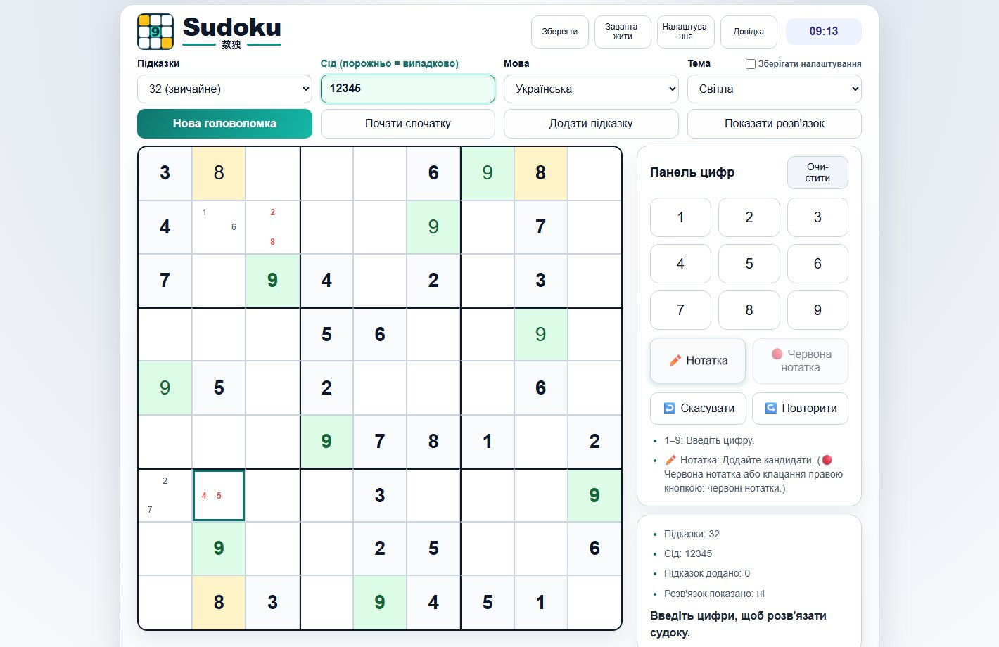
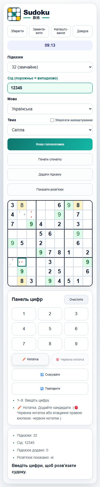

# Sudoku HTML — Українська

[日本語](./README.ja.md) | [English](../../README.md) | [简体中文](./README.zh-CN.md) | [हिन्दी](./README.hi.md) | [Español](./README.es.md) | [العربية](./README.ar.md) | [Français](./README.fr.md) | [Português (Brasil)](./README.pt-BR.md) | [Português (Portugal)](./README.pt-PT.md) | [Русский](./README.ru.md) | [Deutsch](./README.de.md) | [Bahasa Indonesia](./README.id.md) | [বাংলা](./README.bn.md) | [Türkçe](./README.tr.md) | [한국어](./README.ko.md) | [Tiếng Việt](./README.vi.md) | [Italiano](./README.it.md) | [Nederlands](./README.nl.md) | [Polski](./README.pl.md) | [ไทย](./README.th.md) | [اردو](./README.ur.md) | [فارسی](./README.fa.md) | [Kiswahili](./README.sw.md) | [繁體中文](./README.zh-TW.md) | [Українська](./README.uk.md)

Sudoku HTML — браузерна гра в судоку, яку можна запускати з одного файлу `Sudoku_v1.9.0.html`, через онлайнсторінку або як розширення Chrome, Edge чи Firefox.

| Комп’ютер | Телефон |
| --- | --- |
|  |  |

## Як грати

[Посібник із гри](../game-guides/GAME_GUIDE.uk.md)

Виберіть спосіб гри, який вам підходить:

| Версія | Як грати |
| --- | --- |
| **Завантажити HTML-файл** | [Sudoku_v1.9.0.html](https://github.com/piccoripico/sudoku-html/releases/latest/download/Sudoku_v1.9.0.html) Відкрийте завантажений файл безпосередньо у браузері, щоб грати без інтернету. |
| **Грати онлайн** | <https://piccoripico.github.io/sudoku-html/> Відкрийте ту саму гру онлайн. Після завантаження сторінки можна продовжувати гру без інтернету протягом цієї сесії. |
| **Установити розширення** | Після встановлення натисніть значок на панелі інструментів, щоб відкрити One-Click Sudoku у звичайній вкладці й грати офлайн.     |

## Можливості

- **Портативність**: Уся програма міститься в одному файлі `Sudoku_v1.9.0.html`, який можна тримати на комп’ютері чи телефоні та брати із собою.
- **Без інтернету**: Після завантаження HTML-файлу або встановлення розширення Chrome, Edge чи Firefox можна грати без підключення.
- **Інтерфейс для комп’ютера й телефона**: Макет зручний як на широкому моніторі, так і на вертикальному екрані телефона.
- **Світла й темна теми**: Виберіть Системну, Світлу або Темну. Системна автоматично повторює кольори операційної системи.
- **Відтворення поля**: Однаковий сід і кількість підказок відтворюють ту саму головоломку, включно з розташуванням початкових чисел.
- **Нотатки, підказки та історія**: Користуйтеся звичайними й червоними нотатками, підказками, показом розв’язку та скасуванням/повтором.
- **Зберегти й продовжити**: Збережіть поле, нотатки, таймер та історію скасування/повтору в локальний JSON-файл; завантажте його, щоб продовжити з того самого стану.
- **Без облікового запису й зовнішніх служб**: Немає реклами, платежів, облікових записів, аналітики, надсилання ігрових даних або збирання даних користувачів.
- **Кількість готових полів**: Навіть одна родина шаблонів може дати понад приблизно 609,5 мільярда повністю заповнених полів через перетворення. Програма використовує кілька родин, тож варіантів ще більше.

## Розробка

1. Виконайте `npm ci`.
2. Виконайте `npm run typecheck`.
3. Виконайте `npm test`.
4. Виконайте `npm run build`.
5. Перед першим використанням браузерних тестів виконайте `npm run test:e2e:install`.
6. Виконайте `npm run test:e2e` для базових браузерних тестів або `npm run verify` для повного набору локальних перевірок.

`npm run build` створює самодостатній `dist/Sudoku_v1.9.0.html` та розпаковані пакети Manifest V3 у `dist/extension-chromium` і `dist/extension-firefox`. `npm run verify` перевіряє TypeScript, модульні тести, вимоги до результатів збирання й браузерні тести.

## Автоматизація

GitHub Actions автоматизує тестування, розгортання Pages та створення файлів релізу.

- CI: [`.github/workflows/ci.yml`](../../.github/workflows/ci.yml) працює для pull request до `main`; його також можна запустити вручну на вкладці `Actions`.
- Pages: [`.github/workflows/pages.yml`](../../.github/workflows/pages.yml) працює під час push до `main`, збирає `dist/Sudoku_v1.9.0.html` і публікує на GitHub Pages: <https://piccoripico.github.io/sudoku-html/>.
- Release: [`.github/workflows/release.yml`](../../.github/workflows/release.yml) працює під час push тегу версії на кшталт `v1.2.3` й автоматично додає `Sudoku_v1.9.0.html` до GitHub Release.
