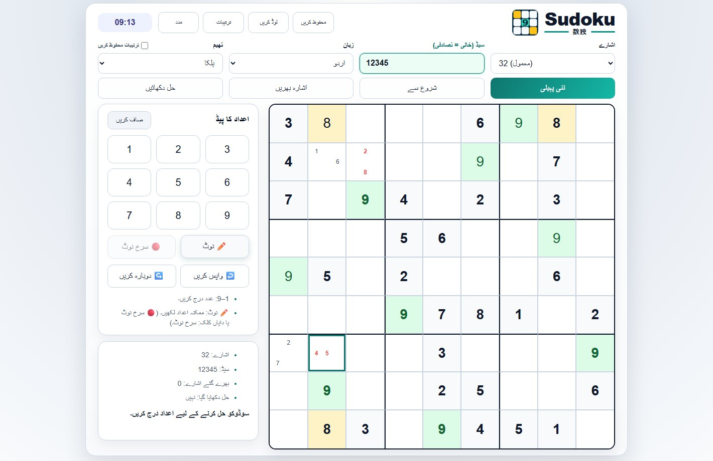

# Sudoku HTML — اردو

[日本語](./README.ja.md) | [English](../../README.md) | [简体中文](./README.zh-CN.md) | [हिन्दी](./README.hi.md) | [Español](./README.es.md) | [العربية](./README.ar.md) | [Français](./README.fr.md) | [Português (Brasil)](./README.pt-BR.md) | [Português (Portugal)](./README.pt-PT.md) | [Русский](./README.ru.md) | [Deutsch](./README.de.md) | [Bahasa Indonesia](./README.id.md) | [বাংলা](./README.bn.md) | [Türkçe](./README.tr.md) | [한국어](./README.ko.md) | [Tiếng Việt](./README.vi.md) | [Italiano](./README.it.md) | [Nederlands](./README.nl.md) | [Polski](./README.pl.md) | [ไทย](./README.th.md) | [اردو](./README.ur.md) | [فارسی](./README.fa.md) | [Kiswahili](./README.sw.md) | [繁體中文](./README.zh-TW.md) | [Українська](./README.uk.md)

Sudoku HTML براؤزر پر چلنے والا سوڈوکو گیم ہے جسے ایک `Sudoku_v1.9.0.html` فائل، آن لائن صفحے یا Chrome، Edge اور Firefox ایکسٹینشن کے ذریعے کھیلا جا سکتا ہے۔

| کمپیوٹر | موبائل |
| --- | --- |
|  |  |

## کیسے کھیلیں

[گیم گائیڈ](../game-guides/GAME_GUIDE.ur.md)

اپنے کھیلنے کے انداز کے مطابق طریقہ منتخب کریں:

| ورژن | کیسے کھیلیں |
| --- | --- |
| **HTML فائل ڈاؤن لوڈ کریں** | [Sudoku_v1.9.0.html](https://github.com/piccoripico/sudoku-html/releases/latest/download/Sudoku_v1.9.0.html) ڈاؤن لوڈ کی گئی فائل براہ راست براؤزر میں کھول کر آف لائن کھیلیں۔ |
| **آن لائن کھیلیں** | <https://piccoripico.github.io/sudoku-html/> اسی گیم کو آن لائن کھولیں۔ صفحہ لوڈ ہونے کے بعد اس سیشن میں انٹرنیٹ کے بغیر بھی کھیل جاری رکھ سکتے ہیں۔ |
| **براؤزر ایکسٹینشن انسٹال کریں** | انسٹال کرنے کے بعد ٹول بار آئیکن پر کلک کرکے One-Click Sudoku عام براؤزر ٹیب میں کھولیں اور آف لائن کھیلیں۔     |

## خصوصیات

- **آسانی سے ساتھ لے جائیں**: پوری ایپ ایک `Sudoku_v1.9.0.html` فائل میں ہے جسے کمپیوٹر یا فون میں محفوظ کرکے کہیں بھی لے جا سکتے ہیں۔
- **آف لائن**: HTML فائل ڈاؤن لوڈ کرنے یا Chrome/Edge/Firefox ایکسٹینشن انسٹال کرنے کے بعد انٹرنیٹ کے بغیر کھیل سکتے ہیں۔
- **ڈیسک ٹاپ اور موبائل UI**: ترتیب چوڑی ڈیسک ٹاپ اسکرین اور لمبی موبائل اسکرین دونوں کے لیے تیار کی گئی ہے۔
- **ہلکی اور گہری تھیم**: سسٹم، لائٹ یا ڈارک منتخب کریں؛ سسٹم موڈ خودکار طور پر آپریٹنگ سسٹم کی رنگ سکیم اپناتا ہے۔
- **بورڈ دوبارہ بنانا**: ایک ہی سیڈ اور ایک ہی اشاروں کی تعداد سے اشاروں کی جگہ سمیت وہی پہیلی دوبارہ بنتی ہے۔
- **نوٹس، اشارے اور تاریخ**: عام نوٹس، سرخ نوٹس، اشارہ بھرنا، حل دکھانا اور Undo/Redo استعمال کریں۔
- **محفوظ کریں اور بعد میں جاری رکھیں**: بورڈ، نوٹس، ٹائمر اور Undo/Redo کی تاریخ مقامی JSON فائل میں محفوظ کرکے وہی حالت دوبارہ لوڈ کریں۔
- **اکاؤنٹ یا بیرونی سروس نہیں**: اشتہار، ادائیگی، اکاؤنٹ، تجزیات، کھیل کے ڈیٹا کی اپ لوڈ یا صارف کی معلومات جمع کرنا شامل نہیں۔
- **مکمل بورڈز کی تعداد**: صرف ایک سانچے کے خاندان سے تبدیلیوں کے ذریعے تقریباً 609.5 ارب سے زیادہ مکمل بورڈ بنائے جا سکتے ہیں۔ ایپ کئی خاندان استعمال کرتی ہے، اس لیے مجموعی تعداد مزید زیادہ ہے۔

## ترقی

1. چلائیں `npm ci`.
2. چلائیں `npm run typecheck`.
3. چلائیں `npm test`.
4. چلائیں `npm run build`.
5. براؤزر ٹیسٹ پہلی مرتبہ چلانے سے پہلے `npm run test:e2e:install` چلائیں۔
6. براؤزر/رن ٹائم کے بنیادی ٹیسٹ کے لیے `npm run test:e2e` یا تمام مقامی جانچ کے لیے `npm run verify` چلائیں۔

`npm run build` ایک خودمختار `dist/Sudoku_v1.9.0.html` اور کھولے ہوئے Manifest V3 ایکسٹینشن پیکج `dist/extension-chromium` اور `dist/extension-firefox` تیار کرتا ہے۔ `npm run verify` TypeScript، یونٹ ٹیسٹ، بلڈ نتائج کی شرائط اور براؤزر/رن ٹائم ٹیسٹ چیک کرتا ہے۔

## خودکاری

GitHub Actions ٹیسٹ، Pages کی اشاعت اور ریلیز فائلیں بنانا خودکار بناتا ہے۔

- CI: [`.github/workflows/ci.yml`](../../.github/workflows/ci.yml) `main` کو ہدف بنانے والی pull request پر چلتا ہے؛ `Actions` ٹیب سے دستی طور پر بھی شروع ہو سکتا ہے۔
- Pages: [`.github/workflows/pages.yml`](../../.github/workflows/pages.yml) `main` پر push ہونے کے بعد `dist/Sudoku_v1.9.0.html` بنا کر GitHub Pages پر شائع کرتا ہے: <https://piccoripico.github.io/sudoku-html/>۔
- Release: [`.github/workflows/release.yml`](../../.github/workflows/release.yml) `v1.2.3` جیسے ورژن ٹیگ کے push پر `Sudoku_v1.9.0.html` خودکار طور پر GitHub Release سے منسلک کرتا ہے۔
