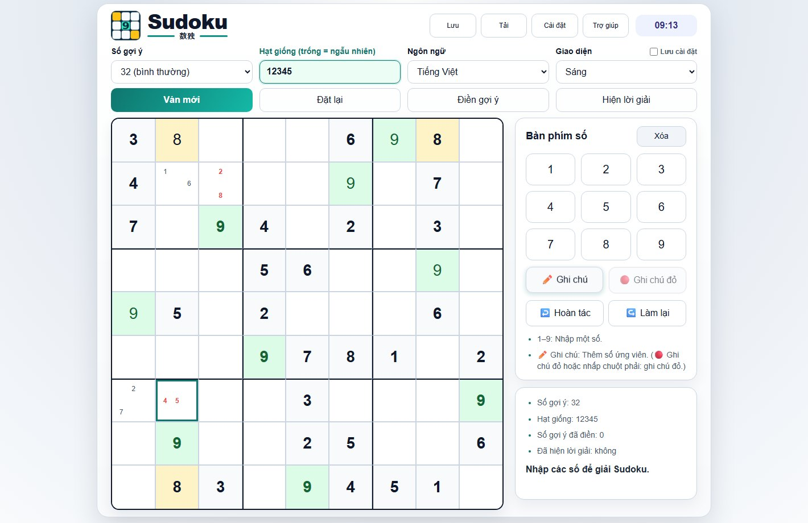
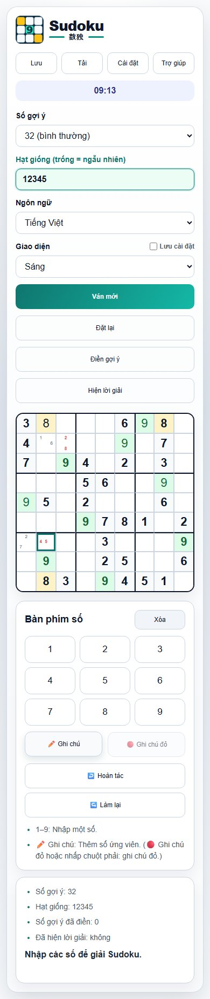

# Sudoku HTML — Tiếng Việt

[日本語](./README.ja.md) | [English](../../README.md) | [简体中文](./README.zh-CN.md) | [हिन्दी](./README.hi.md) | [Español](./README.es.md) | [العربية](./README.ar.md) | [Français](./README.fr.md) | [Português (Brasil)](./README.pt-BR.md) | [Português (Portugal)](./README.pt-PT.md) | [Русский](./README.ru.md) | [Deutsch](./README.de.md) | [Bahasa Indonesia](./README.id.md) | [বাংলা](./README.bn.md) | [Türkçe](./README.tr.md) | [한국어](./README.ko.md) | [Tiếng Việt](./README.vi.md) | [Italiano](./README.it.md) | [Nederlands](./README.nl.md) | [Polski](./README.pl.md) | [ไทย](./README.th.md) | [اردو](./README.ur.md) | [فارسی](./README.fa.md) | [Kiswahili](./README.sw.md) | [繁體中文](./README.zh-TW.md) | [Українська](./README.uk.md)

Sudoku HTML là trò Sudoku chạy trong trình duyệt, có thể chơi từ một tệp `Sudoku_v1.9.0.html`, trang trực tuyến hoặc tiện ích mở rộng Chrome, Edge hay Firefox.

| Máy tính | Điện thoại |
| --- | --- |
|  |  |

## Cách chơi

[Hướng dẫn trò chơi](../game-guides/GAME_GUIDE.vi.md)

Chọn phiên bản phù hợp với cách bạn muốn chơi:

| Phiên bản | Cách chơi |
| --- | --- |
| **Tải tệp HTML** | [Sudoku_v1.9.0.html](https://github.com/piccoripico/sudoku-html/releases/latest/download/Sudoku_v1.9.0.html) Mở tệp đã tải xuống trực tiếp trong trình duyệt để chơi ngoại tuyến. |
| **Chơi trực tuyến** | <https://piccoripico.github.io/sudoku-html/> Mở cùng trò chơi trên mạng. Sau khi trang tải xong, bạn có thể tiếp tục chơi mà không cần mạng trong phiên đó. |
| **Cài tiện ích trình duyệt** | Sau khi cài, nhấp biểu tượng trên thanh công cụ để mở One-Click Sudoku trong thẻ trình duyệt thông thường và chơi ngoại tuyến.     |

## Tính năng

- **Di động**: Toàn bộ ứng dụng nằm trong một tệp `Sudoku_v1.9.0.html`, có thể lưu trên máy tính hoặc điện thoại và mang theo khắp nơi.
- **Ngoại tuyến**: Sau khi tải tệp HTML hoặc cài tiện ích Chrome/Edge/Firefox, trò chơi chạy không cần kết nối mạng.
- **Giao diện máy tính/điện thoại**: Bố cục phù hợp với màn hình máy tính rộng và màn hình điện thoại cao.
- **Giao diện sáng và tối**: Chọn Hệ thống, Sáng hoặc Tối; chế độ Hệ thống tự động theo màu của hệ điều hành.
- **Tái tạo bàn cờ**: Cùng hạt giống và số gợi ý sẽ tái tạo cùng một câu đố, kể cả vị trí các ô gợi ý.
- **Ghi chú, gợi ý và lịch sử**: Có thể dùng ghi chú thường, ghi chú đỏ, điền gợi ý, hiển thị lời giải và hoàn tác/làm lại khi chơi.
- **Lưu và chơi tiếp**: Lưu bàn cờ, ghi chú, đồng hồ và lịch sử hoàn tác/làm lại vào tệp JSON cục bộ; tải lên để tiếp tục đúng trạng thái cũ.
- **Không cần tài khoản hay dịch vụ bên ngoài**: Không quảng cáo, thanh toán, tài khoản, phân tích, tải dữ liệu chơi lên mạng hay thu thập dữ liệu người dùng.
- **Số lượng bàn cờ hoàn chỉnh**: Chỉ một họ mẫu đã có thể tạo ra hơn khoảng 609,5 tỷ bàn hoàn chỉnh nhờ phép biến đổi. Ứng dụng dùng nhiều họ mẫu nên tổng số biến thể còn lớn hơn.

## Phát triển

1. Chạy `npm ci`.
2. Chạy `npm run typecheck`.
3. Chạy `npm test`.
4. Chạy `npm run build`.
5. Lần đầu dùng bài kiểm thử trình duyệt, chạy `npm run test:e2e:install`.
6. Chạy `npm run test:e2e` để kiểm tra cơ bản trình duyệt/runtime hoặc `npm run verify` để kiểm tra đầy đủ trên máy.

`npm run build` tạo tệp độc lập `dist/Sudoku_v1.9.0.html` cùng các gói Manifest V3 đã giải nén ở `dist/extension-chromium` và `dist/extension-firefox`. `npm run verify` kiểm tra TypeScript, unit test, yêu cầu sản phẩm và kiểm thử trình duyệt/runtime.

## Tự động hóa

GitHub Actions tự động chạy kiểm thử, triển khai Pages và tạo sản phẩm phát hành.

- CI: [`.github/workflows/ci.yml`](../../.github/workflows/ci.yml) chạy cho pull request hướng tới `main`, cũng có thể kích hoạt thủ công từ tab `Actions`.
- Pages: [`.github/workflows/pages.yml`](../../.github/workflows/pages.yml) chạy khi push lên `main`, xây dựng `dist/Sudoku_v1.9.0.html` và xuất bản lên GitHub Pages: <https://piccoripico.github.io/sudoku-html/>.
- Release: [`.github/workflows/release.yml`](../../.github/workflows/release.yml) chạy khi push thẻ phiên bản như `v1.2.3` và tự động đính kèm `Sudoku_v1.9.0.html` vào GitHub Release.
