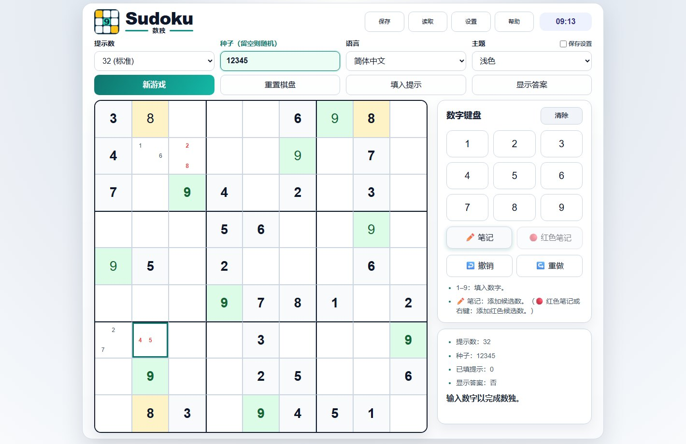
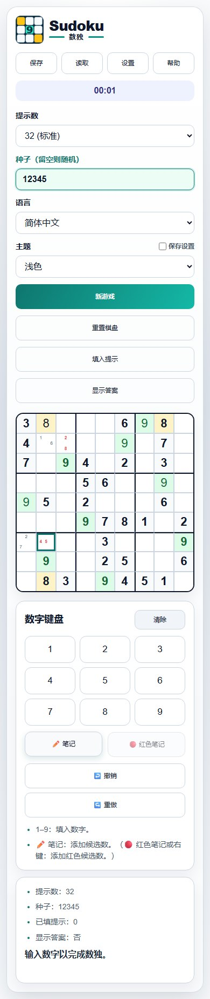

# Sudoku HTML — 数独

[日本語](./README.ja.md) | [English](../../README.md) | [简体中文](./README.zh-CN.md) | [हिन्दी](./README.hi.md) | [Español](./README.es.md) | [العربية](./README.ar.md) | [Français](./README.fr.md) | [Português (Brasil)](./README.pt-BR.md) | [Português (Portugal)](./README.pt-PT.md) | [Русский](./README.ru.md) | [Deutsch](./README.de.md) | [Bahasa Indonesia](./README.id.md) | [বাংলা](./README.bn.md) | [Türkçe](./README.tr.md) | [한국어](./README.ko.md) | [Tiếng Việt](./README.vi.md) | [Italiano](./README.it.md) | [Nederlands](./README.nl.md) | [Polski](./README.pl.md) | [ไทย](./README.th.md) | [اردو](./README.ur.md) | [فارسی](./README.fa.md) | [Kiswahili](./README.sw.md) | [繁體中文](./README.zh-TW.md) | [Українська](./README.uk.md)

Sudoku HTML 是一款浏览器数独游戏，可以通过单个 `Sudoku_v1.9.0.html` 文件、在线网页或 Chrome、Edge、Firefox 扩展运行。

| 桌面版 | 手机版 |
| --- | --- |
|  |  |

## 开始游戏

[游戏指南](../game-guides/GAME_GUIDE.zh-CN.md)

请选择适合自己的游戏方式：

| 版本 | 使用方法 |
| --- | --- |
| **下载 HTML 文件** | [Sudoku_v1.9.0.html](https://github.com/piccoripico/sudoku-html/releases/latest/download/Sudoku_v1.9.0.html) 直接在浏览器中打开下载的文件，即可离线游玩。 |
| **在线游玩** | <https://piccoripico.github.io/sudoku-html/> 在线打开同一个游戏。页面加载完成后，本次会话期间即使断网也可继续游玩。 |
| **安装浏览器扩展** | 安装后点击工具栏图标，即可在普通浏览器标签页打开 One-Click Sudoku 并离线游玩。     |

## 主要功能

- **便携**：整个应用打包为单个 `Sudoku_v1.9.0.html` 文件，可以保存在电脑或手机上随身使用。
- **离线**：应用可离线运行；下载该 HTML 文件或安装 Chrome、Edge、Firefox 扩展后，无需联网即可游玩。
- **桌面和移动界面**：布局同时适合横向较宽的电脑屏幕和纵向较长的手机屏幕。
- **浅色与深色主题**：可选跟随系统、浅色或深色；系统模式自动遵循操作系统的配色方案。
- **棋盘可重现**：使用相同的提示数与种子值，可以重新生成完全相同的题目，包括提示数字的位置。
- **笔记、提示与撤销历史**：解题时可使用普通笔记、红色笔记、填入提示、显示答案和撤销/重做。
- **保存并稍后继续**：可将当前棋盘、笔记、计时器和撤销/重做历史保存到本地 JSON 文件，读取后从同一状态继续。
- **不需要账户或外部服务**：没有广告、付费、账户、统计分析、游戏数据上传或用户数据收集。
- **完成盘面数量**：仅一种模板系列通过变换就能生成超过约6095亿种完整棋盘；应用使用多个模板系列，总变化更多。

## 开发

1. 执行 `npm ci`.
2. 执行 `npm run typecheck`.
3. 执行 `npm test`.
4. 执行 `npm run build`.
5. 首次运行浏览器测试时，请执行 `npm run test:e2e:install`。
6. 运行 `npm run test:e2e` 进行浏览器/运行时冒烟测试，或运行 `npm run verify` 完成全部本地检查。

`npm run build` 会生成独立运行的 `dist/Sudoku_v1.9.0.html`，以及解包后的 Manifest V3 扩展目录 `dist/extension-chromium` 和 `dist/extension-firefox`。`npm run verify` 会检查 TypeScript、单元测试、构建产物约束和浏览器运行测试。

## 自动化

GitHub Actions 自动执行测试、Pages 部署以及发行版文件生成。

- CI: [`.github/workflows/ci.yml`](../../.github/workflows/ci.yml) 对以 `main` 为目标的拉取请求运行，也可以从 `Actions` 页面手动启动。
- Pages: [`.github/workflows/pages.yml`](../../.github/workflows/pages.yml) 在推送到 `main` 后运行，将 `dist/Sudoku_v1.9.0.html` 构建并发布至 GitHub Pages：<https://piccoripico.github.io/sudoku-html/>。
- Release: [`.github/workflows/release.yml`](../../.github/workflows/release.yml) 推送 `v1.2.3` 之类的版本标签时运行，自动将 `Sudoku_v1.9.0.html` 添加到 GitHub Release。
