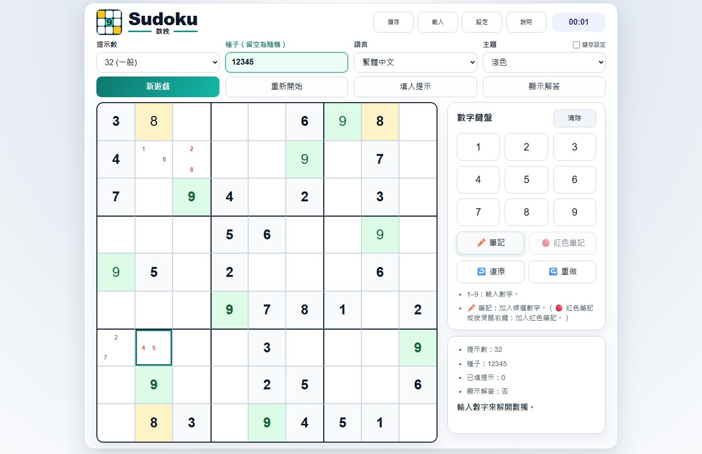
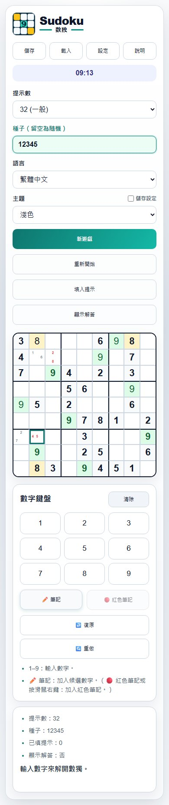

# Sudoku HTML — 繁體中文

[日本語](./README.ja.md) | [English](../../README.md) | [简体中文](./README.zh-CN.md) | [हिन्दी](./README.hi.md) | [Español](./README.es.md) | [العربية](./README.ar.md) | [Français](./README.fr.md) | [Português (Brasil)](./README.pt-BR.md) | [Português (Portugal)](./README.pt-PT.md) | [Русский](./README.ru.md) | [Deutsch](./README.de.md) | [Bahasa Indonesia](./README.id.md) | [বাংলা](./README.bn.md) | [Türkçe](./README.tr.md) | [한국어](./README.ko.md) | [Tiếng Việt](./README.vi.md) | [Italiano](./README.it.md) | [Nederlands](./README.nl.md) | [Polski](./README.pl.md) | [ไทย](./README.th.md) | [اردو](./README.ur.md) | [فارسی](./README.fa.md) | [Kiswahili](./README.sw.md) | [繁體中文](./README.zh-TW.md) | [Українська](./README.uk.md)

Sudoku HTML 是一款瀏覽器數獨遊戲，可透過單一 `Sudoku_v1.9.0.html` 檔案、線上網頁或 Chrome、Edge、Firefox 擴充功能遊玩。

| 電腦 | 手機 |
| --- | --- |
|  |  |

## 玩法說明

[遊戲指南](../game-guides/GAME_GUIDE.zh-TW.md)

請選擇最適合您的遊玩方式：

| 版本 | 使用方式 |
| --- | --- |
| **下載 HTML 檔案** | [Sudoku_v1.9.0.html](https://github.com/piccoripico/sudoku-html/releases/latest/download/Sudoku_v1.9.0.html) 直接在瀏覽器開啟下載的檔案，即可離線遊玩。 |
| **線上遊玩** | <https://piccoripico.github.io/sudoku-html/> 在線上開啟同一款遊戲。頁面載入完成後，本次工作階段中即使離線仍可繼續玩。 |
| **安裝瀏覽器擴充功能** | 安裝後按一下工具列圖示，即可在一般瀏覽器分頁開啟 One-Click Sudoku 並離線遊玩。     |

## 主要功能

- **方便攜帶**：整個應用程式都封裝在單一 `Sudoku_v1.9.0.html` 檔案中，可儲存於電腦或手機隨身使用。
- **離線**：下載 HTML 檔案或安裝 Chrome、Edge、Firefox 擴充功能後，無須連線也可遊玩。
- **桌面及手機介面**：版面適合寬幅電腦螢幕及直向手機螢幕使用。
- **淺色與深色主題**：可選系統、淺色或深色；系統模式會自動依照作業系統的配色設定。
- **重現棋盤**：使用相同的種子及提示數，即可重新產生相同的題目，包括提示數字的位置。
- **筆記、提示與復原紀錄**：遊玩時可使用一般筆記、紅色筆記、填入提示、顯示解答及復原/重做。
- **儲存後繼續**：可將目前棋盤、筆記、計時器及復原/重做紀錄存成電腦上的 JSON 檔案，載入後從相同狀態繼續。
- **無須帳號或外部服務**：沒有廣告、付費、帳號、分析、遊戲資料上傳或使用者資料收集。
- **完整棋盤數量**：僅一個範本系列經過變換，就能產生超過約6,095億種完整棋盤；程式使用多個系列，因此整體變化更多。

## 開發

1. 執行 `npm ci`.
2. 執行 `npm run typecheck`.
3. 執行 `npm test`.
4. 執行 `npm run build`.
5. 第一次使用瀏覽器測試時，請執行 `npm run test:e2e:install`。
6. 執行 `npm run test:e2e` 進行瀏覽器/執行時初步測試，或執行 `npm run verify` 完成所有本機檢查。

`npm run build` 會產生獨立運作的 `dist/Sudoku_v1.9.0.html`，以及已解開的 Manifest V3 擴充功能套件 `dist/extension-chromium` 與 `dist/extension-firefox`。`npm run verify` 會檢查 TypeScript、單元測試、建置成果規則及瀏覽器執行測試。

## 自動化

GitHub Actions 自動執行測試、Pages 部署及版本檔案建立。

- CI: [`.github/workflows/ci.yml`](../../.github/workflows/ci.yml) 在以 `main` 為目標的 pull request 中執行，也可以從 `Actions` 分頁手動啟動。
- Pages: [`.github/workflows/pages.yml`](../../.github/workflows/pages.yml) 推送至 `main` 後執行，建置 `dist/Sudoku_v1.9.0.html` 並發布至 GitHub Pages：<https://piccoripico.github.io/sudoku-html/>。
- Release: [`.github/workflows/release.yml`](../../.github/workflows/release.yml) 推送 `v1.2.3` 等版本標籤時執行，自動將 `Sudoku_v1.9.0.html` 附加至 GitHub Release。
