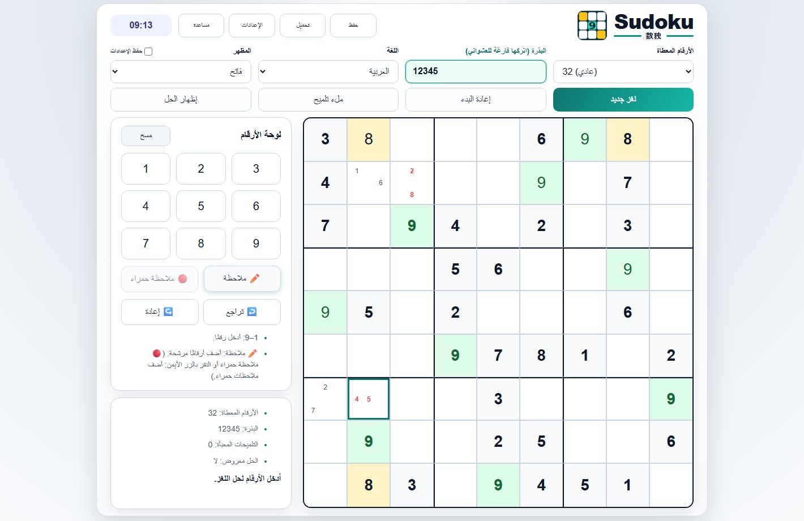
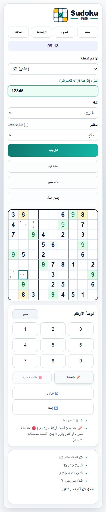

# دليل اللعبة — Sudoku

[日本語](./GAME_GUIDE.ja.md) | [English](./GAME_GUIDE.md) | [简体中文](./GAME_GUIDE.zh-CN.md) | [हिन्दी](./GAME_GUIDE.hi.md) | [Español](./GAME_GUIDE.es.md) | [العربية](./GAME_GUIDE.ar.md) | [Français](./GAME_GUIDE.fr.md) | [Português (Brasil)](./GAME_GUIDE.pt-BR.md) | [Português (Portugal)](./GAME_GUIDE.pt-PT.md) | [Русский](./GAME_GUIDE.ru.md) | [Deutsch](./GAME_GUIDE.de.md) | [Bahasa Indonesia](./GAME_GUIDE.id.md) | [বাংলা](./GAME_GUIDE.bn.md) | [Türkçe](./GAME_GUIDE.tr.md) | [한국어](./GAME_GUIDE.ko.md) | [Tiếng Việt](./GAME_GUIDE.vi.md) | [Italiano](./GAME_GUIDE.it.md) | [Nederlands](./GAME_GUIDE.nl.md) | [Polski](./GAME_GUIDE.pl.md) | [ไทย](./GAME_GUIDE.th.md) | [اردو](./GAME_GUIDE.ur.md) | [فارسی](./GAME_GUIDE.fa.md) | [Kiswahili](./GAME_GUIDE.sw.md) | [繁體中文](./GAME_GUIDE.zh-TW.md) | [Українська](./GAME_GUIDE.uk.md)

| حاسوب | هاتف |
| --- | --- |
|  |  |

## ابدأ اللعب

- اختر خلية وأدخل رقمًا من 1 إلى 9.
- يجب أن يحتوي كل صف وعمود ومربع 3×3 محاط بخطوط سميكة على الأرقام من 1 إلى 9 مرة واحدة لكل رقم.
- كل لغز يتم إنشاؤه له حل صحيح واحد.
- يمكن اللعب دون اتصال؛ اللعب لا يحتاج إلى الشبكة.

## الإعدادات والأزرار أعلى اللوحة

- `الأرقام المعطاة`: تحدد عدد الأرقام الموجودة عند بدء لغز جديد.
- `البذرة`: استخدام البذرة نفسها مع العدد نفسه يعطي اللغز نفسه؛ تركها فارغة يعطي لغزًا عشوائيًا.
- `اللغة`: تغيير لغة الواجهة.
- `المظهر`: اختيار النظام أو الفاتح أو الداكن؛ وضع النظام يتبع الجهاز.
- `حفظ الإعدادات`: عند تفعيل `حفظ الإعدادات` تُخزَّن حالة التفعيل نفسها و`عدد الخانات المعطاة` و`البذرة` و`اللغة` و`السمة` وخيارا التمييز في التخزين المحلي، وتُستعاد عند فتح التطبيق مجدداً. يكون `حفظ الإعدادات` معطّلاً افتراضياً، لذلك لا تُحفظ أي تفضيلات في المتصفح عند البدء.
- `لغز جديد`: إنشاء لغز بالإعدادات الحالية.
- `إعادة البدء`: استعادة اللوحة الأولية وإعادة ضبط المؤقت.
- `ملء تلميح`: ملء خلية فارغة بالرقم الصحيح.
- `إظهار الحل`: عرض الحل كاملًا.
- `حفظ`: حفظ اللوحة والملاحظات والوقت وسجل التراجع والإعادة في ملف JSON.
- `تحميل`: استعادة الحالة من ملف JSON محفوظ.
- `الإعدادات`: تشغيل أو إيقاف تمييز الأرقام المكتملة بشكل صحيح والأرقام المكررة، كلٌّ على حدة.
- `مساعدة`: فتح المساعدة دون اتصال.

## التفضيلات المحفوظة في المتصفح

- يكون `حفظ الإعدادات` معطّلاً افتراضياً، لذلك لا تُحفظ أي تفضيلات في المتصفح عند البدء.
- عند تفعيل `حفظ الإعدادات` تُخزَّن حالة التفعيل نفسها و`عدد الخانات المعطاة` و`البذرة` و`اللغة` و`السمة` وخيارا التمييز في التخزين المحلي، وتُستعاد عند فتح التطبيق مجدداً.
- عند إيقاف `حفظ الإعدادات` تُحذف جميع هذه التفضيلات. إذا تُرك حقل البذرة فارغاً فلن تُحفظ أي بذرة حتى مع تفعيل الحفظ.
- هذه التفضيلات منفصلة عن ملف JSON لحالة اللعبة الذي ينشئه زر `حفظ`. لا تُحفظ اللوحة والملاحظات والمؤقّت وسجل التراجع/الإعادة تلقائياً.

## الماوس واللمس

- `اختيار خلية`: اختر خلية من اللوحة.
- `إدخال رقم`: استخدم لوحة الأرقام لإدخال رقم.
- `مسح`: امسح الخلية المحددة.
- `✏️ ملاحظة`: بدّل إلى وضع إدخال الملاحظات؛ إدخال رقم فيه يضيف ملاحظة.
- `🔴 ملاحظة حمراء`: بدّل إلى الملاحظات الحمراء؛ في وضع الملاحظات يمكن أيضاً النقر بزر الفأرة الأيمن على رقم لإدخال ملاحظة حمراء.
- `↩️ تراجع`: تراجع عن آخر إدخال أو ملاحظة.
- `↪️ إعادة`: أعِد إدخالاً أو ملاحظة سبق التراجع عنها.

## لوحة المفاتيح

- مفاتيح الأسهم: انتقل بين الخلايا.
- `1`–`9`: أدخل رقماً.
- `0` / `Backspace` / `Delete`: امسح الخلية المحددة.
- `Enter`: بدّل وضع الملاحظات.
- `Shift+1`–`9`: أدخل ملاحظة حمراء.
- `Ctrl+Z`: تراجع عن آخر إدخال أو ملاحظة.
- `Ctrl+Y` or `Ctrl+Shift+Z`: أعِد إدخالاً أو ملاحظة سبق التراجع عنها.
