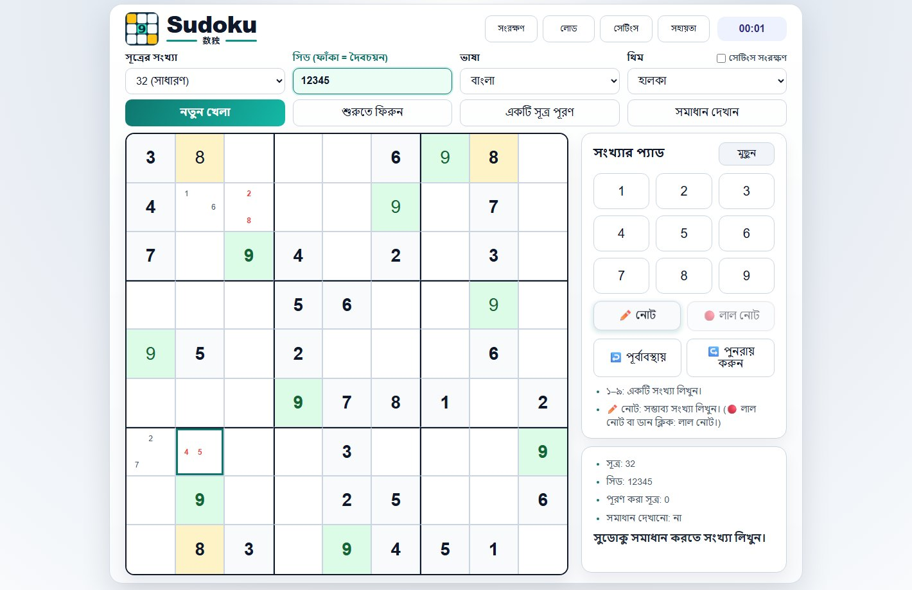
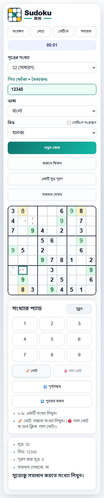

# কীভাবে খেলবেন — Sudoku

[日本語](./GAME_GUIDE.ja.md) | [English](./GAME_GUIDE.md) | [简体中文](./GAME_GUIDE.zh-CN.md) | [हिन्दी](./GAME_GUIDE.hi.md) | [Español](./GAME_GUIDE.es.md) | [العربية](./GAME_GUIDE.ar.md) | [Français](./GAME_GUIDE.fr.md) | [Português (Brasil)](./GAME_GUIDE.pt-BR.md) | [Português (Portugal)](./GAME_GUIDE.pt-PT.md) | [Русский](./GAME_GUIDE.ru.md) | [Deutsch](./GAME_GUIDE.de.md) | [Bahasa Indonesia](./GAME_GUIDE.id.md) | [বাংলা](./GAME_GUIDE.bn.md) | [Türkçe](./GAME_GUIDE.tr.md) | [한국어](./GAME_GUIDE.ko.md) | [Tiếng Việt](./GAME_GUIDE.vi.md) | [Italiano](./GAME_GUIDE.it.md) | [Nederlands](./GAME_GUIDE.nl.md) | [Polski](./GAME_GUIDE.pl.md) | [ไทย](./GAME_GUIDE.th.md) | [اردو](./GAME_GUIDE.ur.md) | [فارسی](./GAME_GUIDE.fa.md) | [Kiswahili](./GAME_GUIDE.sw.md) | [繁體中文](./GAME_GUIDE.zh-TW.md) | [Українська](./GAME_GUIDE.uk.md)

| কম্পিউটার | মোবাইল |
| --- | --- |
|  |  |

## কীভাবে খেলবেন

- একটি ঘর বেছে নিয়ে ১ থেকে ৯ পর্যন্ত সংখ্যা লিখুন।
- প্রতিটি সারি, কলাম ও মোটা রেখায় ঘেরা 3×3 ব্লকে 1 থেকে 9 পর্যন্ত প্রতিটি সংখ্যা ঠিক একবার থাকতে হবে।
- প্রতিটি তৈরি করা সুডোকুর ঠিক একটি সমাধান আছে।
- ইন্টারনেট ছাড়াই খেলতে পারবেন; খেলার সময় সংযোগ লাগে না।

## সেটিংস ও বোতাম

- `সূত্রের সংখ্যা`: পরের খেলার শুরুর সংখ্যার পরিমাণ নির্ধারণ করে।
- `সিড (ফাঁকা = দৈবচয়ন)`: একই সিড ও সূত্রের সংখ্যা একই বোর্ড তৈরি করে; ফাঁকা রাখলে দৈবচয়ন।
- `ভাষা`: ইন্টারফেসের ভাষা বদলায়।
- `থিম`: সিস্টেম, হালকা বা গাঢ় থিম বেছে নিন।
- `সেটিংস সংরক্ষণ`: চালু করলে চালু থাকার অবস্থাসহ `সূত্র সংখ্যা`, `সিড`, `ভাষা`, `থিম` এবং দুটি হাইলাইট বিকল্প লোকাল স্টোরেজে সংরক্ষিত হয় ও পরেরবার খুললে ফিরিয়ে আনা হয়। `সেটিংস সংরক্ষণ` ডিফল্টভাবে বন্ধ থাকে, তাই শুরুতে ব্রাউজারে কোনো পছন্দ সংরক্ষিত হয় না।
- `নতুন খেলা`: বর্তমান সেটিংস দিয়ে নতুন সুডোকু তৈরি করে।
- `শুরুতে ফিরুন`: শুরুর বোর্ড ফিরিয়ে আনে ও সময় নতুন করে শুরু করে।
- `একটি সূত্র পূরণ`: একটি খালি ঘরে সঠিক সংখ্যা বসায়।
- `সমাধান দেখান`: সম্পূর্ণ সমাধান দেখায়।
- `সংরক্ষণ`: বোর্ড, নোট, সময় ও ইতিহাস JSON ফাইলে রাখে।
- `লোড`: JSON ফাইল থেকে সংরক্ষিত খেলা ফেরায়।
- `সেটিংস`: সঠিকভাবে সম্পূর্ণ সংখ্যা ও পুনরাবৃত্ত সংখ্যার হাইলাইট আলাদাভাবে চালু বা বন্ধ করে।
- `সহায়তা`: অফলাইনে সহায়তা দেখায়।

## ব্রাউজারে সংরক্ষিত পছন্দ

- `সেটিংস সংরক্ষণ` ডিফল্টভাবে বন্ধ থাকে, তাই শুরুতে ব্রাউজারে কোনো পছন্দ সংরক্ষিত হয় না।
- চালু করলে চালু থাকার অবস্থাসহ `সূত্র সংখ্যা`, `সিড`, `ভাষা`, `থিম` এবং দুটি হাইলাইট বিকল্প লোকাল স্টোরেজে সংরক্ষিত হয় ও পরেরবার খুললে ফিরিয়ে আনা হয়।
- `সেটিংস সংরক্ষণ` বন্ধ করলে এই সব পছন্দ মুছে যায়। সিড ঘর খালি থাকলে সংরক্ষণ চালু থাকলেও কোনো সিড সংরক্ষিত হয় না।
- এই পছন্দগুলি `সংরক্ষণ` বোতামে তৈরি গেমের JSON ফাইলের থেকে আলাদা। বোর্ড, নোট, টাইমার ও পূর্বাবস্থা/পুনরায় করার ইতিহাস স্বয়ংক্রিয়ভাবে সংরক্ষিত হয় না।

## মাউস ও স্পর্শ

- `ঘর বাছুন`: বোর্ডের একটি ঘর বেছে নিন।
- `সংখ্যা লিখুন`: নম্বর প্যাড দিয়ে একটি সংখ্যা লিখুন।
- `মুছুন`: নির্বাচিত ঘর মুছুন।
- `✏️ নোট`: নোট মোড চালু করুন; এতে সংখ্যা লিখলে একটি নোট যুক্ত হয়।
- `🔴 লাল নোট`: লাল নোট চালু করুন; নোট মোডে মাউসের ডান বোতামে সংখ্যা ক্লিক করেও লাল নোট দেওয়া যায়।
- `↩️ পূর্বাবস্থায়`: সর্বশেষ সংখ্যা বা নোটের কাজটি বাতিল করুন।
- `↪️ পুনরায় করুন`: বাতিল করা সংখ্যা বা নোটের কাজটি আবার করুন।

## কীবোর্ড

- তীরচিহ্নের কী: এক ঘর থেকে অন্য ঘরে যান।
- `1`–`9`: একটি সংখ্যা লিখুন।
- `0` / `Backspace` / `Delete`: নির্বাচিত ঘর মুছুন।
- `Enter`: নোট মোড বদলান।
- `Shift+1`–`9`: লাল নোট লিখুন।
- `Ctrl+Z`: সর্বশেষ সংখ্যা বা নোটের কাজটি বাতিল করুন।
- `Ctrl+Y` or `Ctrl+Shift+Z`: বাতিল করা সংখ্যা বা নোটের কাজটি আবার করুন।
