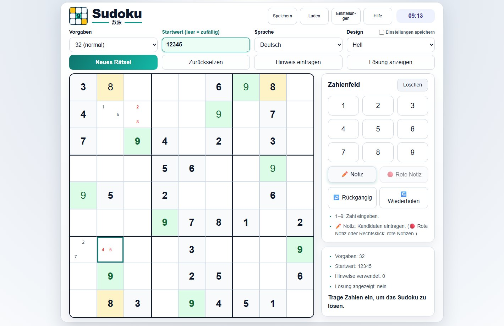
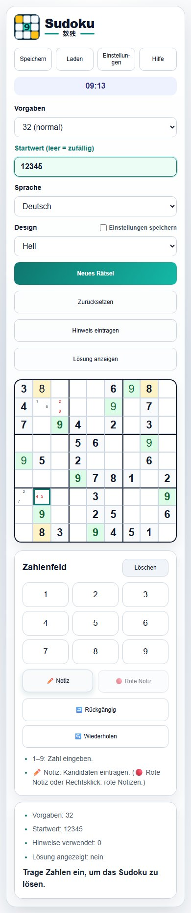

# Spielanleitung — Sudoku

[日本語](./GAME_GUIDE.ja.md) | [English](./GAME_GUIDE.md) | [简体中文](./GAME_GUIDE.zh-CN.md) | [हिन्दी](./GAME_GUIDE.hi.md) | [Español](./GAME_GUIDE.es.md) | [العربية](./GAME_GUIDE.ar.md) | [Français](./GAME_GUIDE.fr.md) | [Português (Brasil)](./GAME_GUIDE.pt-BR.md) | [Português (Portugal)](./GAME_GUIDE.pt-PT.md) | [Русский](./GAME_GUIDE.ru.md) | [Deutsch](./GAME_GUIDE.de.md) | [Bahasa Indonesia](./GAME_GUIDE.id.md) | [বাংলা](./GAME_GUIDE.bn.md) | [Türkçe](./GAME_GUIDE.tr.md) | [한국어](./GAME_GUIDE.ko.md) | [Tiếng Việt](./GAME_GUIDE.vi.md) | [Italiano](./GAME_GUIDE.it.md) | [Nederlands](./GAME_GUIDE.nl.md) | [Polski](./GAME_GUIDE.pl.md) | [ไทย](./GAME_GUIDE.th.md) | [اردو](./GAME_GUIDE.ur.md) | [فارسی](./GAME_GUIDE.fa.md) | [Kiswahili](./GAME_GUIDE.sw.md) | [繁體中文](./GAME_GUIDE.zh-TW.md) | [Українська](./GAME_GUIDE.uk.md)

| Desktop | Mobil |
| --- | --- |
|  |  |

## Spielanleitung

- Wähle eine Zelle aus und trage eine Zahl von 1 bis 9 ein.
- Jede Zeile, Spalte und jeder durch dicke Linien markierte 3×3-Block muss jede Ziffer von 1 bis 9 genau einmal enthalten.
- Jedes erzeugte Rätsel hat genau eine Lösung.
- Du kannst offline spielen; während des Spiels ist keine Verbindung nötig.

## Einstellungen und Schaltflächen

- `Vorgaben`: Legt fest, wie viele Zahlen im nächsten Rätsel vorgegeben sind.
- `Startwert (leer = zufällig)`: Gleicher Startwert und gleiche Vorgabenzahl erzeugen dasselbe Rätsel; leer bedeutet zufällig.
- `Sprache`: Ändert die Sprache der Oberfläche.
- `Design`: Wähle System, Hell oder Dunkel; System folgt deinem Gerät.
- `Einstellungen speichern`: Beim Einschalten werden auch der aktivierte Zustand selbst sowie `Vorgaben`, `Seed`, `Sprache`, `Design` und beide Hervorhebungen im lokalen Speicher abgelegt und beim nächsten Öffnen wiederhergestellt. `Einstellungen speichern` ist standardmäßig ausgeschaltet; anfangs werden keine Einstellungen im Browser gespeichert.
- `Neues Rätsel`: Erzeugt ein neues Rätsel mit den aktuellen Einstellungen.
- `Zurücksetzen`: Stellt das Anfangsrätsel wieder her und setzt die Zeit zurück.
- `Hinweis eintragen`: Trägt einen korrekten Wert in eine freie Zelle ein.
- `Lösung anzeigen`: Zeigt die vollständige Lösung.
- `Speichern`: Speichert Feld, Notizen, Zeit und Verlauf als JSON.
- `Laden`: Lädt einen gespeicherten Spielstand aus JSON.
- `Einstellungen`: Schaltet die Markierung vollständig ausgefüllter und doppelter Zahlen unabhängig ein oder aus.
- `Hilfe`: Öffnet die offline verfügbare Hilfe.

## Im Browser gespeicherte Einstellungen

- `Einstellungen speichern` ist standardmäßig ausgeschaltet; anfangs werden keine Einstellungen im Browser gespeichert.
- Beim Einschalten werden auch der aktivierte Zustand selbst sowie `Vorgaben`, `Seed`, `Sprache`, `Design` und beide Hervorhebungen im lokalen Speicher abgelegt und beim nächsten Öffnen wiederhergestellt.
- Das Ausschalten löscht alle diese Einstellungen. Ist das Seed-Feld leer, wird selbst bei aktivierter Speicherung kein Seed gespeichert.
- Diese Einstellungen sind von der JSON-Datei getrennt, die mit `Speichern` den Spielstand sichert. Spielfeld, Notizen, Timer und Rückgängig/Wiederholen-Verlauf werden nicht automatisch gespeichert.

## Maus und Touch

- `Zelle wählen`: Wählen Sie eine Zelle im Spielfeld.
- `Zahl eingeben`: Geben Sie mit dem Zahlenfeld eine Ziffer ein.
- `Löschen`: Löschen Sie die gewählte Zelle.
- `✏️ Notiz`: Wechseln Sie in den Notizmodus; eine eingegebene Ziffer wird dann als Notiz hinzugefügt.
- `🔴 Rote Notiz`: Wechseln Sie zu roten Notizen; im Notizmodus können Sie eine Ziffer auch mit einem Rechtsklick als rote Notiz eingeben.
- `↩️ Rückgängig`: Machen Sie die letzte Eingabe oder Notiz rückgängig.
- `↪️ Wiederholen`: Stellen Sie eine rückgängig gemachte Eingabe oder Notiz wieder her.

## Tastatur

- Pfeiltasten: Bewegen Sie sich zwischen Zellen.
- `1`–`9`: Geben Sie eine Ziffer ein.
- `0` / `Backspace` / `Delete`: Löschen Sie die gewählte Zelle.
- `Enter`: Wechseln Sie in den Notizmodus.
- `Shift+1`–`9`: Geben Sie eine rote Notiz ein.
- `Ctrl+Z`: Machen Sie die letzte Eingabe oder Notiz rückgängig.
- `Ctrl+Y` or `Ctrl+Shift+Z`: Stellen Sie eine rückgängig gemachte Eingabe oder Notiz wieder her.
