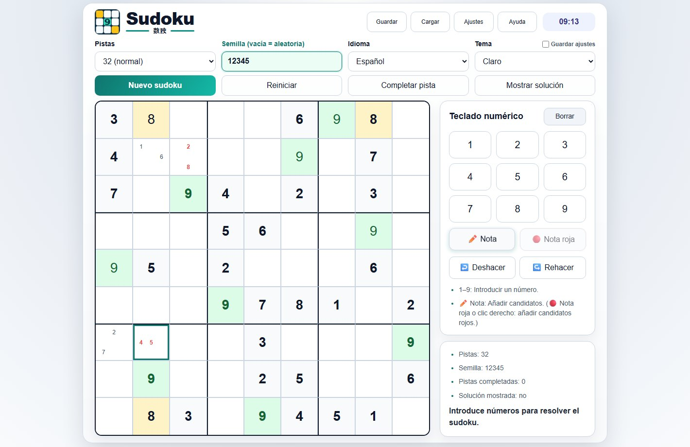
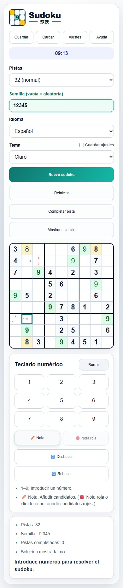

# Guía del juego — Sudoku

[日本語](./GAME_GUIDE.ja.md) | [English](./GAME_GUIDE.md) | [简体中文](./GAME_GUIDE.zh-CN.md) | [हिन्दी](./GAME_GUIDE.hi.md) | [Español](./GAME_GUIDE.es.md) | [العربية](./GAME_GUIDE.ar.md) | [Français](./GAME_GUIDE.fr.md) | [Português (Brasil)](./GAME_GUIDE.pt-BR.md) | [Português (Portugal)](./GAME_GUIDE.pt-PT.md) | [Русский](./GAME_GUIDE.ru.md) | [Deutsch](./GAME_GUIDE.de.md) | [Bahasa Indonesia](./GAME_GUIDE.id.md) | [বাংলা](./GAME_GUIDE.bn.md) | [Türkçe](./GAME_GUIDE.tr.md) | [한국어](./GAME_GUIDE.ko.md) | [Tiếng Việt](./GAME_GUIDE.vi.md) | [Italiano](./GAME_GUIDE.it.md) | [Nederlands](./GAME_GUIDE.nl.md) | [Polski](./GAME_GUIDE.pl.md) | [ไทย](./GAME_GUIDE.th.md) | [اردو](./GAME_GUIDE.ur.md) | [فارسی](./GAME_GUIDE.fa.md) | [Kiswahili](./GAME_GUIDE.sw.md) | [繁體中文](./GAME_GUIDE.zh-TW.md) | [Українська](./GAME_GUIDE.uk.md)

| Escritorio | Móvil |
| --- | --- |
|  |  |

## Jugar

- Selecciona una casilla e introduce un número del 1 al 9.
- Cada fila, columna y bloque de 3×3 delimitado por líneas gruesas debe contener del 1 al 9 exactamente una vez.
- Todas las cuadrículas generadas tienen una única solución.
- Puedes jugar sin internet; la partida no necesita conexión de red.

## Opciones y botones superiores

- `Pistas`: Cantidad de números iniciales para la próxima partida.
- `Semilla`: La misma semilla y cantidad de pistas generan la misma cuadrícula; vacía = aleatoria.
- `Idioma`: Cambia el idioma de la interfaz.
- `Tema`: Elige Sistema, Claro u Oscuro; Sistema sigue el dispositivo.
- `Guardar ajustes`: Al activarlo, se guardan en el almacenamiento local tanto el estado de activación como `Pistas`, `Semilla`, `Idioma`, `Tema` y los dos interruptores de resaltado, y se recuperan al volver a abrir el juego. `Guardar ajustes` está desactivado por defecto, por lo que al principio no se guarda ninguna preferencia en el navegador.
- `Nuevo sudoku`: Genera una partida con las opciones actuales.
- `Reiniciar`: Vuelve al tablero inicial y reinicia el cronómetro.
- `Completar pista`: Rellena una casilla vacía con el número correcto.
- `Mostrar solución`: Muestra la solución completa.
- `Guardar`: Guarda tablero, notas, tiempo e historial de deshacer/rehacer en JSON.
- `Cargar`: Recupera la partida desde un JSON guardado.
- `Ajustes`: Activa o desactiva por separado el resaltado de números completados y de números repetidos.
- `Ayuda`: Abre la ayuda sin conexión.

## Preferencias guardadas en el navegador

- `Guardar ajustes` está desactivado por defecto, por lo que al principio no se guarda ninguna preferencia en el navegador.
- Al activarlo, se guardan en el almacenamiento local tanto el estado de activación como `Pistas`, `Semilla`, `Idioma`, `Tema` y los dos interruptores de resaltado, y se recuperan al volver a abrir el juego.
- Al desactivar `Guardar ajustes`, se eliminan todas estas preferencias. Si la semilla está vacía, no se guarda ningún valor aunque la opción esté activada.
- Estas preferencias son independientes del JSON de la partida creado mediante `Guardar`. El tablero, las notas, el cronómetro y el historial de deshacer/rehacer no se guardan automáticamente.

## Ratón y pantalla táctil

- `Elegir casilla`: Selecciona una casilla del tablero.
- `Introducir número`: Usa el teclado numérico para introducir un número.
- `Borrar`: Borra la casilla seleccionada.
- `✏️ Nota`: Activa o desactiva el modo Nota; al introducir un número con él activo, añades una nota.
- `🔴 Nota roja`: Cambia a notas rojas; mientras estés en modo Nota, también puedes hacer clic derecho en un número para añadir una nota roja.
- `↩️ Deshacer`: Deshace la última entrada o nota.
- `↪️ Rehacer`: Reaplica una entrada o nota deshecha.

## Teclado

- Teclas de flecha: Muévete entre las casillas.
- `1`–`9`: Introduce un número.
- `0` / `Backspace` / `Delete`: Borra la casilla seleccionada.
- `Enter`: Activa el modo Nota.
- `Shift+1`–`9`: Introduce una nota roja.
- `Ctrl+Z`: Deshace la última entrada o nota.
- `Ctrl+Y` or `Ctrl+Shift+Z`: Reaplica una entrada o nota deshecha.
