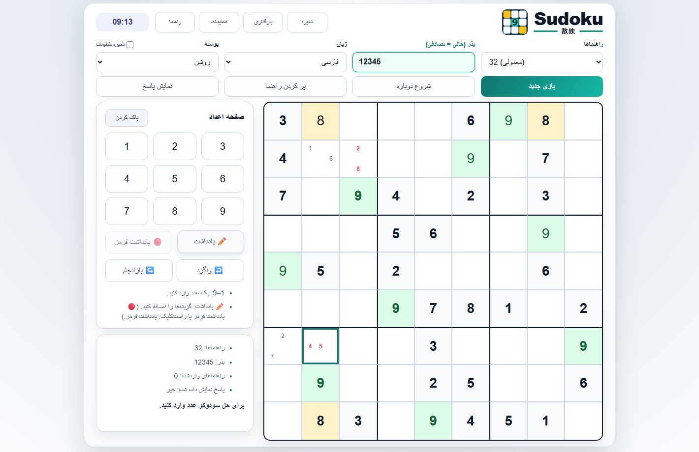
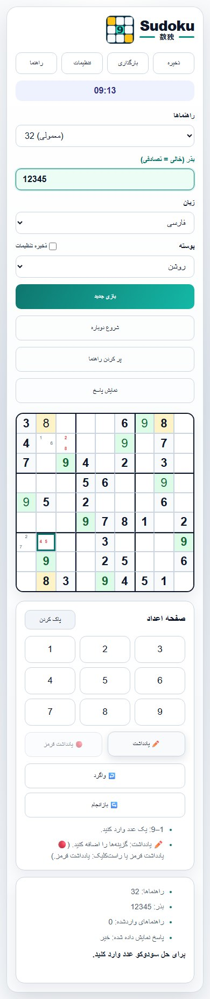

# روش بازی — Sudoku

[日本語](./GAME_GUIDE.ja.md) | [English](./GAME_GUIDE.md) | [简体中文](./GAME_GUIDE.zh-CN.md) | [हिन्दी](./GAME_GUIDE.hi.md) | [Español](./GAME_GUIDE.es.md) | [العربية](./GAME_GUIDE.ar.md) | [Français](./GAME_GUIDE.fr.md) | [Português (Brasil)](./GAME_GUIDE.pt-BR.md) | [Português (Portugal)](./GAME_GUIDE.pt-PT.md) | [Русский](./GAME_GUIDE.ru.md) | [Deutsch](./GAME_GUIDE.de.md) | [Bahasa Indonesia](./GAME_GUIDE.id.md) | [বাংলা](./GAME_GUIDE.bn.md) | [Türkçe](./GAME_GUIDE.tr.md) | [한국어](./GAME_GUIDE.ko.md) | [Tiếng Việt](./GAME_GUIDE.vi.md) | [Italiano](./GAME_GUIDE.it.md) | [Nederlands](./GAME_GUIDE.nl.md) | [Polski](./GAME_GUIDE.pl.md) | [ไทย](./GAME_GUIDE.th.md) | [اردو](./GAME_GUIDE.ur.md) | [فارسی](./GAME_GUIDE.fa.md) | [Kiswahili](./GAME_GUIDE.sw.md) | [繁體中文](./GAME_GUIDE.zh-TW.md) | [Українська](./GAME_GUIDE.uk.md)

| رایانه | تلفن همراه |
| --- | --- |
|  |  |

## روش بازی

- یک خانه انتخاب کنید و عددی از 1 تا 9 وارد کنید.
- هر ردیف، ستون و بلوک 3×3 مشخص‌شده با خطوط ضخیم باید هر عدد 1 تا 9 را دقیقاً یک بار داشته باشد.
- هر جدول تولیدشده دقیقاً یک پاسخ دارد.
- بدون اینترنت بازی کنید؛ هنگام بازی نیازی به اتصال نیست.

## تنظیمات و دکمه‌ها

- `راهنماها`: تعداد عددهای اولیه جدول بعدی را تعیین می‌کند.
- `بذر (خالی = تصادفی)`: بذر و تعداد راهنمای یکسان همان جدول را می‌سازد؛ خالی یعنی تصادفی.
- `زبان`: زبان رابط را تغییر می‌دهد.
- `پوسته`: سیستم، روشن یا تیره را انتخاب کنید؛ سیستم از دستگاه پیروی می‌کند.
- `ذخیره تنظیمات`: با فعال‌کردن آن، خود وضعیت فعال‌بودن همراه با `تعداد راهنماها`، `بذر`، `زبان`، `پوسته` و هر دو گزینه برجسته‌سازی در حافظه محلی ذخیره شده و در بازکردن بعدی بازی بازیابی می‌شوند. `ذخیره تنظیمات` به‌طور پیش‌فرض خاموش است؛ بنابراین در ابتدا هیچ ترجیحی در مرورگر ذخیره نمی‌شود.
- `بازی جدید`: با تنظیمات فعلی جدول جدید می‌سازد.
- `شروع دوباره`: جدول اولیه را بازمی‌گرداند و زمان‌سنج را صفر می‌کند.
- `پر کردن راهنما`: یک خانه خالی را با عدد درست پر می‌کند.
- `نمایش پاسخ`: پاسخ کامل را نمایش می‌دهد.
- `ذخیره`: جدول، یادداشت‌ها، زمان و تاریخچه را در JSON ذخیره می‌کند.
- `بارگذاری`: بازی ذخیره‌شده را از فایل JSON بارگذاری می‌کند.
- `تنظیمات`: برجسته‌سازی اعداد کامل‌شده و اعداد تکراری را جداگانه روشن یا خاموش می‌کند.
- `راهنما`: راهنمای قابل استفاده آفلاین را باز می‌کند.

## تنظیمات ذخیره‌شده در مرورگر

- `ذخیره تنظیمات` به‌طور پیش‌فرض خاموش است؛ بنابراین در ابتدا هیچ ترجیحی در مرورگر ذخیره نمی‌شود.
- با فعال‌کردن آن، خود وضعیت فعال‌بودن همراه با `تعداد راهنماها`، `بذر`، `زبان`، `پوسته` و هر دو گزینه برجسته‌سازی در حافظه محلی ذخیره شده و در بازکردن بعدی بازی بازیابی می‌شوند.
- خاموش‌کردن `ذخیره تنظیمات` همه این ترجیحات را پاک می‌کند. اگر کادر بذر خالی باشد حتی با فعال‌بودن ذخیره، مقداری برای بذر ذخیره نمی‌شود.
- این تنظیمات از فایل JSON وضعیت بازی که با `ذخیره` ساخته می‌شود جدا هستند. جدول فعلی، یادداشت‌ها، زمان‌سنج و تاریخچه بازگشت/تکرار به‌طور خودکار ذخیره نمی‌شوند.

## ماوس و لمس

- `انتخاب خانه`: یک خانه از جدول را انتخاب کنید.
- `وارد کردن عدد`: با صفحه اعداد عددی وارد کنید.
- `پاک کردن`: خانه انتخاب‌شده را پاک کنید.
- `✏️ یادداشت`: به حالت یادداشت بروید؛ واردکردن عدد در این حالت یادداشت اضافه می‌کند.
- `🔴 یادداشت قرمز`: به یادداشت قرمز بروید؛ در حالت یادداشت می‌توانید با راست‌کلیک روی عدد هم یادداشت قرمز وارد کنید.
- `↩️ واگرد`: آخرین ورود عدد یا یادداشت را برگردانید.
- `↪️ بازانجام`: عدد یا یادداشت بازگردانده‌شده را دوباره اجرا کنید.

## صفحه‌کلید

- کلیدهای جهت‌نما: بین خانه‌ها حرکت کنید.
- `1`–`9`: عددی وارد کنید.
- `0` / `Backspace` / `Delete`: خانه انتخاب‌شده را پاک کنید.
- `Enter`: حالت یادداشت را تغییر دهید.
- `Shift+1`–`9`: یادداشت قرمز وارد کنید.
- `Ctrl+Z`: آخرین ورود عدد یا یادداشت را برگردانید.
- `Ctrl+Y` or `Ctrl+Shift+Z`: عدد یا یادداشت بازگردانده‌شده را دوباره اجرا کنید.
