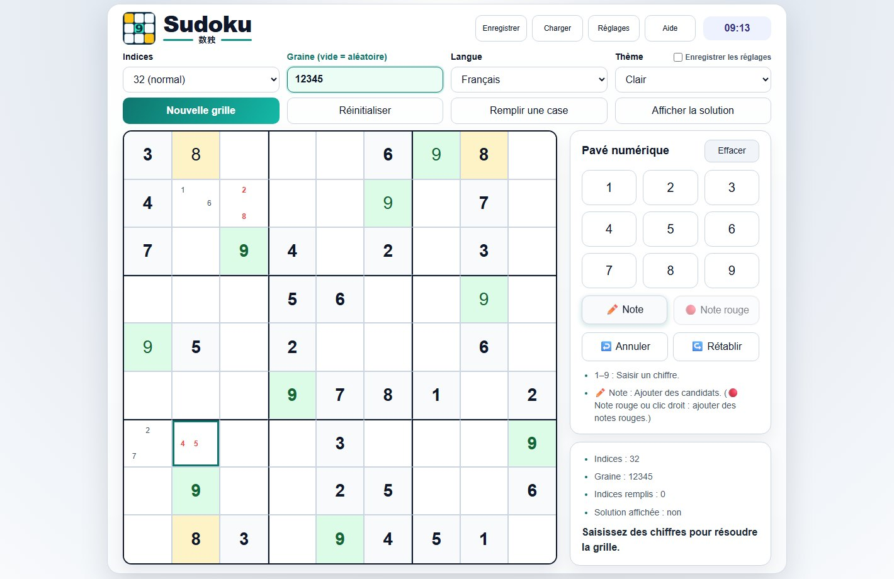
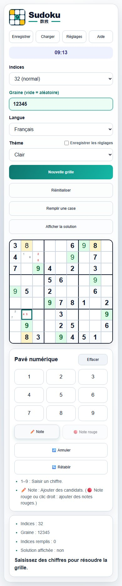

# Guide du jeu — Sudoku

[日本語](./GAME_GUIDE.ja.md) | [English](./GAME_GUIDE.md) | [简体中文](./GAME_GUIDE.zh-CN.md) | [हिन्दी](./GAME_GUIDE.hi.md) | [Español](./GAME_GUIDE.es.md) | [العربية](./GAME_GUIDE.ar.md) | [Français](./GAME_GUIDE.fr.md) | [Português (Brasil)](./GAME_GUIDE.pt-BR.md) | [Português (Portugal)](./GAME_GUIDE.pt-PT.md) | [Русский](./GAME_GUIDE.ru.md) | [Deutsch](./GAME_GUIDE.de.md) | [Bahasa Indonesia](./GAME_GUIDE.id.md) | [বাংলা](./GAME_GUIDE.bn.md) | [Türkçe](./GAME_GUIDE.tr.md) | [한국어](./GAME_GUIDE.ko.md) | [Tiếng Việt](./GAME_GUIDE.vi.md) | [Italiano](./GAME_GUIDE.it.md) | [Nederlands](./GAME_GUIDE.nl.md) | [Polski](./GAME_GUIDE.pl.md) | [ไทย](./GAME_GUIDE.th.md) | [اردو](./GAME_GUIDE.ur.md) | [فارسی](./GAME_GUIDE.fa.md) | [Kiswahili](./GAME_GUIDE.sw.md) | [繁體中文](./GAME_GUIDE.zh-TW.md) | [Українська](./GAME_GUIDE.uk.md)

| Ordinateur | Mobile |
| --- | --- |
|  |  |

## Jouer

- Sélectionnez une case et saisissez un chiffre de 1 à 9.
- Chaque ligne, colonne et bloc 3×3 délimité par des traits épais doit contenir chaque chiffre de 1 à 9 exactement une fois.
- Chaque grille générée admet une seule solution.
- Le jeu fonctionne sans Internet et ne nécessite aucune connexion pendant une partie.

## Réglages et boutons en haut

- `Indices`: Définit le nombre de chiffres de départ pour la prochaine grille.
- `Graine`: Même graine et même nombre d’indices : même grille. Laisser vide pour le hasard.
- `Langue`: Change la langue de l’interface.
- `Thème`: Choisissez Système, Clair ou Sombre. Système suit les réglages de l’appareil.
- `Enregistrer les réglages`: En l’activant, son état actif, `Indices`, `Graine`, `Langue`, `Thème` et les deux interrupteurs de surlignage sont enregistrés dans le stockage local puis restaurés à la prochaine ouverture. `Enregistrer les réglages` est désactivé par défaut : aucune préférence n’est initialement stockée dans le navigateur.
- `Nouvelle grille`: Génère une grille avec les réglages actuels.
- `Réinitialiser`: Rétablit la grille initiale et remet le chronomètre à zéro.
- `Remplir une case`: Insère le bon chiffre dans une case vide.
- `Afficher la solution`: Affiche la solution complète.
- `Enregistrer`: Enregistre grille, notes, temps et historique Annuler/Rétablir en JSON.
- `Charger`: Restaure une partie depuis un fichier JSON.
- `Réglages`: Active ou désactive séparément le surlignage des chiffres complétés et des doublons.
- `Aide`: Ouvre l’aide hors ligne.

## Préférences enregistrées dans le navigateur

- `Enregistrer les réglages` est désactivé par défaut : aucune préférence n’est initialement stockée dans le navigateur.
- En l’activant, son état actif, `Indices`, `Graine`, `Langue`, `Thème` et les deux interrupteurs de surlignage sont enregistrés dans le stockage local puis restaurés à la prochaine ouverture.
- Désactiver `Enregistrer les réglages` supprime toutes ces préférences. Si le champ de graine est vide, aucune graine n’est conservée, même quand l’enregistrement est activé.
- Ces préférences sont distinctes du fichier JSON d’état de partie créé par `Enregistrer`. La grille, les notes, le chronomètre et l’historique Annuler/Rétablir ne sont pas sauvegardés automatiquement.

## Souris et tactile

- `Choisir une case`: Sélectionnez une case de la grille.
- `Saisir un chiffre`: Utilisez le pavé numérique pour saisir un chiffre.
- `Effacer`: Effacez la case sélectionnée.
- `✏️ Note`: Passez en mode Note ; saisir un chiffre dans ce mode ajoute une note.
- `🔴 Note rouge`: Passez aux notes rouges ; en mode Note, un clic droit sur un chiffre permet aussi de saisir une note rouge.
- `↩️ Annuler`: Annulez la dernière saisie ou note.
- `↪️ Rétablir`: Rétablissez une saisie ou une note annulée.

## Clavier

- Touches fléchées: Déplacez-vous entre les cases.
- `1`–`9`: Saisissez un chiffre.
- `0` / `Backspace` / `Delete`: Effacez la case sélectionnée.
- `Enter`: Activez le mode Note.
- `Shift+1`–`9`: Saisissez une note rouge.
- `Ctrl+Z`: Annulez la dernière saisie ou note.
- `Ctrl+Y` or `Ctrl+Shift+Z`: Rétablissez une saisie ou une note annulée.
