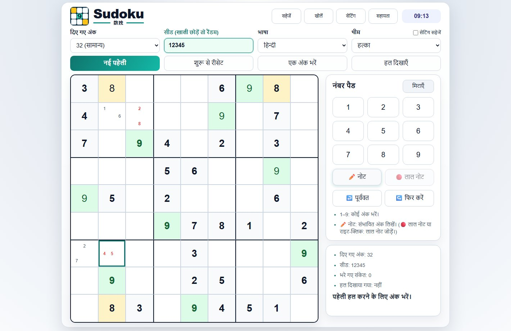
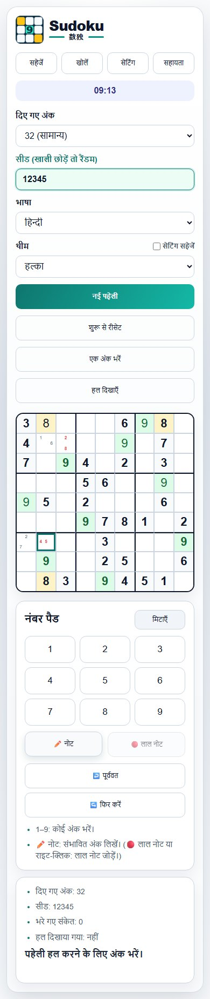

# खेल मार्गदर्शिका — Sudoku

[日本語](./GAME_GUIDE.ja.md) | [English](./GAME_GUIDE.md) | [简体中文](./GAME_GUIDE.zh-CN.md) | [हिन्दी](./GAME_GUIDE.hi.md) | [Español](./GAME_GUIDE.es.md) | [العربية](./GAME_GUIDE.ar.md) | [Français](./GAME_GUIDE.fr.md) | [Português (Brasil)](./GAME_GUIDE.pt-BR.md) | [Português (Portugal)](./GAME_GUIDE.pt-PT.md) | [Русский](./GAME_GUIDE.ru.md) | [Deutsch](./GAME_GUIDE.de.md) | [Bahasa Indonesia](./GAME_GUIDE.id.md) | [বাংলা](./GAME_GUIDE.bn.md) | [Türkçe](./GAME_GUIDE.tr.md) | [한국어](./GAME_GUIDE.ko.md) | [Tiếng Việt](./GAME_GUIDE.vi.md) | [Italiano](./GAME_GUIDE.it.md) | [Nederlands](./GAME_GUIDE.nl.md) | [Polski](./GAME_GUIDE.pl.md) | [ไทย](./GAME_GUIDE.th.md) | [اردو](./GAME_GUIDE.ur.md) | [فارسی](./GAME_GUIDE.fa.md) | [Kiswahili](./GAME_GUIDE.sw.md) | [繁體中文](./GAME_GUIDE.zh-TW.md) | [Українська](./GAME_GUIDE.uk.md)

| डेस्कटॉप | मोबाइल |
| --- | --- |
|  |  |

## खेलना शुरू करें

- कोई खाना चुनें और 1 से 9 तक अंक भरें।
- हर पंक्ति, स्तंभ और मोटी रेखाओं से घिरे 3×3 खंड में 1 से 9 तक हर अंक ठीक एक बार होना चाहिए।
- हर बनाई गई पहेली का केवल एक सही हल होता है।
- बिना इंटरनेट खेल सकते हैं; खेल के दौरान नेटवर्क की आवश्यकता नहीं है।

## ऊपर की सेटिंग और बटन

- `दिए गए अंक`: नई पहेली में शुरू के अंकों की संख्या चुनें।
- `सीड`: समान सीड और अंक संख्या से वही पहेली बनती है; खाली रखने पर रैंडम।
- `भाषा`: इंटरफ़ेस की भाषा बदलें।
- `थीम`: सिस्टम, हल्का या गहरा चुनें; सिस्टम डिवाइस की सेटिंग अपनाता है।
- `सेटिंग सहेजें`: इसे चालू करने पर चालू होने की स्थिति के साथ `संकेत संख्या`, `सीड`, `भाषा`, `थीम` और दोनों हाइलाइट विकल्प लोकल स्टोरेज में सहेजे जाते हैं और अगली बार खोलने पर लौट आते हैं। `सेटिंग सहेजें` डिफ़ॉल्ट रूप से बंद है, इसलिए शुरुआत में ब्राउज़र में कोई प्राथमिकता सहेजी नहीं जाती।
- `नई पहेली`: मौजूदा सेटिंग से नई पहेली बनाएँ।
- `शुरू से रीसेट`: बोर्ड और टाइमर शुरू की स्थिति में लौटाएँ।
- `एक अंक भरें`: किसी खाली खाने में सही अंक भरें।
- `हल दिखाएँ`: पूरा हल दिखाएँ।
- `सहेजें`: बोर्ड, नोट, समय और पूर्ववत इतिहास JSON में सहेजें।
- `खोलें`: JSON फ़ाइल से वही स्थिति वापस खोलें।
- `सेटिंग`: नौ स्थानों पर सही तरह पूरी हुई संख्याओं और दोहराई गई संख्याओं की हाइलाइट अलग-अलग चालू या बंद करें।
- `सहायता`: ऑफ़लाइन सहायता खोलें।

## ब्राउज़र में सहेजी गई प्राथमिकताएँ

- `सेटिंग सहेजें` डिफ़ॉल्ट रूप से बंद है, इसलिए शुरुआत में ब्राउज़र में कोई प्राथमिकता सहेजी नहीं जाती।
- इसे चालू करने पर चालू होने की स्थिति के साथ `संकेत संख्या`, `सीड`, `भाषा`, `थीम` और दोनों हाइलाइट विकल्प लोकल स्टोरेज में सहेजे जाते हैं और अगली बार खोलने पर लौट आते हैं।
- `सेटिंग सहेजें` बंद करने पर सभी सहेजी प्राथमिकताएँ मिट जाती हैं। सीड फ़ील्ड खाली हो तो चालू होने पर भी कोई सीड नहीं सहेजा जाता।
- ये प्राथमिकताएँ `सहेजें` द्वारा बनाई गई गेम-स्थिति JSON फ़ाइल से अलग हैं; वर्तमान बोर्ड, नोट, टाइमर और Undo/Redo इतिहास अपने आप नहीं सहेजे जाते।

## माउस और स्पर्श

- `खाना चुनें`: बोर्ड पर एक घर चुनें।
- `अंक भरें`: नंबर पैड से कोई संख्या डालें।
- `मिटाएँ`: चुना हुआ घर खाली करें।
- `✏️ नोट`: नोट इनपुट मोड चालू/बंद करें; चालू होने पर संख्या डालने से नोट जुड़ता है।
- `🔴 लाल नोट`: लाल नोट इनपुट चालू करें; नोट मोड में माउस से संख्या पर राइट-क्लिक करके भी लाल नोट डाल सकते हैं।
- `↩️ पूर्ववत`: पिछली संख्या या नोट की कार्रवाई रद्द करें।
- `↪️ फिर करें`: रद्द की गई संख्या या नोट की कार्रवाई दोबारा करें।

## कीबोर्ड

- तीर कुंजियाँ: घरों के बीच जाएँ।
- `1`–`9`: कोई संख्या डालें।
- `0` / `Backspace` / `Delete`: चुना हुआ घर खाली करें।
- `Enter`: नोट मोड बदलें।
- `Shift+1`–`9`: लाल नोट डालें।
- `Ctrl+Z`: पिछली संख्या या नोट की कार्रवाई रद्द करें।
- `Ctrl+Y` or `Ctrl+Shift+Z`: रद्द की गई संख्या या नोट की कार्रवाई दोबारा करें।
