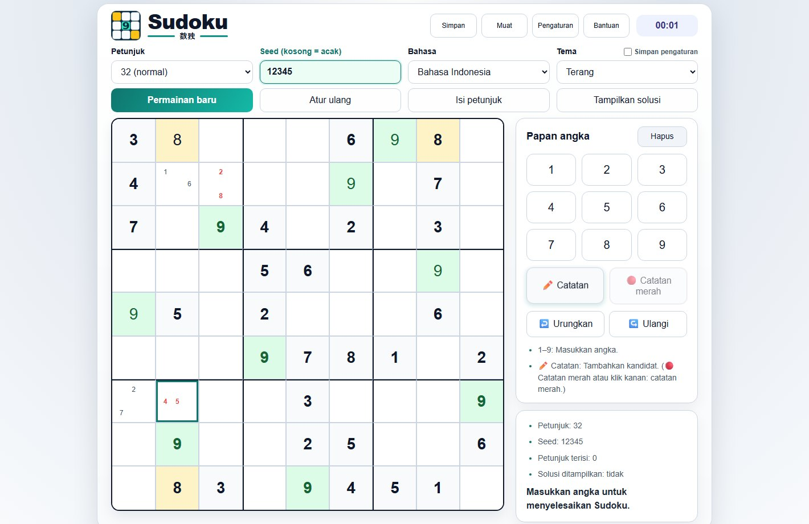
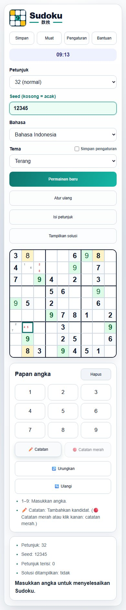

# Cara bermain — Sudoku

[日本語](./GAME_GUIDE.ja.md) | [English](./GAME_GUIDE.md) | [简体中文](./GAME_GUIDE.zh-CN.md) | [हिन्दी](./GAME_GUIDE.hi.md) | [Español](./GAME_GUIDE.es.md) | [العربية](./GAME_GUIDE.ar.md) | [Français](./GAME_GUIDE.fr.md) | [Português (Brasil)](./GAME_GUIDE.pt-BR.md) | [Português (Portugal)](./GAME_GUIDE.pt-PT.md) | [Русский](./GAME_GUIDE.ru.md) | [Deutsch](./GAME_GUIDE.de.md) | [Bahasa Indonesia](./GAME_GUIDE.id.md) | [বাংলা](./GAME_GUIDE.bn.md) | [Türkçe](./GAME_GUIDE.tr.md) | [한국어](./GAME_GUIDE.ko.md) | [Tiếng Việt](./GAME_GUIDE.vi.md) | [Italiano](./GAME_GUIDE.it.md) | [Nederlands](./GAME_GUIDE.nl.md) | [Polski](./GAME_GUIDE.pl.md) | [ไทย](./GAME_GUIDE.th.md) | [اردو](./GAME_GUIDE.ur.md) | [فارسی](./GAME_GUIDE.fa.md) | [Kiswahili](./GAME_GUIDE.sw.md) | [繁體中文](./GAME_GUIDE.zh-TW.md) | [Українська](./GAME_GUIDE.uk.md)

| Komputer | Ponsel |
| --- | --- |
|  |  |

## Cara bermain

- Pilih sel lalu masukkan angka dari 1 hingga 9.
- Setiap baris, kolom, dan blok 3×3 yang dibatasi garis tebal harus memuat angka 1 sampai 9 tepat satu kali.
- Setiap teka-teki yang dibuat memiliki tepat satu solusi.
- Bermainlah tanpa internet; permainan tidak memerlukan koneksi.

## Pengaturan dan tombol

- `Petunjuk`: Menentukan jumlah angka awal di teka-teki berikutnya.
- `Seed (kosong = acak)`: Seed dan jumlah petunjuk yang sama menghasilkan papan yang sama; kosong berarti acak.
- `Bahasa`: Mengubah bahasa antarmuka.
- `Tema`: Pilih Sistem, Terang, atau Gelap; Sistem mengikuti perangkat.
- `Simpan pengaturan`: Ketika diaktifkan, status aktifnya sendiri beserta `Petunjuk`, `Seed`, `Bahasa`, `Tema`, dan kedua pilihan sorotan disimpan di penyimpanan lokal serta dipulihkan saat permainan dibuka lagi. `Simpan pengaturan` nonaktif secara bawaan, sehingga awalnya tidak ada preferensi yang disimpan di peramban.
- `Permainan baru`: Membuat teka-teki baru dengan pengaturan saat ini.
- `Atur ulang`: Mengembalikan papan awal dan mengulang penghitung waktu.
- `Isi petunjuk`: Mengisi satu sel kosong dengan angka yang benar.
- `Tampilkan solusi`: Menampilkan seluruh solusi.
- `Simpan`: Menyimpan papan, catatan, waktu, dan riwayat dalam JSON.
- `Muat`: Memuat permainan tersimpan dari file JSON.
- `Pengaturan`: Mengaktifkan atau menonaktifkan sorotan angka yang selesai dengan benar dan angka duplikat secara terpisah.
- `Bantuan`: Membuka bantuan yang tersedia tanpa internet.

## Preferensi yang tersimpan di peramban

- `Simpan pengaturan` nonaktif secara bawaan, sehingga awalnya tidak ada preferensi yang disimpan di peramban.
- Ketika diaktifkan, status aktifnya sendiri beserta `Petunjuk`, `Seed`, `Bahasa`, `Tema`, dan kedua pilihan sorotan disimpan di penyimpanan lokal serta dipulihkan saat permainan dibuka lagi.
- Menonaktifkan `Simpan pengaturan` menghapus semua preferensi tersebut. Jika kolom seed kosong, tidak ada nilai seed yang disimpan meskipun penyimpanan aktif.
- Preferensi ini terpisah dari berkas JSON status permainan yang dibuat dengan `Simpan`. Papan, catatan, pengatur waktu, dan riwayat urungkan/ulangi tidak disimpan otomatis.

## Mouse dan sentuhan

- `Pilih sel`: Pilih satu sel pada papan.
- `Masukkan angka`: Gunakan papan angka untuk memasukkan angka.
- `Hapus`: Hapus isi sel yang dipilih.
- `✏️ Catatan`: Beralih ke mode Catatan; memasukkan angka saat mode aktif akan menambahkan catatan.
- `🔴 Catatan merah`: Beralih ke catatan merah; saat mode Catatan aktif, klik kanan angka juga dapat menambahkan catatan merah.
- `↩️ Urungkan`: Urungkan masukan atau catatan terakhir.
- `↪️ Ulangi`: Ulangi masukan atau catatan yang telah diurungkan.

## Papan ketik

- Tombol panah: Pindah antarsel.
- `1`–`9`: Masukkan angka.
- `0` / `Backspace` / `Delete`: Hapus isi sel yang dipilih.
- `Enter`: Alihkan mode Catatan.
- `Shift+1`–`9`: Masukkan catatan merah.
- `Ctrl+Z`: Urungkan masukan atau catatan terakhir.
- `Ctrl+Y` or `Ctrl+Shift+Z`: Ulangi masukan atau catatan yang telah diurungkan.
