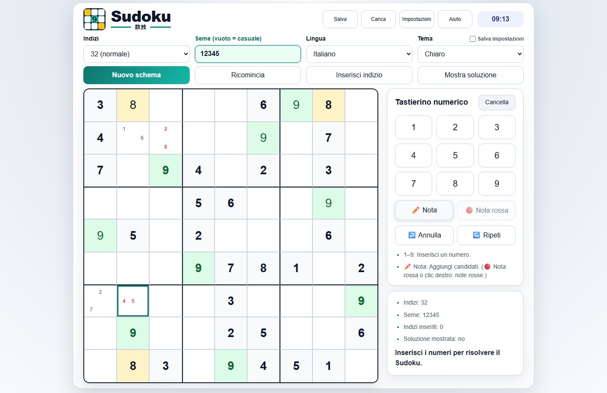
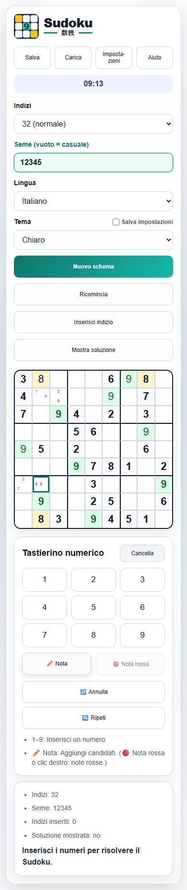

# Come giocare — Sudoku

[日本語](./GAME_GUIDE.ja.md) | [English](./GAME_GUIDE.md) | [简体中文](./GAME_GUIDE.zh-CN.md) | [हिन्दी](./GAME_GUIDE.hi.md) | [Español](./GAME_GUIDE.es.md) | [العربية](./GAME_GUIDE.ar.md) | [Français](./GAME_GUIDE.fr.md) | [Português (Brasil)](./GAME_GUIDE.pt-BR.md) | [Português (Portugal)](./GAME_GUIDE.pt-PT.md) | [Русский](./GAME_GUIDE.ru.md) | [Deutsch](./GAME_GUIDE.de.md) | [Bahasa Indonesia](./GAME_GUIDE.id.md) | [বাংলা](./GAME_GUIDE.bn.md) | [Türkçe](./GAME_GUIDE.tr.md) | [한국어](./GAME_GUIDE.ko.md) | [Tiếng Việt](./GAME_GUIDE.vi.md) | [Italiano](./GAME_GUIDE.it.md) | [Nederlands](./GAME_GUIDE.nl.md) | [Polski](./GAME_GUIDE.pl.md) | [ไทย](./GAME_GUIDE.th.md) | [اردو](./GAME_GUIDE.ur.md) | [فارسی](./GAME_GUIDE.fa.md) | [Kiswahili](./GAME_GUIDE.sw.md) | [繁體中文](./GAME_GUIDE.zh-TW.md) | [Українська](./GAME_GUIDE.uk.md)

| Computer | Cellulare |
| --- | --- |
|  |  |

## Come giocare

- Seleziona una casella e inserisci un numero da 1 a 9.
- Ogni riga, colonna e blocco 3×3 delimitato da linee spesse deve contenere ogni numero da 1 a 9 esattamente una volta.
- Ogni Sudoku generato ha un'unica soluzione.
- Gioca offline: non serve Internet durante la partita.

## Impostazioni e comandi

- `Indizi`: Imposta il numero di cifre iniziali nella prossima griglia.
- `Seme (vuoto = casuale)`: Lo stesso seme e numero di indizi ricreano la stessa griglia; vuoto significa casuale.
- `Lingua`: Cambia la lingua dell'interfaccia.
- `Tema`: Scegli Sistema, Chiaro o Scuro; Sistema segue il dispositivo.
- `Salva impostazioni`: Quando lo si attiva, lo stato di attivazione stesso, `Indizi`, `Seme`, `Lingua`, `Tema` ed entrambe le opzioni di evidenziazione sono salvati nella memoria locale e ripristinati alla successiva apertura. `Salva impostazioni` è disattivato per impostazione predefinita, quindi inizialmente non viene salvata alcuna preferenza nel browser.
- `Nuovo schema`: Genera un nuovo Sudoku con le impostazioni attuali.
- `Ricomincia`: Ripristina lo schema iniziale e azzera il cronometro.
- `Inserisci indizio`: Inserisce la cifra corretta in una casella vuota.
- `Mostra soluzione`: Mostra la soluzione completa.
- `Salva`: Salva griglia, note, tempo e cronologia in JSON.
- `Carica`: Carica una partita salvata da un file JSON.
- `Impostazioni`: Attiva o disattiva separatamente l’evidenziazione dei numeri completati e dei duplicati.
- `Aiuto`: Apre l'aiuto disponibile offline.

## Preferenze salvate nel browser

- `Salva impostazioni` è disattivato per impostazione predefinita, quindi inizialmente non viene salvata alcuna preferenza nel browser.
- Quando lo si attiva, lo stato di attivazione stesso, `Indizi`, `Seme`, `Lingua`, `Tema` ed entrambe le opzioni di evidenziazione sono salvati nella memoria locale e ripristinati alla successiva apertura.
- Disattivare `Salva impostazioni` elimina tutte queste preferenze. Se il campo del seme è vuoto, non viene salvato alcun valore neppure con la funzione attiva.
- Queste preferenze sono distinte dal file JSON di stato della partita creato con `Salva`. Griglia, note, timer e cronologia Annulla/Ripeti non vengono salvati automaticamente.

## Mouse e tocco

- `Seleziona casella`: Seleziona una casella della griglia.
- `Inserisci cifra`: Usa il tastierino numerico per inserire un numero.
- `Cancella`: Cancella la casella selezionata.
- `✏️ Nota`: Attiva il modo Note: inserendo un numero in questo modo, aggiungi una nota.
- `🔴 Nota rossa`: Passa alle note rosse; in modo Note puoi anche fare clic destro su un numero per inserirne una rossa.
- `↩️ Annulla`: Annulla l’ultima immissione o nota.
- `↪️ Ripeti`: Ripristina un’immissione o una nota annullata.

## Tastiera

- Tasti freccia: Spostati tra le caselle.
- `1`–`9`: Inserisci un numero.
- `0` / `Backspace` / `Delete`: Cancella la casella selezionata.
- `Enter`: Attiva il modo Note.
- `Shift+1`–`9`: Inserisci una nota rossa.
- `Ctrl+Z`: Annulla l’ultima immissione o nota.
- `Ctrl+Y` or `Ctrl+Shift+Z`: Ripristina un’immissione o una nota annullata.
