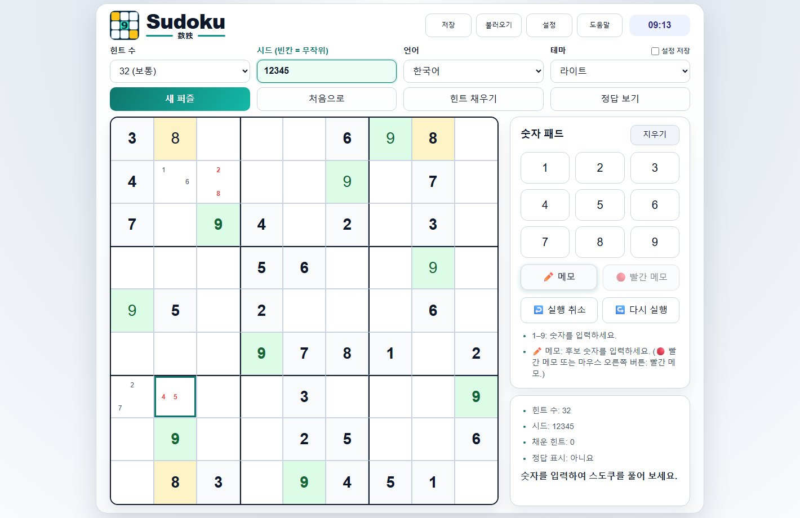
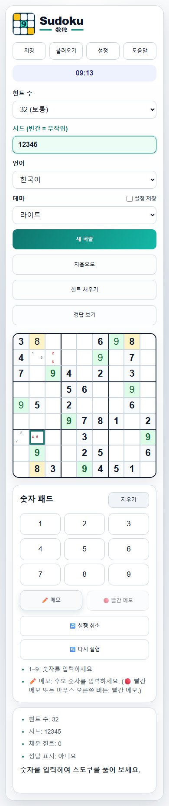

# 게임 방법 — Sudoku

[日本語](./GAME_GUIDE.ja.md) | [English](./GAME_GUIDE.md) | [简体中文](./GAME_GUIDE.zh-CN.md) | [हिन्दी](./GAME_GUIDE.hi.md) | [Español](./GAME_GUIDE.es.md) | [العربية](./GAME_GUIDE.ar.md) | [Français](./GAME_GUIDE.fr.md) | [Português (Brasil)](./GAME_GUIDE.pt-BR.md) | [Português (Portugal)](./GAME_GUIDE.pt-PT.md) | [Русский](./GAME_GUIDE.ru.md) | [Deutsch](./GAME_GUIDE.de.md) | [Bahasa Indonesia](./GAME_GUIDE.id.md) | [বাংলা](./GAME_GUIDE.bn.md) | [Türkçe](./GAME_GUIDE.tr.md) | [한국어](./GAME_GUIDE.ko.md) | [Tiếng Việt](./GAME_GUIDE.vi.md) | [Italiano](./GAME_GUIDE.it.md) | [Nederlands](./GAME_GUIDE.nl.md) | [Polski](./GAME_GUIDE.pl.md) | [ไทย](./GAME_GUIDE.th.md) | [اردو](./GAME_GUIDE.ur.md) | [فارسی](./GAME_GUIDE.fa.md) | [Kiswahili](./GAME_GUIDE.sw.md) | [繁體中文](./GAME_GUIDE.zh-TW.md) | [Українська](./GAME_GUIDE.uk.md)

| 데스크톱 | 모바일 |
| --- | --- |
|  |  |

## 게임 방법

- 칸을 선택하고 1부터 9까지의 숫자를 입력하세요.
- 각 행과 열 및 굵은 선으로 둘러싸인 3×3 블록에는 1부터 9까지의 숫자가 정확히 한 번씩 들어가야 합니다.
- 생성되는 모든 퍼즐에는 정답이 하나뿐입니다.
- 인터넷 없이 플레이할 수 있으며 게임 중 네트워크가 필요하지 않습니다.

## 설정과 버튼

- `힌트 수`: 다음 퍼즐의 시작 힌트 숫자 개수를 정합니다.
- `시드 (빈칸 = 무작위)`: 시드와 힌트 수가 같으면 같은 퍼즐이 생성됩니다. 비우면 무작위입니다.
- `언어`: 화면의 언어를 바꿉니다.
- `테마`: 시스템·라이트·다크 중 선택하세요. 시스템은 기기 설정을 따릅니다.
- `설정 저장`: 켜면 설정 저장의 활성 상태 자체와 `힌트 수`, `시드`, `언어`, `테마`, 강조 표시 두 항목이 로컬 저장소에 저장되고 다음에 열 때 복원됩니다. `설정 저장`은 기본적으로 꺼져 있으므로 처음에는 브라우저에 어떤 설정도 저장하지 않습니다.
- `새 퍼즐`: 현재 설정으로 새 퍼즐을 만듭니다.
- `처음으로`: 시작 상태로 되돌리고 시간을 초기화합니다.
- `힌트 채우기`: 빈칸 하나에 정답을 채웁니다.
- `정답 보기`: 전체 정답을 표시합니다.
- `저장`: 보드, 메모, 시간, 작업 기록을 JSON 파일로 저장합니다.
- `불러오기`: JSON 파일에서 저장된 게임을 불러옵니다.
- `설정`: 완성된 숫자와 중복 숫자의 강조 표시를 각각 켜거나 끕니다.
- `도움말`: 오프라인에서 도움말을 엽니다.

## 브라우저에 저장되는 설정

- `설정 저장`은 기본적으로 꺼져 있으므로 처음에는 브라우저에 어떤 설정도 저장하지 않습니다.
- 켜면 설정 저장의 활성 상태 자체와 `힌트 수`, `시드`, `언어`, `테마`, 강조 표시 두 항목이 로컬 저장소에 저장되고 다음에 열 때 복원됩니다.
- `설정 저장`을 끄면 저장된 설정이 모두 삭제됩니다. 시드 입력란이 비어 있으면 켜져 있어도 시드 값은 저장되지 않습니다.
- 이는 `저장` 버튼으로 만드는 게임 상태 JSON과 별개입니다. 현재 보드, 메모, 타이머, 실행 취소/다시 실행 기록은 자동 저장되지 않습니다.

## 마우스·터치

- `칸 선택`: 보드에서 칸을 선택합니다.
- `숫자 입력`: 숫자 패드로 숫자를 입력합니다.
- `지우기`: 선택한 칸을 지웁니다.
- `✏️ 메모`: 메모 입력 모드로 전환합니다. 이 모드에서 숫자를 입력하면 메모가 추가됩니다.
- `🔴 빨간 메모`: 빨간 메모로 전환합니다. 메모 모드에서 숫자를 마우스 오른쪽 버튼으로 클릭해도 빨간 메모를 넣을 수 있습니다.
- `↩️ 실행 취소`: 마지막 숫자 입력 또는 메모를 취소합니다.
- `↪️ 다시 실행`: 취소한 숫자 입력 또는 메모를 다시 실행합니다.

## 키보드

- 방향키: 칸 사이를 이동합니다.
- `1`–`9`: 숫자를 입력합니다.
- `0` / `Backspace` / `Delete`: 선택한 칸을 지웁니다.
- `Enter`: 메모 입력 모드로 전환합니다.
- `Shift+1`–`9`: 빨간 메모를 입력합니다.
- `Ctrl+Z`: 마지막 숫자 입력 또는 메모를 취소합니다.
- `Ctrl+Y` or `Ctrl+Shift+Z`: 취소한 숫자 입력 또는 메모를 다시 실행합니다.
