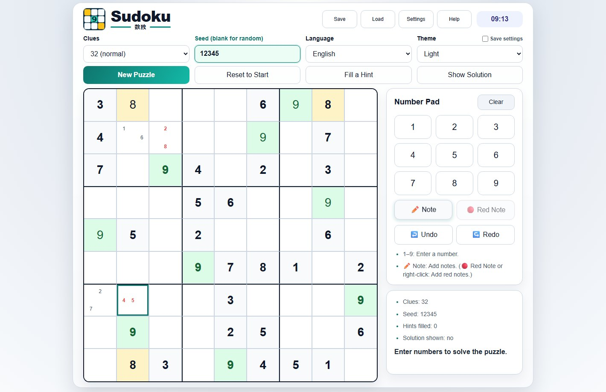
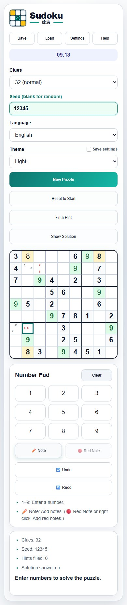

# Sudoku Game Guide

[日本語](./GAME_GUIDE.ja.md) | [English](./GAME_GUIDE.md) | [简体中文](./GAME_GUIDE.zh-CN.md) | [हिन्दी](./GAME_GUIDE.hi.md) | [Español](./GAME_GUIDE.es.md) | [العربية](./GAME_GUIDE.ar.md) | [Français](./GAME_GUIDE.fr.md) | [Português (Brasil)](./GAME_GUIDE.pt-BR.md) | [Português (Portugal)](./GAME_GUIDE.pt-PT.md) | [Русский](./GAME_GUIDE.ru.md) | [Deutsch](./GAME_GUIDE.de.md) | [Bahasa Indonesia](./GAME_GUIDE.id.md) | [বাংলা](./GAME_GUIDE.bn.md) | [Türkçe](./GAME_GUIDE.tr.md) | [한국어](./GAME_GUIDE.ko.md) | [Tiếng Việt](./GAME_GUIDE.vi.md) | [Italiano](./GAME_GUIDE.it.md) | [Nederlands](./GAME_GUIDE.nl.md) | [Polski](./GAME_GUIDE.pl.md) | [ไทย](./GAME_GUIDE.th.md) | [اردو](./GAME_GUIDE.ur.md) | [فارسی](./GAME_GUIDE.fa.md) | [Kiswahili](./GAME_GUIDE.sw.md) | [繁體中文](./GAME_GUIDE.zh-TW.md) | [Українська](./GAME_GUIDE.uk.md)

| Desktop view | Mobile view |
| --- | --- |
|  |  |

## How to Play

- Select a cell and enter a number from 1 to 9.
- The puzzle is complete when every row, column, and 3x3 block outlined by the thick lines contains each number from 1 to 9 exactly once.
- Every generated puzzle has exactly one solution.
- You can play offline. Gameplay itself does not require any internet connection.

## Controls and Buttons Above the Board

- `Clues`: Sets the number of starting clues for the next puzzle.
- `Seed`: Enter the same seed to recreate the same puzzle. Leave it empty for a random puzzle.
- `Language`: Switches the interface language.
- `Theme`: Choose `System`, `Light`, or `Dark`. `System` follows your operating system color scheme automatically.
- `Save settings`: When enabled, saves the clue count, seed, language, theme, and both highlight toggles in this browser. It is off by default.
- `New Puzzle`: Generates a new puzzle with the current clue count and seed.
- `Reset to Start`: Returns the board to its initial state. The timer also starts over.
- `Fill a Hint`: Reveals one correct value in an empty cell.
- `Show Solution`: Displays the completed solution.
- `Save`: Saves the current board, notes, timer, and Undo/Redo history as a JSON file.
- `Load`: Loads a saved JSON file and resumes from the same state.
- `Settings`: Independently toggles highlighting of completed numbers and duplicate numbers.
- `Help`: Opens the help dialog. It is available offline.

## Preferences Saved in the Browser

- `Save settings` is off by default, so no preferences are stored in the browser initially.
- When you enable `Save settings`, the enabled state itself plus `Clues`, `Seed`, `Language`, `Theme`, and both highlight toggles are stored in local storage and restored the next time you open the app.
- Turning `Save settings` off removes all of these saved preferences. If the seed field is blank, no seed value is stored even while preference saving is enabled.
- These preferences are separate from the game-state JSON created by `Save`. The current board, notes, timer, and Undo/Redo history are not autosaved.

## Controls (Mouse / Tap)

- Select a cell on the board.
- Use the number pad to enter a number.
- `Clear`: Clears the selected cell.
- `✏️ Note`: Switches to note input mode. When note input mode is on, entering a number adds a note.
- `🔴 Red Note`: Switches note input to red notes. While note input mode is on, you can also right-click a number with the mouse to enter a red note.
- `↩️ Undo`: Undoes the most recent input or note.
- `↪️ Redo`: Reapplies an undone input or note.

## Controls (Keyboard)

- Arrow keys: Move between cells
- `1` to `9`: Enter a number
- `0` / `Backspace` / `Delete`: Clear the selected cell
- `Enter`: Switch to note input mode
- `Shift+1` to `9`: Enter a red note
- `Ctrl+Z`: Undo
- `Ctrl+Y` or `Ctrl+Shift+Z`: Redo
