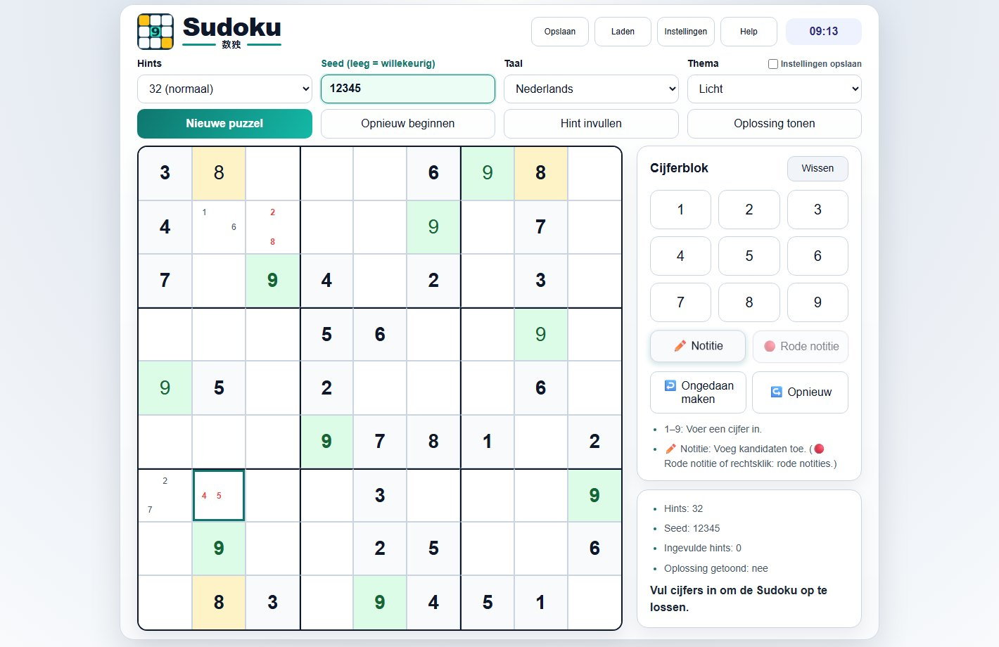
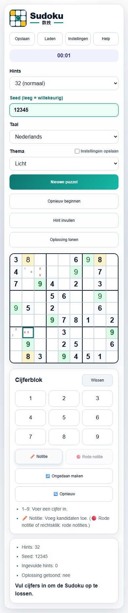

# Speluitleg — Sudoku

[日本語](./GAME_GUIDE.ja.md) | [English](./GAME_GUIDE.md) | [简体中文](./GAME_GUIDE.zh-CN.md) | [हिन्दी](./GAME_GUIDE.hi.md) | [Español](./GAME_GUIDE.es.md) | [العربية](./GAME_GUIDE.ar.md) | [Français](./GAME_GUIDE.fr.md) | [Português (Brasil)](./GAME_GUIDE.pt-BR.md) | [Português (Portugal)](./GAME_GUIDE.pt-PT.md) | [Русский](./GAME_GUIDE.ru.md) | [Deutsch](./GAME_GUIDE.de.md) | [Bahasa Indonesia](./GAME_GUIDE.id.md) | [বাংলা](./GAME_GUIDE.bn.md) | [Türkçe](./GAME_GUIDE.tr.md) | [한국어](./GAME_GUIDE.ko.md) | [Tiếng Việt](./GAME_GUIDE.vi.md) | [Italiano](./GAME_GUIDE.it.md) | [Nederlands](./GAME_GUIDE.nl.md) | [Polski](./GAME_GUIDE.pl.md) | [ไทย](./GAME_GUIDE.th.md) | [اردو](./GAME_GUIDE.ur.md) | [فارسی](./GAME_GUIDE.fa.md) | [Kiswahili](./GAME_GUIDE.sw.md) | [繁體中文](./GAME_GUIDE.zh-TW.md) | [Українська](./GAME_GUIDE.uk.md)

| Desktop | Mobiel |
| --- | --- |
|  |  |

## Speluitleg

- Kies een cel en voer een cijfer van 1 tot en met 9 in.
- Elke rij, kolom en elk met dikke lijnen omrand 3×3-blok moet de cijfers 1 tot en met 9 precies één keer bevatten.
- Elke gegenereerde Sudoku heeft precies één oplossing.
- Speel zonder internet; een verbinding is tijdens het spel niet nodig.

## Instellingen en knoppen

- `Hints`: Bepaalt hoeveel cijfers vooraf zijn ingevuld in de volgende puzzel.
- `Seed (leeg = willekeurig)`: Dezelfde seed en hetzelfde aantal hints maken dezelfde puzzel; leeg betekent willekeurig.
- `Taal`: Wijzigt de taal van de interface.
- `Thema`: Kies Systeem, Licht of Donker; Systeem volgt het apparaat.
- `Instellingen opslaan`: Bij inschakeling worden de ingeschakelde toestand zelf, `Aanwijzingen`, `Seed`, `Taal`, `Thema` en beide markeringsschakelaars lokaal bewaard en bij de volgende opening hersteld. `Instellingen opslaan` staat standaard uit; aanvankelijk worden er geen voorkeuren in de browser opgeslagen.
- `Nieuwe puzzel`: Maakt een nieuwe Sudoku met de huidige instellingen.
- `Opnieuw beginnen`: Herstelt het beginrooster en zet de timer terug.
- `Hint invullen`: Vult één lege cel in met het juiste cijfer.
- `Oplossing tonen`: Toont de volledige oplossing.
- `Opslaan`: Slaat rooster, notities, timer en geschiedenis op in JSON.
- `Laden`: Laadt een opgeslagen spel vanuit een JSON-bestand.
- `Instellingen`: Schakelt markering van voltooide en dubbele cijfers afzonderlijk in of uit.
- `Help`: Opent de offline beschikbare hulp.

## Instellingen opgeslagen in de browser

- `Instellingen opslaan` staat standaard uit; aanvankelijk worden er geen voorkeuren in de browser opgeslagen.
- Bij inschakeling worden de ingeschakelde toestand zelf, `Aanwijzingen`, `Seed`, `Taal`, `Thema` en beide markeringsschakelaars lokaal bewaard en bij de volgende opening hersteld.
- Als `Instellingen opslaan` wordt uitgezet, verdwijnen al deze voorkeuren. Is het seedveld leeg, dan wordt er ook bij ingeschakelde opslag geen seed bewaard.
- Deze voorkeuren staan los van het JSON-bestand met spelstatus dat via `Opslaan` wordt gemaakt. Rooster, notities, timer en geschiedenis voor ongedaan maken/opnieuw worden niet automatisch opgeslagen.

## Muis en aanraken

- `Cel selecteren`: Selecteer een cel op het rooster.
- `Cijfer invoeren`: Voer een cijfer in met het numerieke paneel.
- `Wissen`: Wis de geselecteerde cel.
- `✏️ Notitie`: Schakel de notitiemodus in; een cijfer toevoegen in deze modus maakt een notitie.
- `🔴 Rode notitie`: Schakel over naar rode notities; in de notitiemodus kunt u ook rechtsklikken op een cijfer om een rode notitie in te voeren.
- `↩️ Ongedaan maken`: Maak de laatste invoer of notitie ongedaan.
- `↪️ Opnieuw`: Herhaal een ongedaan gemaakte invoer of notitie.

## Toetsenbord

- Pijltjestoetsen: Verplaats tussen cellen.
- `1`–`9`: Voer een cijfer in.
- `0` / `Backspace` / `Delete`: Wis de geselecteerde cel.
- `Enter`: Schakel de notitiemodus om.
- `Shift+1`–`9`: Voer een rode notitie in.
- `Ctrl+Z`: Maak de laatste invoer of notitie ongedaan.
- `Ctrl+Y` or `Ctrl+Shift+Z`: Herhaal een ongedaan gemaakte invoer of notitie.
