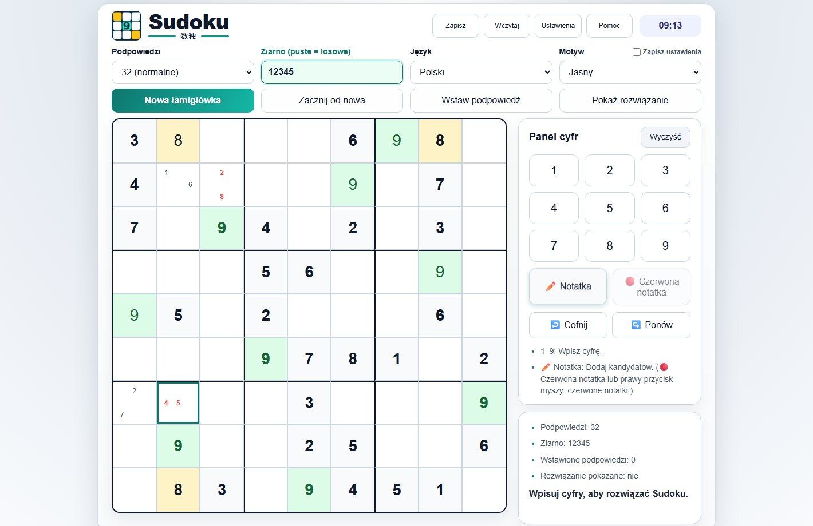
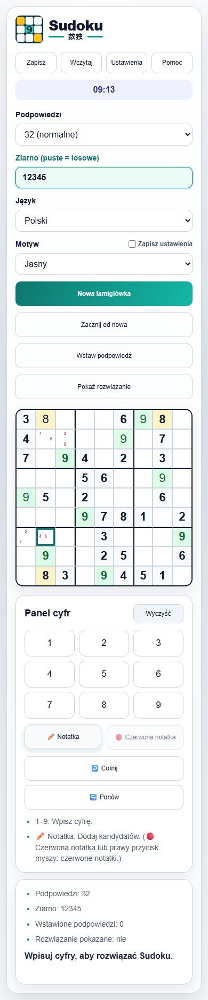

# Jak grać — Sudoku

[日本語](./GAME_GUIDE.ja.md) | [English](./GAME_GUIDE.md) | [简体中文](./GAME_GUIDE.zh-CN.md) | [हिन्दी](./GAME_GUIDE.hi.md) | [Español](./GAME_GUIDE.es.md) | [العربية](./GAME_GUIDE.ar.md) | [Français](./GAME_GUIDE.fr.md) | [Português (Brasil)](./GAME_GUIDE.pt-BR.md) | [Português (Portugal)](./GAME_GUIDE.pt-PT.md) | [Русский](./GAME_GUIDE.ru.md) | [Deutsch](./GAME_GUIDE.de.md) | [Bahasa Indonesia](./GAME_GUIDE.id.md) | [বাংলা](./GAME_GUIDE.bn.md) | [Türkçe](./GAME_GUIDE.tr.md) | [한국어](./GAME_GUIDE.ko.md) | [Tiếng Việt](./GAME_GUIDE.vi.md) | [Italiano](./GAME_GUIDE.it.md) | [Nederlands](./GAME_GUIDE.nl.md) | [Polski](./GAME_GUIDE.pl.md) | [ไทย](./GAME_GUIDE.th.md) | [اردو](./GAME_GUIDE.ur.md) | [فارسی](./GAME_GUIDE.fa.md) | [Kiswahili](./GAME_GUIDE.sw.md) | [繁體中文](./GAME_GUIDE.zh-TW.md) | [Українська](./GAME_GUIDE.uk.md)

| Komputer | Telefon |
| --- | --- |
|  |  |

## Jak grać

- Wybierz komórkę i wpisz cyfrę od 1 do 9.
- Każdy wiersz, kolumna i blok 3×3 otoczony grubymi liniami musi zawierać liczby od 1 do 9 dokładnie po jednym razie.
- Każda wygenerowana łamigłówka ma dokładnie jedno rozwiązanie.
- Graj bez internetu; podczas gry nie jest wymagane połączenie.

## Ustawienia i przyciski

- `Podpowiedzi`: Ustala liczbę początkowych cyfr w kolejnym Sudoku.
- `Ziarno (puste = losowe)`: To samo ziarno i liczba podpowiedzi odtworzą tę samą planszę; puste pole = losowo.
- `Język`: Zmienia język interfejsu.
- `Motyw`: Wybierz Systemowy, Jasny lub Ciemny; Systemowy śledzi urządzenie.
- `Zapisz ustawienia`: Po włączeniu w pamięci lokalnej zapisywany jest sam stan włączenia oraz `Wskazówki`, `Ziarno`, `Język`, `Motyw` i oba przełączniki podświetlenia; są przywracane przy następnym otwarciu. `Zapisuj ustawienia` jest domyślnie wyłączone, więc początkowo przeglądarka nie zapisuje żadnych preferencji.
- `Nowa łamigłówka`: Tworzy nowe Sudoku z bieżącymi ustawieniami.
- `Zacznij od nowa`: Przywraca początkową planszę i zeruje licznik czasu.
- `Wstaw podpowiedź`: Wypełnia jedną pustą komórkę poprawną cyfrą.
- `Pokaż rozwiązanie`: Pokazuje kompletne rozwiązanie.
- `Zapisz`: Zapisuje planszę, notatki, czas i historię do JSON.
- `Wczytaj`: Wczytuje zapisaną grę z pliku JSON.
- `Ustawienia`: Niezależnie włącza lub wyłącza podświetlanie ukończonych i powtarzających się liczb.
- `Pomoc`: Otwiera pomoc dostępną offline.

## Preferencje zapisane w przeglądarce

- `Zapisuj ustawienia` jest domyślnie wyłączone, więc początkowo przeglądarka nie zapisuje żadnych preferencji.
- Po włączeniu w pamięci lokalnej zapisywany jest sam stan włączenia oraz `Wskazówki`, `Ziarno`, `Język`, `Motyw` i oba przełączniki podświetlenia; są przywracane przy następnym otwarciu.
- Wyłączenie `Zapisuj ustawienia` usuwa wszystkie te preferencje. Gdy pole ziarna jest puste, żadne ziarno nie zostaje zapisane nawet przy włączonej opcji.
- Preferencje są niezależne od pliku JSON stanu gry tworzonego przez `Zapisz`. Plansza, notatki, licznik czasu oraz historia Cofnij/Ponów nie zapisują się automatycznie.

## Mysz i dotyk

- `Wybierz komórkę`: Wybierz pole na planszy.
- `Wprowadź cyfrę`: Wpisz liczbę za pomocą panelu cyfr.
- `Wyczyść`: Wyczyść wybrane pole.
- `✏️ Notatka`: Przełącz na tryb notatek; wpisanie liczby w tym trybie dodaje notatkę.
- `🔴 Czerwona notatka`: Przełącz na czerwone notatki; w trybie notatek można także kliknąć liczbę prawym przyciskiem myszy, aby dodać czerwoną notatkę.
- `↩️ Cofnij`: Cofnij ostatni wpis lub notatkę.
- `↪️ Ponów`: Ponów cofnięty wpis lub notatkę.

## Klawiatura

- Klawisze strzałek: Przechodź między polami.
- `1`–`9`: Wpisz liczbę.
- `0` / `Backspace` / `Delete`: Wyczyść wybrane pole.
- `Enter`: Przełącz tryb notatek.
- `Shift+1`–`9`: Wpisz czerwoną notatkę.
- `Ctrl+Z`: Cofnij ostatni wpis lub notatkę.
- `Ctrl+Y` or `Ctrl+Shift+Z`: Ponów cofnięty wpis lub notatkę.
