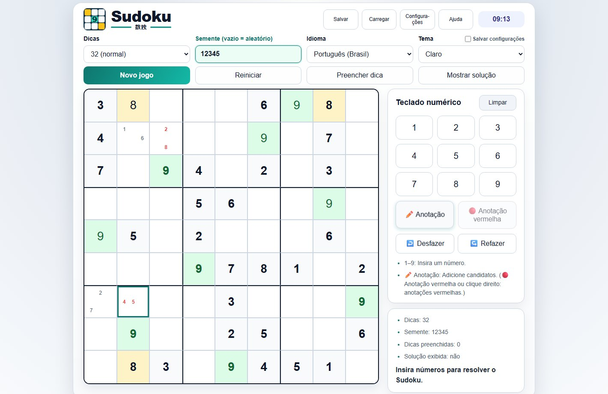
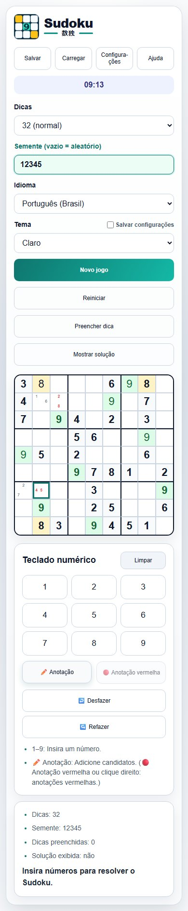

# Como jogar — Sudoku

[日本語](./GAME_GUIDE.ja.md) | [English](./GAME_GUIDE.md) | [简体中文](./GAME_GUIDE.zh-CN.md) | [हिन्दी](./GAME_GUIDE.hi.md) | [Español](./GAME_GUIDE.es.md) | [العربية](./GAME_GUIDE.ar.md) | [Français](./GAME_GUIDE.fr.md) | [Português (Brasil)](./GAME_GUIDE.pt-BR.md) | [Português (Portugal)](./GAME_GUIDE.pt-PT.md) | [Русский](./GAME_GUIDE.ru.md) | [Deutsch](./GAME_GUIDE.de.md) | [Bahasa Indonesia](./GAME_GUIDE.id.md) | [বাংলা](./GAME_GUIDE.bn.md) | [Türkçe](./GAME_GUIDE.tr.md) | [한국어](./GAME_GUIDE.ko.md) | [Tiếng Việt](./GAME_GUIDE.vi.md) | [Italiano](./GAME_GUIDE.it.md) | [Nederlands](./GAME_GUIDE.nl.md) | [Polski](./GAME_GUIDE.pl.md) | [ไทย](./GAME_GUIDE.th.md) | [اردو](./GAME_GUIDE.ur.md) | [فارسی](./GAME_GUIDE.fa.md) | [Kiswahili](./GAME_GUIDE.sw.md) | [繁體中文](./GAME_GUIDE.zh-TW.md) | [Українська](./GAME_GUIDE.uk.md)

| Computador | Celular |
| --- | --- |
|  |  |

## Como jogar

- Selecione uma célula e digite um número de 1 a 9.
- Cada linha, coluna e bloco 3×3 delimitado por linhas grossas precisa conter os números de 1 a 9 exatamente uma vez.
- Todo Sudoku gerado tem solução única.
- Jogue sem conexão; nenhuma rede é necessária durante a partida.

## Configurações e controles

- `Dicas`: Define quantos números já estarão preenchidos no próximo jogo.
- `Semente (vazio = aleatório)`: A mesma semente com o mesmo número de dicas reproduz o mesmo jogo; vazio gera um aleatório.
- `Idioma`: Altera o idioma da interface.
- `Tema`: Escolha Sistema, Claro ou Escuro; Sistema acompanha o dispositivo.
- `Salvar configurações`: Ao ativá-lo, o próprio estado de ativação, `Dicas`, `Semente`, `Idioma`, `Tema` e os dois controles de destaque são armazenados no armazenamento local e restaurados na próxima abertura. `Salvar configurações` vem desativado, portanto nenhuma preferência é salva no navegador inicialmente.
- `Novo jogo`: Cria um novo Sudoku com as opções atuais.
- `Reiniciar`: Restaura o tabuleiro inicial e reinicia o cronômetro.
- `Preencher dica`: Preenche uma célula vazia com o número correto.
- `Mostrar solução`: Mostra toda a solução.
- `Salvar`: Salva o tabuleiro, as notas, o cronômetro e o histórico em JSON.
- `Carregar`: Carrega uma partida salva de um arquivo JSON.
- `Configurações`: Ativa ou desativa separadamente o destaque dos números concluídos e dos números repetidos.
- `Ajuda`: Abre a ajuda, disponível sem conexão.

## Preferências salvas no navegador

- `Salvar configurações` vem desativado, portanto nenhuma preferência é salva no navegador inicialmente.
- Ao ativá-lo, o próprio estado de ativação, `Dicas`, `Semente`, `Idioma`, `Tema` e os dois controles de destaque são armazenados no armazenamento local e restaurados na próxima abertura.
- Desativar `Salvar configurações` apaga todas essas preferências. Se o campo de semente estiver vazio, nenhuma semente será armazenada, mesmo com a opção ativa.
- Essas preferências são separadas do JSON do jogo criado por `Salvar`. Tabuleiro, notas, cronômetro e histórico de desfazer/refazer não são salvos automaticamente.

## Mouse e toque

- `Selecionar célula`: Selecione uma célula do tabuleiro.
- `Digitar número`: Use o teclado numérico para inserir um número.
- `Limpar`: Limpa a célula selecionada.
- `✏️ Anotação`: Alterna para o modo Anotação; ao digitar um número nesse modo, você adiciona uma anotação.
- `🔴 Anotação vermelha`: Alterna para anotações vermelhas; no modo Anotação, também é possível clicar com o botão direito em um número para inserir uma anotação vermelha.
- `↩️ Desfazer`: Desfaz a última entrada ou anotação.
- `↪️ Refazer`: Refaz uma entrada ou anotação desfeita.

## Teclado

- Teclas de seta: Mova-se entre as células.
- `1`–`9`: Insira um número.
- `0` / `Backspace` / `Delete`: Limpa a célula selecionada.
- `Enter`: Ativa o modo Anotação.
- `Shift+1`–`9`: Insere uma anotação vermelha.
- `Ctrl+Z`: Desfaz a última entrada ou anotação.
- `Ctrl+Y` or `Ctrl+Shift+Z`: Refaz uma entrada ou anotação desfeita.
