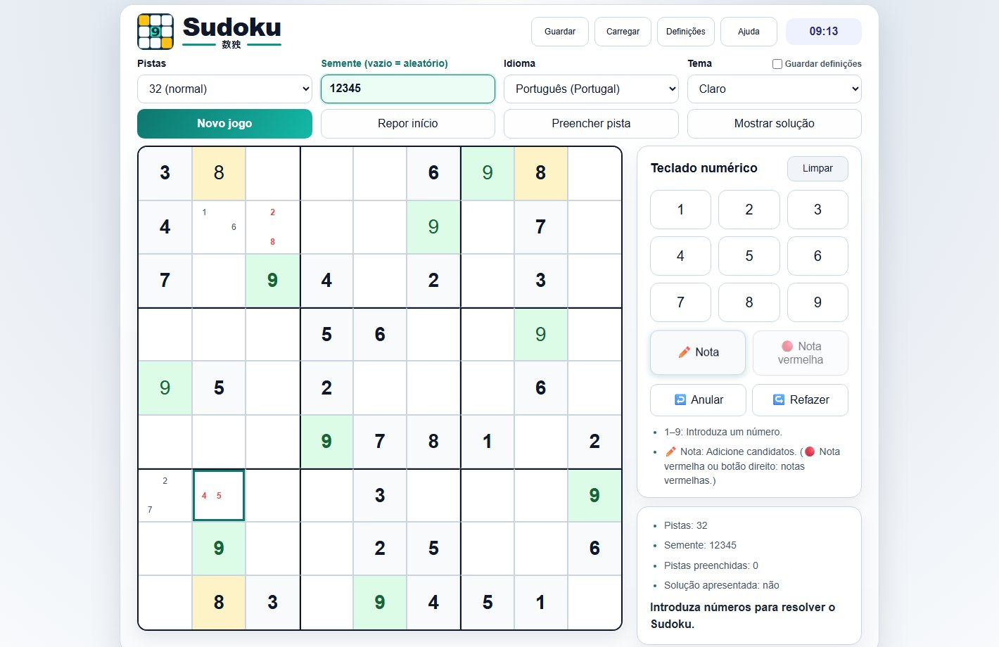
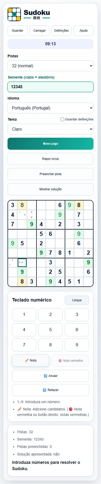

# Como jogar — Sudoku

[日本語](./GAME_GUIDE.ja.md) | [English](./GAME_GUIDE.md) | [简体中文](./GAME_GUIDE.zh-CN.md) | [हिन्दी](./GAME_GUIDE.hi.md) | [Español](./GAME_GUIDE.es.md) | [العربية](./GAME_GUIDE.ar.md) | [Français](./GAME_GUIDE.fr.md) | [Português (Brasil)](./GAME_GUIDE.pt-BR.md) | [Português (Portugal)](./GAME_GUIDE.pt-PT.md) | [Русский](./GAME_GUIDE.ru.md) | [Deutsch](./GAME_GUIDE.de.md) | [Bahasa Indonesia](./GAME_GUIDE.id.md) | [বাংলা](./GAME_GUIDE.bn.md) | [Türkçe](./GAME_GUIDE.tr.md) | [한국어](./GAME_GUIDE.ko.md) | [Tiếng Việt](./GAME_GUIDE.vi.md) | [Italiano](./GAME_GUIDE.it.md) | [Nederlands](./GAME_GUIDE.nl.md) | [Polski](./GAME_GUIDE.pl.md) | [ไทย](./GAME_GUIDE.th.md) | [اردو](./GAME_GUIDE.ur.md) | [فارسی](./GAME_GUIDE.fa.md) | [Kiswahili](./GAME_GUIDE.sw.md) | [繁體中文](./GAME_GUIDE.zh-TW.md) | [Українська](./GAME_GUIDE.uk.md)

| Computador | Telemóvel |
| --- | --- |
|  |  |

## Como jogar

- Selecione uma casa e introduza um número de 1 a 9.
- Cada linha, coluna e bloco 3×3 delimitado por traços grossos tem de conter os números de 1 a 9 exatamente uma vez.
- Cada Sudoku gerado tem apenas uma solução.
- Jogue sem ligação à Internet; a partida não precisa de rede.

## Definições e controlos

- `Pistas`: Define quantos números iniciais terá o próximo jogo.
- `Semente (vazio = aleatório)`: A mesma semente e as mesmas pistas reproduzem a mesma grelha; vazio é aleatório.
- `Idioma`: Altera o idioma da interface.
- `Tema`: Escolha Sistema, Claro ou Escuro; Sistema acompanha o dispositivo.
- `Guardar definições`: Ao ativá-lo, o próprio estado de ativação, `Pistas`, `Semente`, `Idioma`, `Tema` e as duas opções de destaque ficam no armazenamento local e são repostos na próxima abertura. `Guardar definições` está desativado por predefinição, pelo que inicialmente não se guardam preferências no navegador.
- `Novo jogo`: Cria um novo Sudoku com as definições atuais.
- `Repor início`: Restaura a grelha inicial e reinicia o cronómetro.
- `Preencher pista`: Preenche uma casa vazia com o número correto.
- `Mostrar solução`: Mostra a solução completa.
- `Guardar`: Guarda a grelha, as notas, o tempo e o histórico em JSON.
- `Carregar`: Carrega uma partida guardada num ficheiro JSON.
- `Definições`: Ativa ou desativa separadamente o destaque dos números concluídos e dos números repetidos.
- `Ajuda`: Abre a ajuda, disponível sem ligação.

## Preferências guardadas no navegador

- `Guardar definições` está desativado por predefinição, pelo que inicialmente não se guardam preferências no navegador.
- Ao ativá-lo, o próprio estado de ativação, `Pistas`, `Semente`, `Idioma`, `Tema` e as duas opções de destaque ficam no armazenamento local e são repostos na próxima abertura.
- Desativar `Guardar definições` apaga todas essas preferências. Se a semente estiver em branco, não se guarda qualquer valor, mesmo com a opção ativa.
- Estas preferências são diferentes do JSON de jogo criado por `Guardar`. A grelha, as notas, o cronómetro e o histórico de anular/refazer não são guardados automaticamente.

## Rato e toque

- `Selecionar casa`: Selecione uma célula da grelha.
- `Introduzir número`: Use o teclado numérico para introduzir um número.
- `Limpar`: Limpa a célula selecionada.
- `✏️ Nota`: Alterna o modo Nota; ao introduzir um número nesse modo, adiciona uma nota.
- `🔴 Nota vermelha`: Ativa as notas vermelhas; no modo Nota, também pode clicar com o botão direito num número para introduzir uma nota vermelha.
- `↩️ Anular`: Anula a última introdução ou nota.
- `↪️ Refazer`: Refaz uma introdução ou nota anulada.

## Teclado

- Teclas de setas: Desloque-se entre células.
- `1`–`9`: Introduza um número.
- `0` / `Backspace` / `Delete`: Limpa a célula selecionada.
- `Enter`: Ativa o modo Nota.
- `Shift+1`–`9`: Introduz uma nota vermelha.
- `Ctrl+Z`: Anula a última introdução ou nota.
- `Ctrl+Y` or `Ctrl+Shift+Z`: Refaz uma introdução ou nota anulada.
