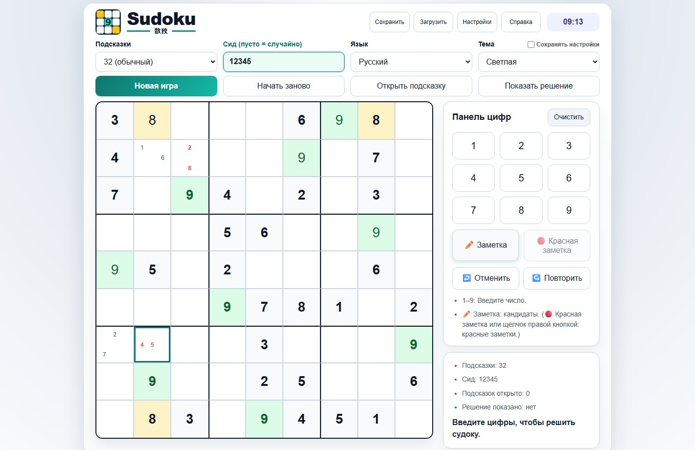
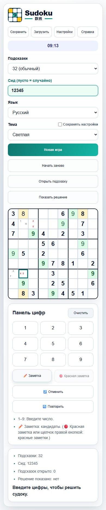

# Как играть — Sudoku

[日本語](./GAME_GUIDE.ja.md) | [English](./GAME_GUIDE.md) | [简体中文](./GAME_GUIDE.zh-CN.md) | [हिन्दी](./GAME_GUIDE.hi.md) | [Español](./GAME_GUIDE.es.md) | [العربية](./GAME_GUIDE.ar.md) | [Français](./GAME_GUIDE.fr.md) | [Português (Brasil)](./GAME_GUIDE.pt-BR.md) | [Português (Portugal)](./GAME_GUIDE.pt-PT.md) | [Русский](./GAME_GUIDE.ru.md) | [Deutsch](./GAME_GUIDE.de.md) | [Bahasa Indonesia](./GAME_GUIDE.id.md) | [বাংলা](./GAME_GUIDE.bn.md) | [Türkçe](./GAME_GUIDE.tr.md) | [한국어](./GAME_GUIDE.ko.md) | [Tiếng Việt](./GAME_GUIDE.vi.md) | [Italiano](./GAME_GUIDE.it.md) | [Nederlands](./GAME_GUIDE.nl.md) | [Polski](./GAME_GUIDE.pl.md) | [ไทย](./GAME_GUIDE.th.md) | [اردو](./GAME_GUIDE.ur.md) | [فارسی](./GAME_GUIDE.fa.md) | [Kiswahili](./GAME_GUIDE.sw.md) | [繁體中文](./GAME_GUIDE.zh-TW.md) | [Українська](./GAME_GUIDE.uk.md)

| Компьютер | Телефон |
| --- | --- |
|  |  |

## Как играть

- Выберите клетку и введите число от 1 до 9.
- В каждой строке, столбце и блоке 3×3, обведённом толстыми линиями, все числа от 1 до 9 должны встречаться ровно по одному разу.
- У каждой сгенерированной головоломки только одно решение.
- Игра работает без интернета и не передаёт данные игры.

## Настройки и кнопки

- `Подсказки`: Задаёт количество открытых цифр в новой головоломке.
- `Сид (пусто = случайно)`: Одинаковый сид и число подсказок дают одинаковую сетку; пустое поле означает случайный выбор.
- `Язык`: Меняет язык интерфейса.
- `Тема`: Выберите системную, светлую или тёмную тему.
- `Сохранять настройки`: При включении в локальном хранилище сохраняются сама настройка включения, `Подсказки`, `Сид`, `Язык`, `Тема` и оба переключателя подсветки; при следующем запуске они восстанавливаются. `Сохранять настройки` по умолчанию выключено, поэтому первоначально предпочтения в браузере не сохраняются.
- `Новая игра`: Создаёт новую головоломку с текущими параметрами.
- `Начать заново`: Возвращает исходную сетку и сбрасывает таймер.
- `Открыть подсказку`: Заполняет одну пустую клетку правильным числом.
- `Показать решение`: Показывает полное решение.
- `Сохранить`: Сохраняет сетку, заметки, таймер и историю в JSON.
- `Загрузить`: Загружает сохранённую игру из JSON-файла.
- `Настройки`: Позволяют отдельно включать и выключать подсветку завершённых и повторяющихся чисел.
- `Справка`: Открывает справку без интернета.

## Настройки, сохраняемые в браузере

- `Сохранять настройки` по умолчанию выключено, поэтому первоначально предпочтения в браузере не сохраняются.
- При включении в локальном хранилище сохраняются сама настройка включения, `Подсказки`, `Сид`, `Язык`, `Тема` и оба переключателя подсветки; при следующем запуске они восстанавливаются.
- Выключение `Сохранять настройки` удаляет все эти данные. Если поле сида пустое, его значение не сохраняется даже при включённом сохранении.
- Настройки не связаны с JSON-файлом состояния игры, создаваемым через `Сохранить`. Поле, заметки, таймер и история отмены/повтора автоматически не сохраняются.

## Мышь и касание

- `Выбрать клетку`: Выберите клетку на поле.
- `Ввести число`: Введите число с цифровой панели.
- `Очистить`: Очистите выделенную клетку.
- `✏️ Заметка`: Переключите режим заметок; ввод числа в этом режиме добавляет заметку.
- `🔴 Красная заметка`: Включите красные заметки; в режиме заметок их можно также вводить правой кнопкой мыши по числу.
- `↩️ Отменить`: Отмените последнее действие с числом или заметкой.
- `↪️ Повторить`: Повторите отменённое действие с числом или заметкой.

## Клавиатура

- Клавиши со стрелками: Перемещайтесь между клетками.
- `1`–`9`: Введите число.
- `0` / `Backspace` / `Delete`: Очистите выделенную клетку.
- `Enter`: Переключите режим заметок.
- `Shift+1`–`9`: Введите красную заметку.
- `Ctrl+Z`: Отмените последнее действие с числом или заметкой.
- `Ctrl+Y` or `Ctrl+Shift+Z`: Повторите отменённое действие с числом или заметкой.
