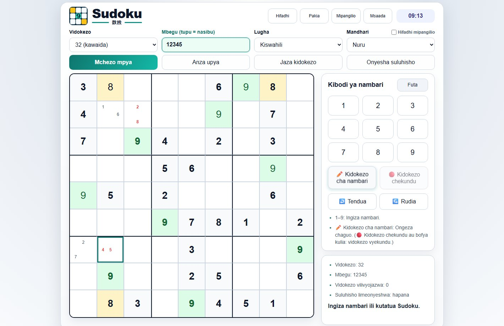
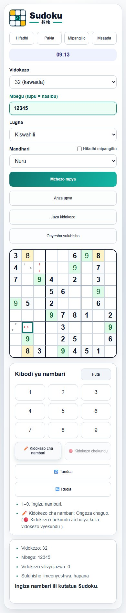

# Jinsi ya kucheza — Sudoku

[日本語](./GAME_GUIDE.ja.md) | [English](./GAME_GUIDE.md) | [简体中文](./GAME_GUIDE.zh-CN.md) | [हिन्दी](./GAME_GUIDE.hi.md) | [Español](./GAME_GUIDE.es.md) | [العربية](./GAME_GUIDE.ar.md) | [Français](./GAME_GUIDE.fr.md) | [Português (Brasil)](./GAME_GUIDE.pt-BR.md) | [Português (Portugal)](./GAME_GUIDE.pt-PT.md) | [Русский](./GAME_GUIDE.ru.md) | [Deutsch](./GAME_GUIDE.de.md) | [Bahasa Indonesia](./GAME_GUIDE.id.md) | [বাংলা](./GAME_GUIDE.bn.md) | [Türkçe](./GAME_GUIDE.tr.md) | [한국어](./GAME_GUIDE.ko.md) | [Tiếng Việt](./GAME_GUIDE.vi.md) | [Italiano](./GAME_GUIDE.it.md) | [Nederlands](./GAME_GUIDE.nl.md) | [Polski](./GAME_GUIDE.pl.md) | [ไทย](./GAME_GUIDE.th.md) | [اردو](./GAME_GUIDE.ur.md) | [فارسی](./GAME_GUIDE.fa.md) | [Kiswahili](./GAME_GUIDE.sw.md) | [繁體中文](./GAME_GUIDE.zh-TW.md) | [Українська](./GAME_GUIDE.uk.md)

| Kompyuta | Simu |
| --- | --- |
|  |  |

## Jinsi ya kucheza

- Chagua kisanduku na uingize nambari ya 1 hadi 9.
- Kila safu mlalo, safu wima na kizuizi cha 3×3 kilichozungukwa na mistari minene lazima kiwe na kila nambari 1 hadi 9 mara moja tu.
- Kila Sudoku inayotengenezwa ina suluhisho moja pekee.
- Cheza bila intaneti; mchezo hauhitaji muunganisho.

## Mipangilio na vitufe

- `Vidokezo`: Huamua idadi ya nambari za kuanzia kwenye mchezo unaofuata.
- `Mbegu (tupu = nasibu)`: Mbegu na idadi ya vidokezo ileile huleta ubao uleule; tupu ni nasibu.
- `Lugha`: Hubadilisha lugha ya kiolesura.
- `Mandhari`: Chagua Mfumo, Nuru au Giza; Mfumo hufuata kifaa.
- `Hifadhi mipangilio`: Ukiiwasha, hali yake ya kuwashwa pamoja na `Vidokezo`, `Mbegu`, `Lugha`, `Mandhari` na swichi zote mbili za uangaziaji huhifadhiwa kwenye hifadhi ya ndani na kurejeshwa unapoifungua tena. `Hifadhi mipangilio` imezimwa kwa chaguo-msingi; hakuna mapendeleo yanayohifadhiwa kwenye kivinjari mwanzoni.
- `Mchezo mpya`: Hutengeneza Sudoku mpya kwa mipangilio ya sasa.
- `Anza upya`: Hurudisha ubao wa mwanzo na kuanza saa upya.
- `Jaza kidokezo`: Hujaza nambari sahihi katika kisanduku kimoja tupu.
- `Onyesha suluhisho`: Huonyesha suluhisho lote.
- `Hifadhi`: Huhifadhi ubao, madokezo, muda na historia kwenye JSON.
- `Pakia`: Hupakia mchezo uliohifadhiwa kutoka faili ya JSON.
- `Mipangilio`: Huwasha au kuzima kando uangaziaji wa nambari zilizokamilika na zinazojirudia.
- `Msaada`: Hufungua msaada unaopatikana bila intaneti.

## Mapendeleo yanayohifadhiwa kwenye kivinjari

- `Hifadhi mipangilio` imezimwa kwa chaguo-msingi; hakuna mapendeleo yanayohifadhiwa kwenye kivinjari mwanzoni.
- Ukiiwasha, hali yake ya kuwashwa pamoja na `Vidokezo`, `Mbegu`, `Lugha`, `Mandhari` na swichi zote mbili za uangaziaji huhifadhiwa kwenye hifadhi ya ndani na kurejeshwa unapoifungua tena.
- Kuzima `Hifadhi mipangilio` hufuta mapendeleo yote hayo. Ikiwa sehemu ya mbegu ni tupu, hakuna mbegu inayohifadhiwa hata ukiruhusu kuhifadhi.
- Mapendeleo haya ni tofauti na faili ya JSON ya hali ya mchezo inayoundwa kwa `Hifadhi`. Ubao, madokezo, kipima muda na historia ya kutendua/kurudia havihifadhiwi kiotomatiki.

## Kipanya na mguso

- `Chagua kisanduku`: Chagua seli kwenye ubao.
- `Ingiza nambari`: Tumia sehemu ya nambari kuingiza nambari.
- `Futa`: Futa yaliyomo kwenye seli iliyochaguliwa.
- `✏️ Kidokezo cha nambari`: Badili hadi hali ya madokezo; kuingiza nambari katika hali hii huongeza dokezo.
- `🔴 Kidokezo chekundu`: Badili hadi madokezo mekundu; katika hali ya madokezo, unaweza pia kubofya nambari kwa kitufe cha kulia cha kipanya ili kuingiza dokezo jekundu.
- `↩️ Tendua`: Tendua ingizo la mwisho au dokezo.
- `↪️ Rudia`: Rudia ingizo au dokezo lililotenduliwa.

## Kibodi

- Vitufe vya mishale: Sogea kati ya seli.
- `1`–`9`: Ingiza nambari.
- `0` / `Backspace` / `Delete`: Futa yaliyomo kwenye seli iliyochaguliwa.
- `Enter`: Badili hali ya madokezo.
- `Shift+1`–`9`: Ingiza dokezo jekundu.
- `Ctrl+Z`: Tendua ingizo la mwisho au dokezo.
- `Ctrl+Y` or `Ctrl+Shift+Z`: Rudia ingizo au dokezo lililotenduliwa.
