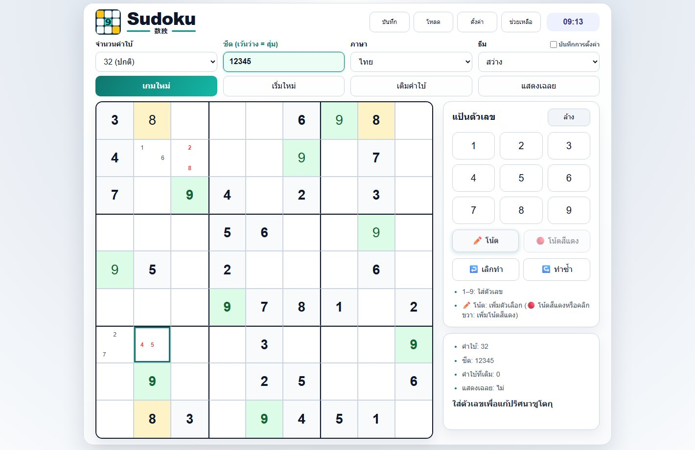
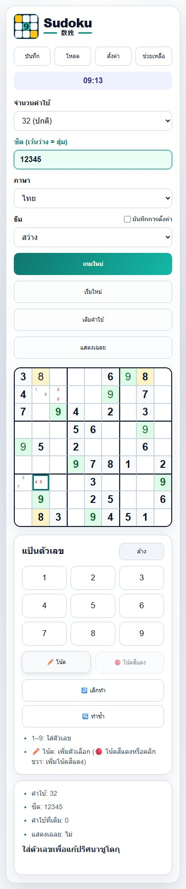

# วิธีเล่น — Sudoku

[日本語](./GAME_GUIDE.ja.md) | [English](./GAME_GUIDE.md) | [简体中文](./GAME_GUIDE.zh-CN.md) | [हिन्दी](./GAME_GUIDE.hi.md) | [Español](./GAME_GUIDE.es.md) | [العربية](./GAME_GUIDE.ar.md) | [Français](./GAME_GUIDE.fr.md) | [Português (Brasil)](./GAME_GUIDE.pt-BR.md) | [Português (Portugal)](./GAME_GUIDE.pt-PT.md) | [Русский](./GAME_GUIDE.ru.md) | [Deutsch](./GAME_GUIDE.de.md) | [Bahasa Indonesia](./GAME_GUIDE.id.md) | [বাংলা](./GAME_GUIDE.bn.md) | [Türkçe](./GAME_GUIDE.tr.md) | [한국어](./GAME_GUIDE.ko.md) | [Tiếng Việt](./GAME_GUIDE.vi.md) | [Italiano](./GAME_GUIDE.it.md) | [Nederlands](./GAME_GUIDE.nl.md) | [Polski](./GAME_GUIDE.pl.md) | [ไทย](./GAME_GUIDE.th.md) | [اردو](./GAME_GUIDE.ur.md) | [فارسی](./GAME_GUIDE.fa.md) | [Kiswahili](./GAME_GUIDE.sw.md) | [繁體中文](./GAME_GUIDE.zh-TW.md) | [Українська](./GAME_GUIDE.uk.md)

| คอมพิวเตอร์ | มือถือ |
| --- | --- |
|  |  |

## วิธีเล่น

- เลือกช่องแล้วใส่ตัวเลข 1 ถึง 9
- ทุกแถว คอลัมน์ และบล็อก 3×3 ที่ล้อมด้วยเส้นหนาต้องมีตัวเลข 1 ถึง 9 อย่างละหนึ่งครั้ง
- ปริศนาที่สร้างทุกเกมมีคำตอบที่ถูกต้องเพียงหนึ่งเดียว
- เล่นแบบออฟไลน์ได้ โดยไม่ต้องเชื่อมต่ออินเทอร์เน็ตระหว่างเล่น

## การตั้งค่าและปุ่ม

- `จำนวนคำใบ้`: กำหนดจำนวนตัวเลขเริ่มต้นในเกมถัดไป
- `ซีด (เว้นว่าง = สุ่ม)`: ใช้ซีดและจำนวนคำใบ้เดิมจะได้ตารางเดิม เว้นว่างเพื่อสุ่ม
- `ภาษา`: เปลี่ยนภาษาของอินเทอร์เฟซ
- `ธีม`: เลือกตามระบบ สว่าง หรือมืด โดยตามระบบจะใช้ค่าจากอุปกรณ์
- `บันทึกการตั้งค่า`: เมื่อเปิดใช้งาน ระบบจะบันทึกสถานะการเปิดนั้นเอง พร้อมกับ `จำนวนตัวช่วย` `Seed` `ภาษา` `ธีม` และสวิตช์ไฮไลต์ทั้งสองลงในที่เก็บข้อมูลภายใน และคืนค่าในการเปิดครั้งถัดไป `บันทึกการตั้งค่า` ปิดเป็นค่าเริ่มต้น จึงไม่มีการบันทึกการตั้งค่าใดไว้ในเบราว์เซอร์เมื่อเริ่มต้น
- `เกมใหม่`: สร้างเกมใหม่ตามการตั้งค่าปัจจุบัน
- `เริ่มใหม่`: คืนค่าตารางเริ่มต้นและเริ่มจับเวลาใหม่
- `เติมคำใบ้`: เติมตัวเลขที่ถูกต้องในช่องว่างหนึ่งช่อง
- `แสดงเฉลย`: แสดงคำตอบทั้งหมด
- `บันทึก`: บันทึกกระดาน โน้ต เวลา และประวัติเป็น JSON
- `โหลด`: โหลดเกมที่บันทึกไว้จากไฟล์ JSON
- `ตั้งค่า`: เปิดหรือปิดการไฮไลต์ตัวเลขที่เติมครบอย่างถูกต้องและตัวเลขซ้ำแยกกันได้
- `ช่วยเหลือ`: เปิดวิธีใช้ที่อ่านได้แบบออฟไลน์

## การตั้งค่าที่บันทึกในเบราว์เซอร์

- `บันทึกการตั้งค่า` ปิดเป็นค่าเริ่มต้น จึงไม่มีการบันทึกการตั้งค่าใดไว้ในเบราว์เซอร์เมื่อเริ่มต้น
- เมื่อเปิดใช้งาน ระบบจะบันทึกสถานะการเปิดนั้นเอง พร้อมกับ `จำนวนตัวช่วย` `Seed` `ภาษา` `ธีม` และสวิตช์ไฮไลต์ทั้งสองลงในที่เก็บข้อมูลภายใน และคืนค่าในการเปิดครั้งถัดไป
- เมื่อปิด `บันทึกการตั้งค่า` ระบบจะลบค่าที่บันทึกเหล่านี้ทั้งหมด หากช่อง Seed ว่าง ก็จะไม่บันทึกค่า Seed แม้เปิดการบันทึกอยู่
- การตั้งค่าเหล่านี้แยกจากไฟล์ JSON สถานะเกมที่สร้างด้วย `บันทึก` กระดาน โน้ต ตัวจับเวลา และประวัติเลิกทำ/ทำซ้ำจะไม่ถูกบันทึกโดยอัตโนมัติ

## เมาส์และสัมผัส

- `เลือกช่อง`: เลือกช่องบนกระดาน
- `ใส่ตัวเลข`: ใช้แป้นตัวเลขเพื่อป้อนตัวเลข
- `ล้าง`: ลบข้อมูลในช่องที่เลือก
- `✏️ โน้ต`: สลับไปโหมดโน้ต เมื่อป้อนตัวเลขในโหมดนี้จะเพิ่มโน้ต
- `🔴 โน้ตสีแดง`: สลับเป็นโน้ตสีแดง ขณะอยู่ในโหมดโน้ตยังคลิกขวาที่ตัวเลขเพื่อใส่โน้ตสีแดงได้
- `↩️ เลิกทำ`: เลิกทำการป้อนตัวเลขหรือโน้ตล่าสุด
- `↪️ ทำซ้ำ`: ทำซ้ำการป้อนตัวเลขหรือโน้ตที่เลิกทำไป

## แป้นพิมพ์

- ปุ่มลูกศร: ย้ายระหว่างช่อง
- `1`–`9`: ป้อนตัวเลข
- `0` / `Backspace` / `Delete`: ลบข้อมูลในช่องที่เลือก
- `Enter`: สลับโหมดโน้ต
- `Shift+1`–`9`: ใส่โน้ตสีแดง
- `Ctrl+Z`: เลิกทำการป้อนตัวเลขหรือโน้ตล่าสุด
- `Ctrl+Y` or `Ctrl+Shift+Z`: ทำซ้ำการป้อนตัวเลขหรือโน้ตที่เลิกทำไป
