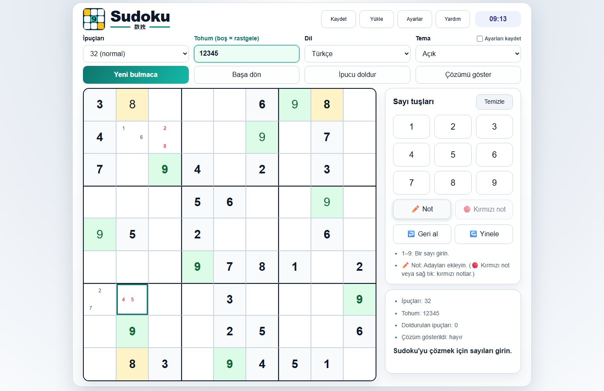
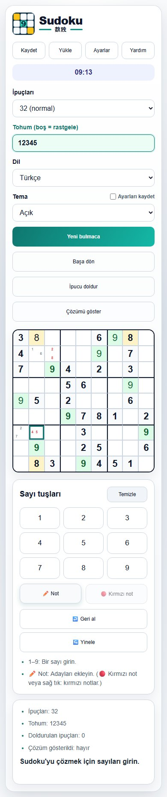

# Nasıl oynanır — Sudoku

[日本語](./GAME_GUIDE.ja.md) | [English](./GAME_GUIDE.md) | [简体中文](./GAME_GUIDE.zh-CN.md) | [हिन्दी](./GAME_GUIDE.hi.md) | [Español](./GAME_GUIDE.es.md) | [العربية](./GAME_GUIDE.ar.md) | [Français](./GAME_GUIDE.fr.md) | [Português (Brasil)](./GAME_GUIDE.pt-BR.md) | [Português (Portugal)](./GAME_GUIDE.pt-PT.md) | [Русский](./GAME_GUIDE.ru.md) | [Deutsch](./GAME_GUIDE.de.md) | [Bahasa Indonesia](./GAME_GUIDE.id.md) | [বাংলা](./GAME_GUIDE.bn.md) | [Türkçe](./GAME_GUIDE.tr.md) | [한국어](./GAME_GUIDE.ko.md) | [Tiếng Việt](./GAME_GUIDE.vi.md) | [Italiano](./GAME_GUIDE.it.md) | [Nederlands](./GAME_GUIDE.nl.md) | [Polski](./GAME_GUIDE.pl.md) | [ไทย](./GAME_GUIDE.th.md) | [اردو](./GAME_GUIDE.ur.md) | [فارسی](./GAME_GUIDE.fa.md) | [Kiswahili](./GAME_GUIDE.sw.md) | [繁體中文](./GAME_GUIDE.zh-TW.md) | [Українська](./GAME_GUIDE.uk.md)

| Bilgisayar | Telefon |
| --- | --- |
|  |  |

## Nasıl oynanır

- Bir hücre seçip 1 ile 9 arasında bir sayı girin.
- Her satır, sütun ve kalın çizgilerle çevrili 3×3 blok, 1 ile 9 arasındaki sayıları tam birer kez içermelidir.
- Oluşturulan her Sudoku'nun tek bir çözümü vardır.
- İnternetsiz oynayabilirsiniz; oyun sırasında bağlantı gerekmez.

## Ayarlar ve düğmeler

- `İpuçları`: Yeni bulmacadaki başlangıç sayılarının miktarını belirler.
- `Tohum (boş = rastgele)`: Aynı tohum ve ipucu sayısı aynı bulmacayı üretir; boş bırakılırsa rastgele olur.
- `Dil`: Arayüz dilini değiştirir.
- `Tema`: Sistem, Açık veya Koyu temayı seçin; Sistem cihazı izler.
- `Ayarları kaydet`: Açıldığında etkinlik durumu ile `İpuçları`, `Tohum`, `Dil`, `Tema` ve iki vurgulama anahtarı yerel depolamaya kaydedilir ve sonraki açılışta geri yüklenir. `Ayarları kaydet` varsayılan olarak kapalıdır; başlangıçta tarayıcıya hiçbir tercih kaydedilmez.
- `Yeni bulmaca`: Geçerli ayarlarla yeni Sudoku oluşturur.
- `Başa dön`: Başlangıç tahtasını geri getirir ve süreyi sıfırlar.
- `İpucu doldur`: Boş hücreye doğru sayıyı yerleştirir.
- `Çözümü göster`: Tam çözümü gösterir.
- `Kaydet`: Tahtayı, notları, zamanı ve geçmişi JSON olarak kaydeder.
- `Yükle`: Kaydedilen oyunu JSON dosyasından yükler.
- `Ayarlar`: Tamamlanan ve tekrarlanan sayıların vurgulanmasını birbirinden bağımsız açıp kapatır.
- `Yardım`: İnternetsiz kullanılabilen yardımı açar.

## Tarayıcıda kaydedilen tercihler

- `Ayarları kaydet` varsayılan olarak kapalıdır; başlangıçta tarayıcıya hiçbir tercih kaydedilmez.
- Açıldığında etkinlik durumu ile `İpuçları`, `Tohum`, `Dil`, `Tema` ve iki vurgulama anahtarı yerel depolamaya kaydedilir ve sonraki açılışta geri yüklenir.
- `Ayarları kaydet` kapatıldığında bu tercihler silinir. Tohum alanı boşsa kayıt açık olsa da tohum değeri saklanmaz.
- Bu tercihler `Kaydet` ile oluşturulan oyun durumu JSON dosyasından ayrıdır. Tahta, notlar, süre ve geri al/yinele geçmişi otomatik kaydedilmez.

## Fare ve dokunma

- `Hücre seç`: Tahtada bir hücre seçin.
- `Sayı gir`: Sayı tuş takımından bir sayı girin.
- `Temizle`: Seçili hücreyi temizleyin.
- `✏️ Not`: Not moduna geçin; bu modda sayı girmek not ekler.
- `🔴 Kırmızı not`: Kırmızı notlara geçin; Not modundayken bir sayıya sağ tıklayarak da kırmızı not ekleyebilirsiniz.
- `↩️ Geri al`: Son sayı girişini veya notu geri alın.
- `↪️ Yinele`: Geri alınan sayı girişini veya notu yineleyin.

## Klavye

- Ok tuşları: Hücreler arasında hareket edin.
- `1`–`9`: Bir sayı girin.
- `0` / `Backspace` / `Delete`: Seçili hücreyi temizleyin.
- `Enter`: Not moduna geçin.
- `Shift+1`–`9`: Kırmızı not girin.
- `Ctrl+Z`: Son sayı girişini veya notu geri alın.
- `Ctrl+Y` or `Ctrl+Shift+Z`: Geri alınan sayı girişini veya notu yineleyin.
