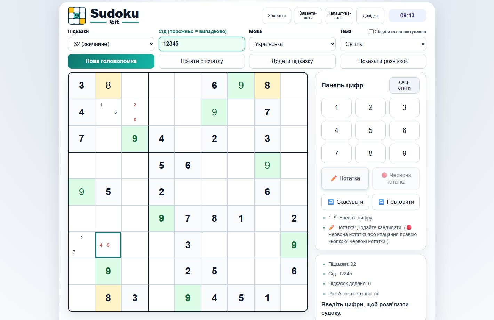
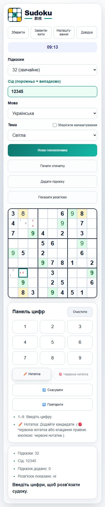

# Як грати — Sudoku

[日本語](./GAME_GUIDE.ja.md) | [English](./GAME_GUIDE.md) | [简体中文](./GAME_GUIDE.zh-CN.md) | [हिन्दी](./GAME_GUIDE.hi.md) | [Español](./GAME_GUIDE.es.md) | [العربية](./GAME_GUIDE.ar.md) | [Français](./GAME_GUIDE.fr.md) | [Português (Brasil)](./GAME_GUIDE.pt-BR.md) | [Português (Portugal)](./GAME_GUIDE.pt-PT.md) | [Русский](./GAME_GUIDE.ru.md) | [Deutsch](./GAME_GUIDE.de.md) | [Bahasa Indonesia](./GAME_GUIDE.id.md) | [বাংলা](./GAME_GUIDE.bn.md) | [Türkçe](./GAME_GUIDE.tr.md) | [한국어](./GAME_GUIDE.ko.md) | [Tiếng Việt](./GAME_GUIDE.vi.md) | [Italiano](./GAME_GUIDE.it.md) | [Nederlands](./GAME_GUIDE.nl.md) | [Polski](./GAME_GUIDE.pl.md) | [ไทย](./GAME_GUIDE.th.md) | [اردو](./GAME_GUIDE.ur.md) | [فارسی](./GAME_GUIDE.fa.md) | [Kiswahili](./GAME_GUIDE.sw.md) | [繁體中文](./GAME_GUIDE.zh-TW.md) | [Українська](./GAME_GUIDE.uk.md)

| Комп’ютер | Телефон |
| --- | --- |
|  |  |

## Як грати

- Виберіть клітинку і введіть цифру від 1 до 9.
- Кожен рядок, стовпець і блок 3×3, окреслений товстими лініями, має містити всі числа від 1 до 9 рівно по одному разу.
- Кожне згенероване судоку має лише один розв'язок.
- Грайте без інтернету; під час гри з'єднання не потрібне.

## Налаштування та кнопки

- `Підказки`: Задає кількість відкритих цифр у наступній головоломці.
- `Сід (порожньо = випадково)`: Однакові сід і число підказок дають ту саму сітку; порожнє поле — випадковий вибір.
- `Мова`: Змінює мову інтерфейсу.
- `Тема`: Оберіть Системна, Світла чи Темна; Системна відповідає пристрою.
- `Зберігати налаштування`: Після ввімкнення у локальному сховищі зберігаються сам стан увімкнення, `Підказки`, `Сід`, `Мова`, `Тема` та обидва перемикачі підсвічування; вони відновлюються під час наступного відкриття. `Зберігати налаштування` типово вимкнено, тому спочатку жодні вподобання в браузері не зберігаються.
- `Нова головоломка`: Створює нове судоку з поточними параметрами.
- `Почати спочатку`: Повертає початкову сітку й скидає таймер.
- `Додати підказку`: Заповнює одну порожню клітинку правильною цифрою.
- `Показати розв'язок`: Показує повний розв'язок.
- `Зберегти`: Зберігає поле, нотатки, час та історію в JSON.
- `Завантажити`: Завантажує збережену гру з файлу JSON.
- `Налаштування`: Окремо вмикає або вимикає підсвічування завершених та повторюваних чисел.
- `Довідка`: Відкриває довідку, доступну офлайн.

## Налаштування, збережені в браузері

- `Зберігати налаштування` типово вимкнено, тому спочатку жодні вподобання в браузері не зберігаються.
- Після ввімкнення у локальному сховищі зберігаються сам стан увімкнення, `Підказки`, `Сід`, `Мова`, `Тема` та обидва перемикачі підсвічування; вони відновлюються під час наступного відкриття.
- Вимкнення `Зберігати налаштування` видаляє всі ці вподобання. Якщо поле сіду порожнє, значення не зберігається навіть за ввімкненої функції.
- Ці вподобання окремі від JSON-файлу стану гри, створеного через `Зберегти`. Поточне поле, нотатки, таймер і історія скасування/повтору автоматично не зберігаються.

## Миша й дотик

- `Вибрати клітинку`: Виберіть клітинку на полі.
- `Ввести цифру`: Введіть число за допомогою цифрової панелі.
- `Очистити`: Очистьте вибрану клітинку.
- `✏️ Нотатка`: Перемкніться в режим нотаток; введення числа в ньому додає нотатку.
- `🔴 Червона нотатка`: Перемкніться на червоні нотатки; у режимі нотаток також можна клацнути число правою кнопкою миші для червоної нотатки.
- `↩️ Скасувати`: Скасуйте останній ввід числа або нотатку.
- `↪️ Повторити`: Повторіть скасований ввід числа або нотатку.

## Клавіатура

- Клавіші зі стрілками: Переміщуйтеся між клітинками.
- `1`–`9`: Введіть число.
- `0` / `Backspace` / `Delete`: Очистьте вибрану клітинку.
- `Enter`: Перемкніть режим нотаток.
- `Shift+1`–`9`: Введіть червону нотатку.
- `Ctrl+Z`: Скасуйте останній ввід числа або нотатку.
- `Ctrl+Y` or `Ctrl+Shift+Z`: Повторіть скасований ввід числа або нотатку.
