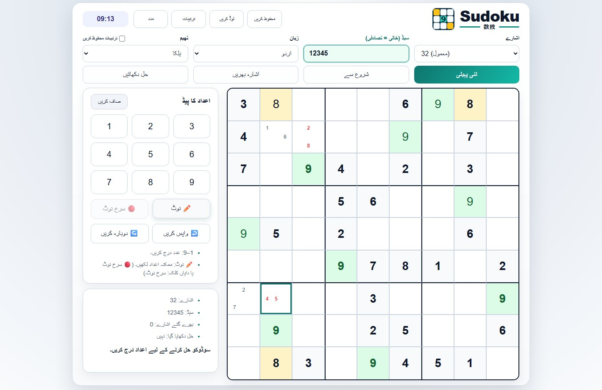
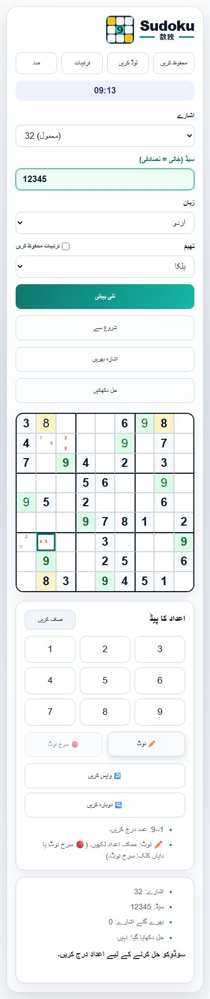

# کیسے کھیلیں — Sudoku

[日本語](./GAME_GUIDE.ja.md) | [English](./GAME_GUIDE.md) | [简体中文](./GAME_GUIDE.zh-CN.md) | [हिन्दी](./GAME_GUIDE.hi.md) | [Español](./GAME_GUIDE.es.md) | [العربية](./GAME_GUIDE.ar.md) | [Français](./GAME_GUIDE.fr.md) | [Português (Brasil)](./GAME_GUIDE.pt-BR.md) | [Português (Portugal)](./GAME_GUIDE.pt-PT.md) | [Русский](./GAME_GUIDE.ru.md) | [Deutsch](./GAME_GUIDE.de.md) | [Bahasa Indonesia](./GAME_GUIDE.id.md) | [বাংলা](./GAME_GUIDE.bn.md) | [Türkçe](./GAME_GUIDE.tr.md) | [한국어](./GAME_GUIDE.ko.md) | [Tiếng Việt](./GAME_GUIDE.vi.md) | [Italiano](./GAME_GUIDE.it.md) | [Nederlands](./GAME_GUIDE.nl.md) | [Polski](./GAME_GUIDE.pl.md) | [ไทย](./GAME_GUIDE.th.md) | [اردو](./GAME_GUIDE.ur.md) | [فارسی](./GAME_GUIDE.fa.md) | [Kiswahili](./GAME_GUIDE.sw.md) | [繁體中文](./GAME_GUIDE.zh-TW.md) | [Українська](./GAME_GUIDE.uk.md)

| کمپیوٹر | موبائل |
| --- | --- |
|  |  |

## کیسے کھیلیں

- ایک خانہ منتخب کریں اور 1 سے 9 تک عدد درج کریں۔
- ہر قطار، کالم اور موٹی لکیروں سے گھرا 3×3 بلاک 1 سے 9 تک ہر عدد صرف ایک مرتبہ رکھتا ہے۔
- ہر تیار کردہ پہیلی کا صرف ایک حل ہوتا ہے۔
- انٹرنیٹ کے بغیر کھیل سکتے ہیں؛ دورانِ کھیل رابطے کی ضرورت نہیں۔

## ترتیبات اور بٹن

- `اشارے`: اگلی پہیلی میں پہلے سے دیے گئے اعداد کی تعداد مقرر کرتا ہے۔
- `سیڈ (خالی = تصادفی)`: ایک ہی سیڈ اور اشاروں کی تعداد سے وہی پہیلی ملتی ہے؛ خالی رکھنے پر تصادفی۔
- `زبان`: انٹرفیس کی زبان بدلتا ہے۔
- `تھیم`: سسٹم، ہلکا یا گہرا تھیم منتخب کریں؛ سسٹم آلے کی پیروی کرتا ہے۔
- `ترتیبات محفوظ کریں`: اسے آن کرنے پر آن ہونے کی حالت خود، `اشاروں کی تعداد`، `سیڈ`، `زبان`، `تھیم` اور دونوں نمایاں کرنے کے اختیار مقامی اسٹوریج میں محفوظ ہوتے ہیں اور اگلی بار کھولنے پر بحال ہوتے ہیں۔ `ترتیبات محفوظ کریں` پہلے سے بند ہوتا ہے، اس لیے ابتدا میں براؤزر میں کوئی ترجیح محفوظ نہیں ہوتی۔
- `نئی پہیلی`: موجودہ ترتیبات سے نئی پہیلی بناتا ہے۔
- `شروع سے`: ابتدائی بورڈ بحال کرتا ہے اور وقت دوبارہ شروع کرتا ہے۔
- `اشارہ بھریں`: ایک خالی خانے میں درست عدد بھرتا ہے۔
- `حل دکھائیں`: مکمل حل دکھاتا ہے۔
- `محفوظ کریں`: بورڈ، نوٹس، وقت اور تاریخ JSON میں محفوظ کرتا ہے۔
- `لوڈ کریں`: JSON فائل سے محفوظ شدہ کھیل لوڈ کرتا ہے۔
- `ترتیبات`: مکمل شدہ اور دہرائے گئے اعداد کی نمایاں کاری کو الگ الگ آن یا آف کرتا ہے۔
- `مدد`: آف لائن دستیاب مدد کھولتا ہے۔

## براؤزر میں محفوظ ترجیحات

- `ترتیبات محفوظ کریں` پہلے سے بند ہوتا ہے، اس لیے ابتدا میں براؤزر میں کوئی ترجیح محفوظ نہیں ہوتی۔
- اسے آن کرنے پر آن ہونے کی حالت خود، `اشاروں کی تعداد`، `سیڈ`، `زبان`، `تھیم` اور دونوں نمایاں کرنے کے اختیار مقامی اسٹوریج میں محفوظ ہوتے ہیں اور اگلی بار کھولنے پر بحال ہوتے ہیں۔
- `ترتیبات محفوظ کریں` بند کرنے سے یہ تمام ترجیحات حذف ہو جاتی ہیں۔ اگر سیڈ کا خانہ خالی ہو تو محفوظ کرنے کا اختیار آن ہونے پر بھی سیڈ محفوظ نہیں ہوتا۔
- یہ ترجیحات `محفوظ کریں` سے بننے والی گیم اسٹیٹ JSON فائل سے الگ ہیں۔ موجودہ بورڈ، نوٹس، ٹائمر اور واپس/دوبارہ کرنے کی تاریخ خودکار طور پر محفوظ نہیں ہوتی۔

## ماؤس اور ٹچ

- `خانہ منتخب کریں`: بورڈ پر ایک خانہ منتخب کریں۔
- `عدد درج کریں`: نمبر پیڈ سے عدد درج کریں۔
- `صاف کریں`: منتخب خانہ صاف کریں۔
- `✏️ نوٹ`: نوٹ موڈ فعال کریں؛ اس میں عدد درج کرنے سے نوٹ شامل ہوتا ہے۔
- `🔴 سرخ نوٹ`: سرخ نوٹس فعال کریں؛ نوٹ موڈ میں عدد پر ماؤس کا دایاں بٹن دبا کر بھی سرخ نوٹ درج کیا جا سکتا ہے۔
- `↩️ واپس کریں`: آخری عدد یا نوٹ کی کارروائی واپس کریں۔
- `↪️ دوبارہ کریں`: واپس کی گئی عدد یا نوٹ کی کارروائی دوبارہ کریں۔

## کی بورڈ

- تیر والے بٹن: خانوں کے درمیان جائیں۔
- `1`–`9`: عدد درج کریں۔
- `0` / `Backspace` / `Delete`: منتخب خانہ صاف کریں۔
- `Enter`: نوٹ موڈ بدلیں۔
- `Shift+1`–`9`: سرخ نوٹ درج کریں۔
- `Ctrl+Z`: آخری عدد یا نوٹ کی کارروائی واپس کریں۔
- `Ctrl+Y` or `Ctrl+Shift+Z`: واپس کی گئی عدد یا نوٹ کی کارروائی دوبارہ کریں۔
