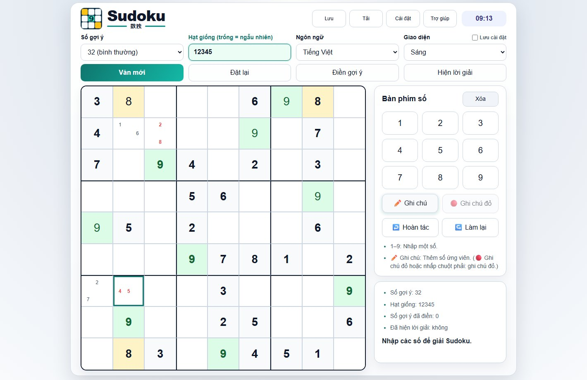
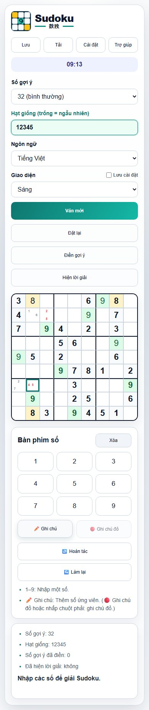

# Cách chơi — Sudoku

[日本語](./GAME_GUIDE.ja.md) | [English](./GAME_GUIDE.md) | [简体中文](./GAME_GUIDE.zh-CN.md) | [हिन्दी](./GAME_GUIDE.hi.md) | [Español](./GAME_GUIDE.es.md) | [العربية](./GAME_GUIDE.ar.md) | [Français](./GAME_GUIDE.fr.md) | [Português (Brasil)](./GAME_GUIDE.pt-BR.md) | [Português (Portugal)](./GAME_GUIDE.pt-PT.md) | [Русский](./GAME_GUIDE.ru.md) | [Deutsch](./GAME_GUIDE.de.md) | [Bahasa Indonesia](./GAME_GUIDE.id.md) | [বাংলা](./GAME_GUIDE.bn.md) | [Türkçe](./GAME_GUIDE.tr.md) | [한국어](./GAME_GUIDE.ko.md) | [Tiếng Việt](./GAME_GUIDE.vi.md) | [Italiano](./GAME_GUIDE.it.md) | [Nederlands](./GAME_GUIDE.nl.md) | [Polski](./GAME_GUIDE.pl.md) | [ไทย](./GAME_GUIDE.th.md) | [اردو](./GAME_GUIDE.ur.md) | [فارسی](./GAME_GUIDE.fa.md) | [Kiswahili](./GAME_GUIDE.sw.md) | [繁體中文](./GAME_GUIDE.zh-TW.md) | [Українська](./GAME_GUIDE.uk.md)

| Máy tính | Điện thoại |
| --- | --- |
|  |  |

## Cách chơi

- Chọn một ô rồi nhập số từ 1 đến 9.
- Mỗi hàng, cột và khối 3×3 có đường viền đậm phải chứa mỗi số từ 1 đến 9 đúng một lần.
- Mỗi câu đố được tạo chỉ có một lời giải.
- Có thể chơi ngoại tuyến; không cần internet khi chơi.

## Cài đặt và nút bấm

- `Số gợi ý`: Quy định số ô cho sẵn ở ván tiếp theo.
- `Hạt giống (trống = ngẫu nhiên)`: Cùng hạt giống và số gợi ý sẽ tạo cùng một bàn; để trống thì ngẫu nhiên.
- `Ngôn ngữ`: Đổi ngôn ngữ giao diện.
- `Giao diện`: Chọn Hệ thống, Sáng hoặc Tối; Hệ thống theo thiết bị.
- `Lưu cài đặt`: Khi bật, chính trạng thái bật, `Số gợi ý`, `Hạt giống`, `Ngôn ngữ`, `Chủ đề` và hai công tắc tô sáng được lưu vào bộ nhớ cục bộ và khôi phục lần mở tiếp theo. `Lưu cài đặt` mặc định tắt, vì vậy ban đầu không có tùy chọn nào được lưu trong trình duyệt.
- `Ván mới`: Tạo một Sudoku mới với cài đặt hiện tại.
- `Đặt lại`: Khôi phục bàn ban đầu và bắt đầu lại đồng hồ.
- `Điền gợi ý`: Điền số đúng vào một ô trống.
- `Hiện lời giải`: Hiện toàn bộ lời giải.
- `Lưu`: Lưu bàn, ghi chú, thời gian và lịch sử vào JSON.
- `Tải`: Tải ván đã lưu từ tệp JSON.
- `Cài đặt`: Bật hoặc tắt riêng phần tô sáng số đã hoàn thành và số trùng lặp.
- `Trợ giúp`: Mở trợ giúp có thể dùng ngoại tuyến.

## Tùy chọn lưu trong trình duyệt

- `Lưu cài đặt` mặc định tắt, vì vậy ban đầu không có tùy chọn nào được lưu trong trình duyệt.
- Khi bật, chính trạng thái bật, `Số gợi ý`, `Hạt giống`, `Ngôn ngữ`, `Chủ đề` và hai công tắc tô sáng được lưu vào bộ nhớ cục bộ và khôi phục lần mở tiếp theo.
- Tắt `Lưu cài đặt` sẽ xóa tất cả tùy chọn đó. Nếu ô hạt giống trống thì không lưu giá trị nào ngay cả khi bật lưu.
- Các tùy chọn này tách biệt với tệp JSON trạng thái trò chơi được tạo bằng `Lưu`. Bàn cờ, ghi chú, đồng hồ và lịch sử hoàn tác/làm lại không tự động lưu.

## Chuột và cảm ứng

- `Chọn ô`: Chọn một ô trên bàn cờ.
- `Nhập số`: Dùng bàn phím số trên màn hình để nhập số.
- `Xóa`: Xóa ô đang chọn.
- `✏️ Ghi chú`: Chuyển sang chế độ Ghi chú; nhập số trong chế độ này sẽ thêm ghi chú.
- `🔴 Ghi chú đỏ`: Chuyển sang ghi chú đỏ; khi đang ở chế độ Ghi chú, bạn cũng có thể nhấp chuột phải vào số để nhập ghi chú đỏ.
- `↩️ Hoàn tác`: Hoàn tác lần nhập số hoặc ghi chú gần nhất.
- `↪️ Làm lại`: Làm lại lần nhập số hoặc ghi chú đã hoàn tác.

## Bàn phím

- Phím mũi tên: Di chuyển giữa các ô.
- `1`–`9`: Nhập một số.
- `0` / `Backspace` / `Delete`: Xóa ô đang chọn.
- `Enter`: Chuyển chế độ Ghi chú.
- `Shift+1`–`9`: Nhập ghi chú đỏ.
- `Ctrl+Z`: Hoàn tác lần nhập số hoặc ghi chú gần nhất.
- `Ctrl+Y` or `Ctrl+Shift+Z`: Làm lại lần nhập số hoặc ghi chú đã hoàn tác.
