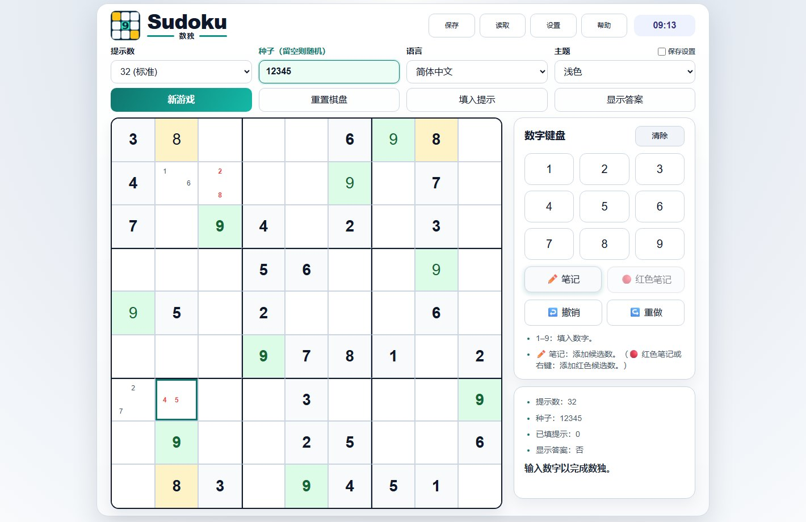
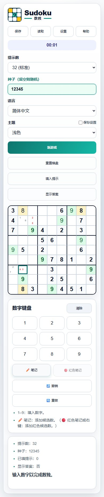

# 游戏指南 — Sudoku

[日本語](./GAME_GUIDE.ja.md) | [English](./GAME_GUIDE.md) | [简体中文](./GAME_GUIDE.zh-CN.md) | [हिन्दी](./GAME_GUIDE.hi.md) | [Español](./GAME_GUIDE.es.md) | [العربية](./GAME_GUIDE.ar.md) | [Français](./GAME_GUIDE.fr.md) | [Português (Brasil)](./GAME_GUIDE.pt-BR.md) | [Português (Portugal)](./GAME_GUIDE.pt-PT.md) | [Русский](./GAME_GUIDE.ru.md) | [Deutsch](./GAME_GUIDE.de.md) | [Bahasa Indonesia](./GAME_GUIDE.id.md) | [বাংলা](./GAME_GUIDE.bn.md) | [Türkçe](./GAME_GUIDE.tr.md) | [한국어](./GAME_GUIDE.ko.md) | [Tiếng Việt](./GAME_GUIDE.vi.md) | [Italiano](./GAME_GUIDE.it.md) | [Nederlands](./GAME_GUIDE.nl.md) | [Polski](./GAME_GUIDE.pl.md) | [ไทย](./GAME_GUIDE.th.md) | [اردو](./GAME_GUIDE.ur.md) | [فارسی](./GAME_GUIDE.fa.md) | [Kiswahili](./GAME_GUIDE.sw.md) | [繁體中文](./GAME_GUIDE.zh-TW.md) | [Українська](./GAME_GUIDE.uk.md)

| 桌面版 | 手机版 |
| --- | --- |
|  |  |

## 开始游戏

- 选择一个格子，输入1到9的数字。
- 粗线框出的每个3×3宫格以及每行、每列，都必须各自恰好包含1到9的所有数字。
- 每道生成的题目都有唯一答案。
- 无需联网即可游玩；游戏过程不发送网络请求。

## 棋盘上方的设置与按钮

- `提示数`: 设置新题目的初始数字数量。
- `种子`: 相同的种子和提示数会生成相同的题目；留空则随机。
- `语言`: 切换界面语言。
- `主题`: 选择系统、浅色或深色；系统模式跟随设备设置。
- `保存设置`: 开启 `保存设置` 后，开启状态本身、`提示数`、`种子`、`语言`、`主题` 及两项高亮开关都会存入浏览器本地存储，并在下次打开时恢复。 默认关闭 `保存设置`，因此最初不会在浏览器中保存任何偏好设置。
- `新游戏`: 按当前设置生成新题目。
- `重置棋盘`: 回到初始棋盘并重新计时。
- `填入提示`: 在一个空格中填入正确数字。
- `显示答案`: 显示完整答案。
- `保存`: 将棋盘、笔记、计时和撤销/重做历史保存为JSON文件。
- `读取`: 读取保存的JSON并恢复游戏状态。
- `设置`: 可分别开启或关闭已正确填满九个位置的数字和重复数字的高亮显示。
- `帮助`: 打开离线帮助。

## 浏览器中保存的设置

- 默认关闭 `保存设置`，因此最初不会在浏览器中保存任何偏好设置。
- 开启 `保存设置` 后，开启状态本身、`提示数`、`种子`、`语言`、`主题` 及两项高亮开关都会存入浏览器本地存储，并在下次打开时恢复。
- 关闭 `保存设置` 会删除所有这些偏好设置。即使开启保存，种子输入框为空时也不会保存种子值。
- 这些偏好设置与 `保存` 按钮创建的游戏状态 JSON 文件相互独立；当前棋盘、笔记、计时以及撤销/重做历史不会自动保存。

## 鼠标与触控

- `选择格子`: 选择棋盘中的一个格子。
- `输入数字`: 使用数字键盘输入数字。
- `清除`: 清除选中的格子。
- `✏️ 笔记`: 切换到笔记输入模式；启用后输入数字会添加笔记。
- `🔴 红色笔记`: 切换为红色笔记；处于笔记模式时，也可用鼠标右键点击数字输入红色笔记。
- `↩️ 撤销`: 撤销最近一次数字输入或笔记修改。
- `↪️ 重做`: 重新执行已撤销的数字输入或笔记修改。

## 键盘操作

- 方向键: 在格子之间移动。
- `1`–`9`: 输入一个数字。
- `0` / `Backspace` / `Delete`: 清除选中的格子。
- `Enter`: 切换笔记输入模式。
- `Shift+1`–`9`: 输入红色笔记。
- `Ctrl+Z`: 撤销最近一次数字输入或笔记修改。
- `Ctrl+Y` or `Ctrl+Shift+Z`: 重新执行已撤销的数字输入或笔记修改。
