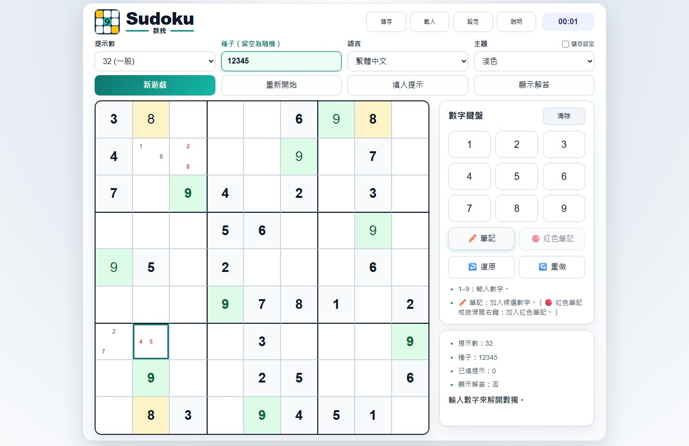
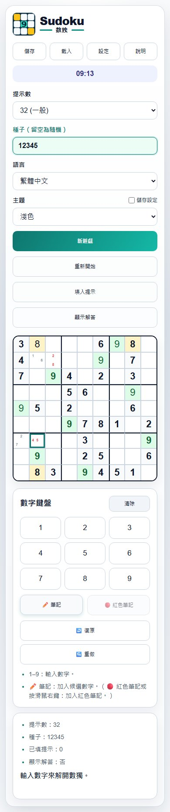

# 玩法說明 — Sudoku

[日本語](./GAME_GUIDE.ja.md) | [English](./GAME_GUIDE.md) | [简体中文](./GAME_GUIDE.zh-CN.md) | [हिन्दी](./GAME_GUIDE.hi.md) | [Español](./GAME_GUIDE.es.md) | [العربية](./GAME_GUIDE.ar.md) | [Français](./GAME_GUIDE.fr.md) | [Português (Brasil)](./GAME_GUIDE.pt-BR.md) | [Português (Portugal)](./GAME_GUIDE.pt-PT.md) | [Русский](./GAME_GUIDE.ru.md) | [Deutsch](./GAME_GUIDE.de.md) | [Bahasa Indonesia](./GAME_GUIDE.id.md) | [বাংলা](./GAME_GUIDE.bn.md) | [Türkçe](./GAME_GUIDE.tr.md) | [한국어](./GAME_GUIDE.ko.md) | [Tiếng Việt](./GAME_GUIDE.vi.md) | [Italiano](./GAME_GUIDE.it.md) | [Nederlands](./GAME_GUIDE.nl.md) | [Polski](./GAME_GUIDE.pl.md) | [ไทย](./GAME_GUIDE.th.md) | [اردو](./GAME_GUIDE.ur.md) | [فارسی](./GAME_GUIDE.fa.md) | [Kiswahili](./GAME_GUIDE.sw.md) | [繁體中文](./GAME_GUIDE.zh-TW.md) | [Українська](./GAME_GUIDE.uk.md)

| 電腦 | 手機 |
| --- | --- |
|  |  |

## 玩法說明

- 選取一個空格並輸入1到9的數字。
- 每一列、每一行，以及粗線框出的每個 3×3 宮格，都必須讓數字 1 至 9 各出現一次。
- 每道產生的數獨題目都只有一個解答。
- 可離線遊玩，遊戲期間不需要網路連線。

## 設定與按鈕

- `提示數`: 設定下一題預先填入的數字數量。
- `種子（留空為隨機）`: 相同的種子與提示數會產生相同題目；留空則隨機。
- `語言`: 切換介面語言。
- `主題`: 選擇系統設定、淺色或深色；系統設定會跟隨裝置。
- `儲存設定`: 啟用後，啟用狀態本身、`提示數`、`種子`、`語言`、`主題` 以及兩個醒目提示開關會存入瀏覽器的本機儲存空間，並在下次開啟時還原。 `儲存設定` 預設關閉，所以一開始不會在瀏覽器儲存任何偏好設定。
- `新遊戲`: 依目前設定產生新題目。
- `重新開始`: 還原初始棋盤並重新計時。
- `填入提示`: 在一個空格填入正確數字。
- `顯示解答`: 顯示完整解答。
- `儲存`: 將棋盤、筆記、計時與歷史記錄儲存為JSON。
- `載入`: 從JSON檔案載入已儲存的遊戲。
- `設定`: 可分別開啟或關閉已正確填滿九個位置的數字及重複數字的醒目提示。
- `說明`: 開啟可離線閱讀的說明。

## 儲存在瀏覽器的偏好設定

- `儲存設定` 預設關閉，所以一開始不會在瀏覽器儲存任何偏好設定。
- 啟用後，啟用狀態本身、`提示數`、`種子`、`語言`、`主題` 以及兩個醒目提示開關會存入瀏覽器的本機儲存空間，並在下次開啟時還原。
- 關閉 `儲存設定` 會刪除上述所有偏好設定。如果種子欄位留白，即使已啟用儲存也不會存入種子值。
- 這些偏好設定與使用 `儲存` 建立的遊戲狀態 JSON 檔案分開；目前棋盤、筆記、計時器及復原/重做紀錄不會自動儲存。

## 滑鼠與觸控

- `選取空格`: 在棋盤上選取一個格子。
- `輸入數字`: 使用數字鍵盤輸入數字。
- `清除`: 清除選取的格子。
- `✏️ 筆記`: 切換至筆記模式；在此模式輸入數字會新增筆記。
- `🔴 紅色筆記`: 切換至紅色筆記；在筆記模式中，也可用滑鼠右鍵按數字輸入紅色筆記。
- `↩️ 復原`: 復原最近一次輸入或筆記。
- `↪️ 重做`: 重做已復原的輸入或筆記。

## 鍵盤

- 方向鍵: 在格子之間移動。
- `1`–`9`: 輸入數字。
- `0` / `Backspace` / `Delete`: 清除選取的格子。
- `Enter`: 切換筆記模式。
- `Shift+1`–`9`: 輸入紅色筆記。
- `Ctrl+Z`: 復原最近一次輸入或筆記。
- `Ctrl+Y` or `Ctrl+Shift+Z`: 重做已復原的輸入或筆記。
